# skkeleton の状態機械（今の振る舞い）

<!-- このファイルは `semantics/doc.lua` が `semantics/model/model.lua` から生成する。手で編集しない。 -->

- 親の issue: #179
- モデルの issue: #184
- データ源: `semantics/model/model.lua`（状態 56 / イベント 93 / 遷移 982）
- 生成: `nvim --headless -u NONE -i NONE -l semantics/doc.lua`
- 図の生成: `nvim --headless -u NONE -i NONE -l semantics/figures/gen.lua`（Graphviz の `dot` を使う）
- この文書は**今の**振る舞いだけを書く。望ましい振る舞いは決めない。

## 0. 読み方

### 0.1 この文書の立場

状態は 3 つの層に分けて書く。

1. **Vim のモード**：`n` / `i` / `ni`（`<C-o>`）/ `R` / `v`・`s` / `c` / `cr` / `t` / `nt` / `ic` / `@`（辞書登録のプロンプト）。
2. **skkeleton の入力相**：off / direct / ▽ / ▼ / escape。かなのモードは hira / kata / hankata / zenkaku / abbrev。
3. **表示**：pre-edit がどこにあるか（extmark / cmdline の文字 / terminal の文字）、popup、pending。

このモデルが持つのは、主に 1 と 2 と、表示のうち状態クラスに落とせる部分（pre-edit の有無と種類）だけ。extmark の位置・メニューの位置・タイミングは状態クラスに持っていない（P2 / P6 / P15 が決められない理由）。

### 0.2 用語と status

用語は [GLOSSARY.md](GLOSSARY.md) に合わせる。状態クラスは人が読む名前、内部状態は `model.lua` の `M.states` の名前。人は 20 個のクラスを読み、モデルは 56 個の内部状態に分けている。

- `ok`：モデルが今の振る舞いに合っている（コード読解か観測で確かめた）
- `gap`：今の振る舞いが性質を破っている（`M.known` に issue を書く）
- `unknown`：まだ確かめていない
- `impossible`：起こり得ない

遷移の表は、同じ状態クラスの組（from → to）を 1 行にまとめている。イベントはその組に含まれるイベント名（`model.lua` の `M.events` のキー）、effects は語彙（GLOSSARY）の和、status は遷移の数、根拠は代表の遷移 id・`refs`・観測のキー列。1 行に複数の遷移があるので、status の数は行の遷移数と一致する。

`refs` は `ファイル:行`、issue 番号、棚卸しの節（`keys.md §6` など）。`観測:` は `M.observations` / `M.probes` のキー列を流したもの。遷移id は `model.lua` と 1 対 1 で、手置きの図（`data.js`）とはこの id と状態クラス名で対応を取る。`data.js` は作者の手元だけにあり、リポジトリには無い。

### 0.3 図

各モードの節に Mermaid の図と、Graphviz で作った SVG を置く。図は status が `ok` / `gap` の遷移、または観測のある遷移だけを描く。`unknown` だけの辺は表にだけ出す。

### 0.4 生成し直す

```sh
nvim --headless -u NONE -i NONE -l semantics/doc.lua
nvim --headless -u NONE -i NONE -l semantics/figures/gen.lua
```

どちらも時刻や環境に依存する値を書かない。生成し直しても差分が出ないことを確かめてある。

## 1. 3 層のモデル

### 1.1 Vim のモード

状態クラスは Vim のモードをまたぐ。`n` / `v` / `s` / `o` は skk が無効な `N_OFF` にまとめ、`i` は無効（`I_OFF`）と有効（`I_DIRECT` ほか）に分ける。`ni` は `NI`、`R` は `R_OFF`、`c` / `cr` は `C_*`、`t` / `nt` は `T_*`、`ic` / `ix` は `IC`、辞書登録の `@` は `P_PROMPT`。

### 1.2 skkeleton の入力相

入力相は off / direct / ▽ / ▼ / escape。状態クラスの `reading` が romaji / point / henkan のどれか、`phase` が `input:direct` / `input:okurinasi|okuriari` / `henkan` / `escape` / `prompt` のどれかで表す。かなのモード（hira / kata / hankata / zenkaku / abbrev）は状態クラスに持っていない（P11 が決められない理由）。

### 1.3 表示

pre-edit の置き場所は Vim のモードで変わる。insert は extmark、cmdline は cmdline の本物の文字、terminal は端末の行の本物の文字。状態クラスは「pre-edit があるか」「どの種類か」だけを持ち、位置・数・メニューの位置は持たない（P2 / P15）。

## 2. 状態とイベントの一覧

### 2.1 状態クラス

人が読むクラスは 20 個。`NI` / `V_PRE` / `P_PROMPT` は相を括弧で書く（作者の判断 4）。「どう入るか」は、ほかのクラスから入る遷移のキーを並べたもの。

| クラス | Vim のモード | reading | 内部状態 | どう入るか | そこで何が起きるか |
| --- | --- | --- | --- | --- | --- |
| `N_OFF` | n / o / s / v | none | N_KEEP<br>N_OFF<br>N_REC | 起動直後、または `I_DIRECT` から `<Esc>`, `I_ROMAJI` から `<Esc>`, `I_POINT` から `<Esc>`, `I_SELECT` から `<Esc>`, `I_ESCAPE` から `cleanup_escape`, `I_OFF` から `<Esc>`, ほか 42 | skk は無効で、キーは Vim がそのまま処理する。`enable` / `toggle` で insert に入る。`keepState` の one-shot 待ち（`N_KEEP`）とマクロの記録中（`N_REC`）も、人が読むクラスはここ。 |
| `N_WAIT` | n | any | N_WAIT | `I_DIRECT` から `<C-c>`, `I_ROMAJI` から `<C-c>`, `I_POINT` から `<C-c>`, `I_SELECT` から `<C-c>`, `IC` から `<C-c>` | `<C-c>` などのあと、`SafeState` の one-shot の片付けを待つ途中の状態。片付けが走ると `N_OFF` になる。 |
| `V_IDLE` | s / v | none | V_IDLE | `NI` から `v`, `I_DIRECT` から `<C-o>v`, `C_DIRECT` から `<Esc>` | visual / select で skk は有効のまま、pre-edit は無い。`<C-o>v` を direct から押すとここに入る。 |
| `V_PRE（point）` | s / v | point | V_PRE_POINT | `I_ROMAJI` から `<C-o>v`, `NI` から `v`, `I_POINT` から `<C-o>v`, `C_POINT` から `<Esc>` | ▽ が pre-edit として残り続ける。`<Esc>` で insert に戻る。 |
| `V_PRE（select）` | s / v | henkan | V_PRE_SELECT | `NI` から `v`, `I_SELECT` から `<C-o>v` | ▼ が pre-edit として残り続ける。`<Esc>` で insert に戻る。 |
| `I_OFF` | i | none | I_OFF<br>I_OFF_MENU | `I_DIRECT` から `<Plug>(skkeleton-toggle)`, `I_ROMAJI` から `<Plug>(skkeleton-toggle)`, `I_POINT` から `<Plug>(skkeleton-toggle)`, `I_SELECT` から `<Plug>(skkeleton-toggle)`, `I_DIRECT` から `<Plug>(skkeleton-disable)`, `I_ROMAJI` から `<Plug>(skkeleton-disable)`, ほか 23 | insert で skk が無効。キーは Vim が処理し、有効化するまで skk は関与しない。blink の buffer 補完のメニューが開いている間（`I_OFF_MENU`）もここ。 |
| `I_DIRECT` | i | none | I_DIRECT | `N_OFF` から `<Plug>(skkeleton-enable)`, `I_OFF` から `<Plug>(skkeleton-enable)`, `N_OFF` から `<Plug>(skkeleton-toggle)`, `I_ROMAJI` から `<Plug>(skkeleton-enable)`, `I_POINT` から `<Plug>(skkeleton-enable)`, `I_SELECT` から `<Plug>(skkeleton-enable)`, ほか 69 | insert が有効で、読みが無い。文字キーで読みを始め、`<Space>` や `<CR>` などは Vim に流れる。 |
| `I_ROMAJI` | i | romaji | I_ROMAJI | `I_DIRECT` から `a`, `I_SELECT` から `a`, `I_DIRECT` から `A`, `I_SELECT` から `A`, `I_DIRECT` から `X`, `I_DIRECT` から `;`, ほか 3 | ローマ字の打ちかけ（`state.feed`）を抱えている。次の文字で ▽ へ進む。制御キーの多くは読みを捨てる（P1 の既知の破れ）。 |
| `I_POINT` | i | point | I_POINT | `NI` から `l`, `V_PRE` から `<Esc>`, `I_ROMAJI` から `a`, `I_DIRECT` から `A`, `I_ROMAJI` から `A`, `I_SELECT` から `x`, ほか 6 | ▽ / ▽* を抱えている。文字キーで読みを進め、`<Space>` / `>` で ▼、`<BS>` で 1 文字戻る。`<CR>` で確定する。 |
| `I_SELECT` | i | henkan | I_SELECT | `NI` から `l`, `V_PRE` から `<Esc>`, `I_POINT` から `>`, `I_POINT` から `<Space>`, `P_PROMPT` から `<CR>`, `P_PROMPT` から `<C-g>@register`, ほか 1 | ▼ を抱えている。候補を選び、`<Space>` / `<CR>` で確定、`x` / `<C-g>` で候補を移る・取り消す。 |
| `I_ESCAPE` | i | none | I_ESCAPE | `I_DIRECT` から `<Esc>`, `I_ROMAJI` から `<Esc>`, `I_POINT` から `<Esc>`, `I_SELECT` から `<Esc>` | マップされた `<Esc>` のあと、`ModeChanged` か `SafeState` の片付けまでの途中の状態。片付けが終わると `N_OFF`。 |
| `NI（direct）` | ni | none | NI_DIRECT | `I_DIRECT` から `<C-o>` | 読みは無い。normal の 1 コマンドを実行してから insert に戻る。 |
| `NI（point）` | ni | point | NI_POINT | `I_ROMAJI` から `<C-o>`, `I_POINT` から `<C-o>`, `IC` から `<C-o>` | ▽ を抱えたまま。戻るときに読みを確定するか、捨てるかが分かれる（#199 の gap）。 |
| `NI（select）` | ni | henkan | NI_SELECT | `I_SELECT` から `<C-o>` | ▼ を抱えたまま。戻るときに候補を確定するか、捨てるかが分かれる（#199 の gap）。 |
| `R_OFF` | R | none | R_MID<br>R_OFF | `N_OFF` から `R`, `I_OFF` から `<Insert>`, `I_DIRECT` から `<Insert>`, `I_ROMAJI` から `<Insert>`, `I_POINT` から `<Insert>`, `I_SELECT` から `<Insert>`, ほか 5 | replace で skk が無効。`<Insert>` の前後で `R_MID`（途中の状態）を通る。 |
| `C_DIRECT` | c | none | C_DIRECT<br>C_IDLE<br>C_OFF | `N_OFF` から `:`, `V_IDLE` から `:`, `C_POINT` から `<Plug>(skkeleton-disable)`, `C_POINT` から `<C-g>`, `C_REPLACE` から `<Insert>`, `C_POINT` から `winleave`, ほか 15 | cmdline に pre-edit が無い。skk が有効でないとき、c のマッピングが無いとき（visual から入ったとき）もここ。 |
| `C_POINT` | c | henkan / point / romaji | C_IDLE_PRE<br>C_POINT<br>C_ROMAJI<br>C_SELECT | `V_PRE` から `:`, `C_REPLACE` から `<Insert>`, `C_DIRECT` から `a`, `C_DIRECT` から `A`, `C_DIRECT` から `X`, `C_DIRECT` から `;`, ほか 1 | cmdline に ▽ / ▽* / ▼ / 打ちかけを本物の文字として書いている。確定・取消のほか、ずれの検出で読みが捨てられる（P1 の既知の破れ）。 |
| `C_REPLACE` | cr | henkan / none / point / romaji | C_REPLACE_DIRECT<br>C_REPLACE_OFF<br>C_REPLACE_POINT<br>C_REPLACE_ROMAJI<br>C_REPLACE_SELECT | `C_DIRECT` から `<Insert>`, `C_POINT` から `<Insert>` | cmdline の置換モード（`cr`）。`<Insert>` で入り、`<C-j>` で確定しても `cr` のまま、`<CR>` でコマンドを実行して抜ける。 |
| `T_DIRECT` | t | none | T_DIRECT<br>T_ESCAPE<br>T_OFF | `N_OFF` から `:terminal`, `T_POINT` から `<Plug>(skkeleton-disable)`, `T_POINT` から `<Plug>(skkeleton-toggle)`, `T_POINT` から `<Esc>`, `T_NORMAL` から `i`, `T_POINT` から `a`, ほか 20 | terminal で pre-edit が無い。skk が無効のとき（`T_OFF`）と `<Esc>` の片付け待ち（`T_ESCAPE`）もここ。 |
| `T_POINT` | t | henkan / point / romaji | T_POINT<br>T_ROMAJI<br>T_SELECT | `T_NORMAL` から `i`, `T_DIRECT` から `a`, `T_DIRECT` から `A`, `T_DIRECT` から `X`, `T_DIRECT` から `;` | terminal の行に ▽ / ▼ / 打ちかけを本物の文字として書いている。ジョブへ渡すキーは確定してから渡す（P14）。 |
| `T_NORMAL` | nt | henkan / none / point / romaji | T_NORMAL_DIRECT<br>T_NORMAL_OFF<br>T_NORMAL_POINT<br>T_NORMAL_ROMAJI<br>T_NORMAL_SELECT | `T_DIRECT` から `<C-\><C-n>`, `T_POINT` から `<C-\><C-n>` | terminal-normal（`nt`）。`<C-\><C-n>` で移っても skk は有効のままで、読みと pre-edit を抱えたまま。`t` に戻ると続きから打てる（P4）。 |
| `IC` | i / ic / ix | henkan / none / point / romaji | IC<br>IX_DIRECT<br>IX_POINT<br>IX_ROMAJI<br>IX_SELECT<br>I_BLINK_POINT | `I_DIRECT` から `<C-n>`, `I_ROMAJI` から `<C-n>`, `I_POINT` から `<C-n>`, `I_SELECT` から `<C-n>`, `I_DIRECT` から `<C-x>`, `I_ROMAJI` から `<C-x>`, ほか 4 | 補完のメニューが開いている。組み込み（`ic`）、`<C-x>` のキー待ち（`ix`）、blink.cmp（Vim のモードは `i` のまま）を含む。組み込みは入った時点で pre-edit が消える。 |
| `P_PROMPT（point）` | c | none / point | P_PROMPT_POINT<br>P_PROMPT_POINT_NESTED<br>P_PROMPT_POINT_NESTED_READING<br>P_PROMPT_POINT_READING | `I_POINT` から `<Space>`, `C_POINT` から `<Space>` | 外側の ▽ は凍結する。取り消すと凍結した外側に、確定すると insert に戻る。 |
| `P_PROMPT（select）` | c | none / point | P_PROMPT_SELECT<br>P_PROMPT_SELECT_NESTED<br>P_PROMPT_SELECT_NESTED_READING<br>P_PROMPT_SELECT_READING | `I_SELECT` から `<Space>`, `C_POINT` から `<Space>` | 外側の ▼ は凍結する。取り消すと凍結した外側に、確定すると insert に戻る。 |

内部状態が複数あるクラスは、モデルの中だけで分けたもの。`IC` は組み込み・キー待ち・blink を、`C_DIRECT` / `T_DIRECT` は無効・有効・マッピング無しを、`N_OFF` は one-shot 待ちとマクロ記録中を含む。

### 2.2 イベント

モデルのイベントは 93 個。種類は key（キー）/ autocmd（Vim のイベント）/ api（skkeleton の関数）/ input（キー以外の入力）/ internal（キーの処理の途中で走る片付け）/ vim（Vim 本体の動き）。

| イベント | 種類 | キー | モード | 根拠 |
| --- | --- | --- | --- | --- |
| `bs` | キー | `<BS>`, `<C-h>` | i / t / c / cr | function/input.lua:178-204, keymap.lua:27,29, keys.md §1 |
| `cg` | キー | `<C-g>` | i / t / c / cr | #87, function/common.lua:71-86, keymap.lua:28,47 |
| `char` | キー | `a`, `b`, `c`, `d`, `e`, `f`, ほか 57 | i / t / c / cr | function/input.lua:85-120, keymap.lua:23-56,64-88, keys.md §1,§3 |
| `char_shift` | キー | `A`, `B`, `C`, `D`, `E`, `F`, ほか 18 | i / t / c / cr | function/input.lua:85-120, keys.md §1 |
| `cmdline_ctrl_e` | キー | `<C-e>` | c | keys.md §6 |
| `cmdline_ctrl_n` | キー | `<C-n>` | c | keys.md §6 |
| `cmdline_ctrl_p` | キー | `<C-p>` | c | keys.md §6 |
| `cmdline_ctrl_y` | キー | `<C-y>` | c | keys.md §6 |
| `cmdline_insert` | キー | `<Insert>` | c / cr | #38, cleanup.lua:183,207-214, keys.md §1 |
| `cmdline_move` | キー | `<Left>`, `<Right>`, `<Home>`, `<End>` | c | #12, #189, cleanup.lua:120-165,283-286, ほか 2 |
| `cmdline_open` | キー | `:`, `/` | n / v / s | #28, events.md, keys.md §1 |
| `cmdline_window` | キー | `<C-f>` | c / cr | #54, #205, cleanup.lua:254-266 |
| `completion_accept` | キー | `<C-y>` | i / ic / t | #19, #190, keys.md §6 |
| `completion_cancel` | キー | `<C-e>` | i / ic | #19, #190, keys.md §6 |
| `completion_key` | キー | `<C-x>` | i / ic / t | #190, keys.md §5 |
| `completion_newline` | キー | `<CR>` | i / ic | #190, doc/skkeleton.txt:516-518, keys.md §6 |
| `completion_next` | キー | `<C-n>`, `<C-p>` | i / ic | #190, blink.cmp keymap super-tab, keys.md §5 |
| `completion_open` | キー | `<C-n>`, `<C-p>`, `<C-x><C-n>` | i / t | #18, #19, #45, ほか 3 |
| `completion_tab` | キー | `<Tab>`, `<S-Tab>` | i / ic | #190, blink.cmp keymap super-tab, keys.md §5 |
| `cr` | キー | `<CR>` | i / t / c / cr | function/common.lua:59-68, keymap.lua:30,48 |
| `ctrl_a` | キー | `<C-a>` | i / t / c | NOTES.md 未考慮 7, guard.lua:78-80, keys.md §6 |
| `ctrl_at` | キー | `<C-@>` | i / t / c | #56, guard.lua:62-65, keys.md §4,§6 |
| `ctrl_c` | キー | `<C-c>`, `<C-\><C-n>` | i / t / c / cr | #70, #74, #142, ほか 1 |
| `ctrl_k` | キー | `<C-k>`, `<C-k>a:` | i / t / c | #12, guard.lua:78-80, keys.md §5,§6 |
| `ctrl_o` | キー | `<C-o>` | i / t | #117, cleanup.lua:185,215-217, keymap.lua |
| `ctrl_o_R` | キー | `<C-o>R` | i | cleanup.lua:179-190 |
| `ctrl_o_colon` | キー | `<C-o>:`, `<C-o>:<Esc>`, `<C-o>:<CR>` | i | #86, cleanup.lua:254-266 |
| `ctrl_o_v` | キー | `<C-o>v`, `<C-o>V`, `<C-o><C-v>` | i | cleanup.lua:179-190 |
| `ctrl_r` | キー | `<C-r>`, `<C-r><C-r>`, `<C-r>=`, `<C-r>{reg}`, `<C-r>a`, `<C-r>=1<CR>` | i / t / c | #8, #12, #20, ほか 2 |
| `ctrl_t` | キー | `<C-t>` | i / t / c | guard.lua:78-80, keys.md §5,§6 |
| `ctrl_u` | キー | `<C-u>` | i / t / c | #8, #12, guard.lua:78-80, ほか 1 |
| `ctrl_v` | キー | `<C-v>`, `<C-v>065` | i / t / c | #12, guard.lua:78-80, keys.md §5,§6 |
| `ctrl_w` | キー | `<C-w>` | i / t / c | #8, #12, guard.lua:78-80, ほか 1 |
| `dot_repeat` | キー | `.` | n | #36, #152, #192, ほか 1 |
| `esc` | キー | `<Esc>`, `<C-[>` | i / n / v / R / ic / t / c / cr | #86, cleanup.lua:192-251, function/disable.lua:21-27, ほか 1 |
| `guard_special` | キー | `<S-Up>`, `<S-Down>`, `<S-Left>`, `<S-Right>`, `<C-Left>`, `<C-Right>`, ほか 25 | i / t / c / cr | #56, guard.lua:22-37,50-85, keys.md §4 |
| `insert_key` | キー | `<Insert>` | i / R / t | #29, #38, #156, ほか 2 |
| `key_L` | キー | `L` | i / t / c | function/mode.lua, keymap.lua:41 |
| `key_X` | キー | `X` | i / t / c | function/common.lua:89-, keymap.lua:52, keys.md §3 |
| `key_cq` | キー | `<C-q>` | i / t / c | function/mode.lua, keymap.lua:33 |
| `key_gt` | キー | `>` | i / t / c | function/input.lua:206-223, keymap.lua:34,53 |
| `key_l` | キー | `l` | i / t / c | #67, #87, keymap.lua:37 |
| `key_q` | キー | `q` | i / t / c | function/mode.lua, keymap.lua:38 |
| `key_semicolon` | キー | `;` | i / t / c | function/input.lua:147-, keymap.lua:39 |
| `key_slash` | キー | `/` | i / t / c | function/mode.lua, keymap.lua:40 |
| `key_x` | キー | `x` | i / t / c | function/henkan.lua:116-133, keymap.lua:51 |
| `macro_record_start` | キー | `qa` | n | #36, #192, Vim 本体（q のコマンド） |
| `macro_record_stop` | キー | `q` | n | #36, #192, Vim 本体（q のコマンド） |
| `macro_replay` | キー | `@a`, `3@a` | n | #36, #152, #192, ほか 1 |
| `ni_R` | キー | `R` | i | cleanup.lua:179-190 |
| `ni_v` | キー | `v` | i | cleanup.lua:179-190 |
| `nl` | キー | `<C-j>` | i / t | function/common.lua:18-45, keymap.lua:32,49 |
| `normal_R` | キー | `R` | n | Vim 本体 |
| `normal_motion` | キー | `j`, `k`, `h`, `l`, `0`, `$`, ほか 3 | n | #192, Vim 本体（normal の移動） |
| `nt_edit` | キー | `x`, `X`, `dd`, `J`, `o`, `O`, ほか 6 | nt | #188, keys.md §5 |
| `nt_insert` | キー | `i`, `a`, `I`, `A` | nt | #74, tests/test_e2e_cmdline.lua:147-172 |
| `register_cancel` | キー | `<C-g>@register`, `<Esc>@register`, `<Esc>`, `<C-g>`, `<C-c>` | c | #116, #154, #189, ほか 1 |
| `register_commit` | キー | `<CR>` | c | #189, events.md O12, host.lua:125-162,175-213 |
| `space` | キー | `<Space>` | i / t / c / cr | function/henkan.lua:21-56,90-113, keymap.lua:35,50 |
| `t_normal` | キー | `<C-\><C-n>` | t | #74, cleanup.lua:218-248, guard.lua:114-124,154-163, ほか 1 |
| `tab` | キー | `<Tab>` | i / t | #12, guard.lua:89-96, keys.md §5,§6 |
| `visual_entry` | キー | `v`, `V`, `<C-v>` | n | #28, cleanup.lua:179-190 |
| `blink_commit` | 関数 | `completion.confirm` | i | #190, completion/init.lua:221-226, main.lua:205-236 |
| `disable` | 関数 | `<Plug>(skkeleton-disable)`, `skkeleton.disable()` | i / t | events.md O15, function/disable.lua:13-18, main.lua:129-139 |
| `enable` | 関数 | `<Plug>(skkeleton-enable)`, `skkeleton.enable()` | i / n / t | events.md O15, main.lua:101-125, plugin/skkeleton.lua:20-24 |
| `stopinsert` | 関数 | `:stopinsert` | i | #70, cleanup.lua:187,225-248 |
| `term_open` | 関数 | `:terminal`, `vim.cmd('terminal')` | n | #188, explore.lua の terminal プロファイル, keys.md §5 |
| `toggle` | 関数 | `<Plug>(skkeleton-toggle)`, `skkeleton.toggle()` | i / n / t | events.md O15, main.lua:169-175 |
| `blink_hide` | Vim のイベント |  | i | #24, #190, completion/init.lua:135-142 |
| `blink_menu_close` | Vim のイベント |  | i | #143, #174, #190, ほか 1 |
| `blink_menu_open` | Vim のイベント |  | i | #143, #174, #190, ほか 1 |
| `blink_refresh` | Vim のイベント |  | i | #24, #143, #174, ほか 2 |
| `buffer_menu_close` | Vim のイベント |  | i | #24, #190, completion/init.lua:135-158 |
| `buffer_menu_open` | Vim のイベント |  | i | #24, #190, completion/init.lua:143-158 |
| `bufleave` | Vim のイベント |  | i / n / v / R | #169, #191, cleanup.lua:269-281, ほか 1 |
| `complete_done` | Vim のイベント |  | i | #19, #190, cleanup.lua:150-165,283-286, ほか 1 |
| `insert_enter` | Vim のイベント | `i`, `a`, `A`, `o`, `O` | i | #152, events.md, host.lua:235-244 |
| `prompt_cmdlineenter` | Vim のイベント |  | c | #116, #189, events.md CmdlineEnter, ほか 1 |
| `prompt_winenter` | Vim のイベント |  | c | #13, #54, #189, ほか 2 |
| `stale` | Vim のイベント |  | i / v | #8, #12, #61, ほか 3 |
| `text_changed_p` | Vim のイベント |  | i | #19, #190, cleanup.lua:150-165,283-286, ほか 1 |
| `winleave` | Vim のイベント |  | i / n / v / R / c / cr | #46, #169, #191, ほか 2 |
| `mouse_click` | キー以外の入力 | `<LeftMouse>`, `<RightMouse>` | i | #56, #191, cleanup.lua:120-160,269-281, ほか 1 |
| `mouse_click_other` | キー以外の入力 | `<LeftMouse>`, `<RightMouse>` | i / v | #169, #191, cleanup.lua:269-281 |
| `mouse_select` | キー以外の入力 | `<2-LeftMouse>`, `<3-LeftMouse>`, `<DragRight>` | i | #47, #191, cleanup.lua:179-190,207-214, ほか 2 |
| `paste` | キー以外の入力 | `<Paste>` | i | #57, #125, #191, ほか 1 |
| `wheel` | キー以外の入力 | `<ScrollWheelUp>`, `<ScrollWheelDown>` | i | #191, guard.lua:59-61, keys.md §5 |
| `cleanup_escape` | 内部の片付け |  | n | cleanup.lua:218-221 |
| `modechanged_i_to_R` | 内部の片付け |  | R | #29, #156, cleanup.lua:183,207-214 |
| `safestate` | 内部の片付け |  | n | cleanup.lua:225-248, events.md |
| `ni_return_commit` | Vim の動き | `0`, `$`, `<Left>`, `<Right>` | i | #117, cleanup.lua:120-147,185,215-217 |
| `ni_return_drop` | Vim の動き | `x`, `dd`, `J` | i | #199, cleanup.lua:120-147,185,215-217 |
| `ni_return_keep` | Vim の動き | `l`, `h`, `w`, `A`, `o`, `gI` | i | #117, #156, cleanup.lua:185,215-217 |

## 3. Vim のモードごとの図と遷移表

各節は、そのモードの状態クラスから出る遷移をまとめる。外のモードへ出る遷移もここに出る（モードが変わるものだけを集めた表は §4）。表の見方は §0.2。

### 3.1 normal

normal で skk が無効のときと、normal へ移った直後の片付け待ち。insert から `<Esc>` / `<C-c>` / `<Insert>` でここへ出る。

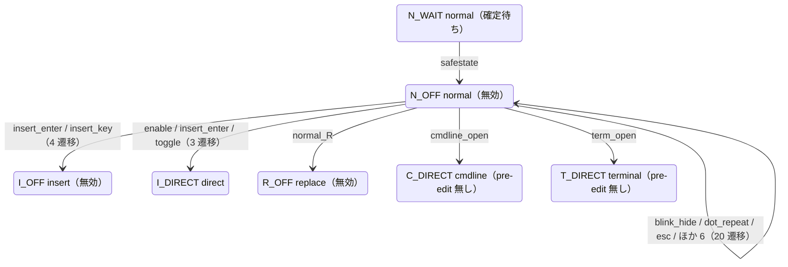

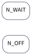

状態クラス 2 個、遷移の組 7 行（この節から出るもの）。

| 状態 | イベント | effects | 遷移先 | status | 根拠 |
| --- | --- | --- | --- | --- | --- |
| `N_OFF` | `blink_hide`, `dot_repeat`, `esc`, `macro_record_start`, `macro_record_stop`, `macro_replay`, `mouse_click`, `normal_motion`, ほか 1 | `feed_key`, `hide_completion`, `pass_key` | `N_OFF` | `ok 15 / unknown 5` | `t.N_KEEP.dot` / #24, #28, #36, ほか 10 / 観測: `A` `<Plug>(skkeleton-enable)` `k` `a` `n` `<C-j>` `<Esc>` `j0` … |
| `N_OFF` | `insert_enter`, `insert_key` | `pass_key` | `I_OFF` | `ok 4` | `t.N_KEEP.insert_enter` / #36, #152, #192, ほか 4 / 観測: `<Plug>(skkeleton-enable)` `K` `a` `n` `<Esc>` `i` |
| `N_OFF` | `enable`, `insert_enter`, `toggle` | `hide_completion`, `install_mapping`, `reset_state`, `save_mapping` | `I_DIRECT` | `ok 2 / unknown 1` | `t.N_KEEP.insert_enter.keepstate` / #152, #192, host.lua:235-244, ほか 2 / 観測: `<Plug>(skkeleton-enable)` |
| `N_OFF` | `normal_R` | `pass_key` | `R_OFF` | `ok 1` | `t.N_OFF.R` / 06 の観測 P.t.N_OFF.R, Vim 本体 / 観測: `R` |
| `N_OFF` | `cmdline_open` | — | `C_DIRECT` | `ok 1` | `t.N_OFF.cmdline_open` / events.md, keys.md §1 / 観測: `:` |
| `N_OFF` | `term_open` | `pass_key` | `T_DIRECT` | `ok 1` | `t.N_OFF.term_open` / explore.lua の terminal プロファイル, keys.md §5 |
| `N_WAIT` | `safestate` | `clear_extmark`, `commit_reading`, `reset_state`, `restore_mapping` | `N_OFF` | `ok 1` | `t.N_WAIT.safestate` / cleanup.lua:225-248 / 観測: `<Plug>(skkeleton-enable)` `K` `a` `n` `<C-c>` |

### 3.2 visual / select

visual / select で skk が有効のまま残る状態。`<C-o>v` で insert から入り、pre-edit が無い `V_IDLE` と、▽ / ▼ を抱えた `V_PRE` に分かれる。

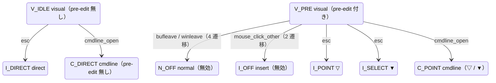

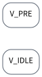

状態クラス 2 個、遷移の組 8 行（この節から出るもの）。

| 状態 | イベント | effects | 遷移先 | status | 根拠 |
| --- | --- | --- | --- | --- | --- |
| `V_IDLE` | `bufleave`, `winleave` | `clear_extmark`, `reset_state`, `restore_mapping` | `N_OFF` | `unknown 2` | `t.V_IDLE.bufleave` / #169, cleanup.lua:269-281 |
| `V_IDLE` | `esc` | `keep` | `I_DIRECT` | `ok 1` | `t.V_IDLE.esc` / cleanup.lua:192-251 / 観測: `<Plug>(skkeleton-enable)` `<C-o>v` `<Esc>` |
| `V_IDLE` | `cmdline_open` | — | `C_DIRECT` | `ok 1` | `t.V_IDLE.cmdline_open` / #28, map.lua:113-139 / 観測: `i` `<Plug>(skkeleton-enable)` `<C-o>v` `/` |
| `V_PRE` | `bufleave`, `winleave` | `clear_extmark`, `drop`, `reset_state`, `restore_mapping` | `N_OFF` | `gap 4（既知: #169）` | `t.V_PRE_POINT.bufleave` / #169, #191, cleanup.lua:269-281 |
| `V_PRE` | `mouse_click_other` | `clear_extmark`, `drop`, `reset_state`, `restore_mapping` | `I_OFF` | `gap 2（既知: #47, #169）` | `t.V_PRE_POINT.mouse_click_other` / #47, #169, #191, ほか 1 |
| `V_PRE` | `esc` | `keep`, `render` | `I_POINT` | `ok 1` | `t.V_PRE_POINT.esc` / cleanup.lua:192-251 / 観測: `<Plug>(skkeleton-enable)` `K` `a` `n` `<C-o>v` `<Esc>` |
| `V_PRE` | `esc` | `keep`, `render` | `I_SELECT` | `unknown 1` | `t.V_PRE_SELECT.esc` / cleanup.lua:192-251 / 観測: `i` `<Plug>(skkeleton-enable)` `K` `a` `n` `<Space>` `<C-o>` `v` … |
| `V_PRE` | `cmdline_open` | `keep` | `C_POINT` | `ok 1` | `t.V_PRE_POINT.cmdline_open` / #28, render.lua / 観測: `i` `<Plug>(skkeleton-enable)` `K` `a` `n` `<C-o>v` `/` |

### 3.3 insert

insert の本体。無効（`I_OFF`）、読みが無い（`I_DIRECT`）、ローマ字の打ちかけ（`I_ROMAJI`）、▽（`I_POINT`）、▼（`I_SELECT`）、`<Esc>` の片付け待ち（`I_ESCAPE`）。

```mermaid
stateDiagram-v2
  state "I_OFF insert（無効）" as I_OFF
  state "I_DIRECT direct" as I_DIRECT
  state "I_ROMAJI 打ちかけ" as I_ROMAJI
  state "I_POINT ▽" as I_POINT
  state "I_SELECT ▼" as I_SELECT
  state "I_ESCAPE escape（片付け待ち）" as I_ESCAPE
  state "N_OFF normal（無効）" as N_OFF
  state "R_OFF replace（無効）" as R_OFF
  state "N_WAIT normal（確定待ち）" as N_WAIT
  state "V_IDLE visual（pre-edit 無し）" as V_IDLE
  state "NI insert-normal" as NI
  state "IC 補完" as IC
  state "V_PRE visual（pre-edit 付き）" as V_PRE
  state "P_PROMPT 辞書登録" as P_PROMPT
  I_OFF --> N_OFF: ctrl_at / esc / mouse_select（4 遷移）
  I_OFF --> I_OFF: blink_hide / buffer_menu_close / buffer_menu_open / ほか 7（11 遷移）
  I_OFF --> I_DIRECT: enable / toggle（3 遷移）
  I_OFF --> R_OFF: insert_key
  I_DIRECT --> N_OFF: ctrl_at / esc / mouse_select / ほか 1（4 遷移）
  I_DIRECT --> N_WAIT: ctrl_c
  I_DIRECT --> V_IDLE: ctrl_o_v
  I_DIRECT --> I_OFF: bufleave / disable / key_l / ほか 3（6 遷移）
  I_DIRECT --> I_DIRECT: blink_refresh / bs / cg / ほか 25（30 遷移）
  I_DIRECT --> I_ROMAJI: char / char_shift / key_X / ほか 2（5 遷移）
  I_DIRECT --> I_POINT: char_shift
  I_DIRECT --> I_ESCAPE: esc
  I_DIRECT --> NI: ctrl_o
  I_DIRECT --> R_OFF: ctrl_o_R / insert_key（2 遷移）
  I_DIRECT --> IC: completion_key / completion_open（2 遷移）
  I_ROMAJI --> N_OFF: ctrl_at / esc / mouse_select / ほか 1（4 遷移）
  I_ROMAJI --> N_WAIT: ctrl_c
  I_ROMAJI --> V_PRE: ctrl_o_v
  I_ROMAJI --> I_OFF: bufleave / disable / key_l / ほか 3（6 遷移）
  I_ROMAJI --> I_DIRECT: bs / cg / cr / ほか 14（18 遷移）
  I_ROMAJI --> I_ROMAJI: blink_refresh / bs / char / ほか 9（12 遷移）
  I_ROMAJI --> I_POINT: char / char_shift（2 遷移）
  I_ROMAJI --> I_ESCAPE: esc
  I_ROMAJI --> NI: ctrl_o
  I_ROMAJI --> R_OFF: ctrl_o_R / insert_key（2 遷移）
  I_ROMAJI --> IC: completion_key / completion_open（2 遷移）
  I_POINT --> N_OFF: ctrl_at / esc / mouse_select / ほか 1（4 遷移）
  I_POINT --> N_WAIT: ctrl_c
  I_POINT --> V_PRE: ctrl_o_v
  I_POINT --> I_OFF: bufleave / disable / key_l / ほか 3（6 遷移）
  I_POINT --> I_DIRECT: cg / cr / ctrl_a / ほか 16（20 遷移）
  I_POINT --> I_ROMAJI: bs
  I_POINT --> I_POINT: bs / char / char_shift / ほか 11（14 遷移）
  I_POINT --> I_SELECT: key_gt / space（2 遷移）
  I_POINT --> I_ESCAPE: esc
  I_POINT --> NI: ctrl_o
  I_POINT --> R_OFF: ctrl_o_R / insert_key（2 遷移）
  I_POINT --> IC: blink_menu_open / blink_refresh / completion_key / ほか 1（4 遷移）
  I_POINT --> P_PROMPT: space
  I_SELECT --> N_OFF: ctrl_at / esc / mouse_select / ほか 1（4 遷移）
  I_SELECT --> N_WAIT: ctrl_c
  I_SELECT --> V_PRE: ctrl_o_v
  I_SELECT --> I_OFF: bufleave / disable / key_l / ほか 3（6 遷移）
  I_SELECT --> I_DIRECT: bs / cg / char / ほか 15（19 遷移）
  I_SELECT --> I_ROMAJI: char / char_shift（2 遷移）
  I_SELECT --> I_POINT: key_x
  I_SELECT --> I_SELECT: blink_refresh / completion_accept / completion_cancel / ほか 10（13 遷移）
  I_SELECT --> I_ESCAPE: esc
  I_SELECT --> NI: ctrl_o
  I_SELECT --> R_OFF: ctrl_o_R / insert_key（2 遷移）
  I_SELECT --> IC: completion_key / completion_open（2 遷移）
  I_SELECT --> P_PROMPT: space
  I_ESCAPE --> N_OFF: cleanup_escape
```


状態クラス 6 個、遷移の組 53 行（この節から出るもの）。

| 状態 | イベント | effects | 遷移先 | status | 根拠 |
| --- | --- | --- | --- | --- | --- |
| `I_OFF` | `ctrl_at`, `esc`, `mouse_select` | `clear_extmark`, `feed_key`, `hide_completion`, `pass_key`, `reset_state`, `restore_mapping` | `N_OFF` | `ok 2 / unknown 2` | `t.I_OFF.ctrl_at` / #24, #56, #191, ほか 3 / 観測: `i` `<C-@>` |
| `I_OFF` | `blink_hide`, `buffer_menu_close`, `buffer_menu_open`, `bufleave`, `guard_special`, `mouse_click`, `mouse_click_other`, `paste`, ほか 2 | `feed_key`, `hide_completion`, `pass_key`, `show_completion` | `I_OFF` | `ok 9 / unknown 2` | `t.I_OFF.blink_hide` / #24, #191, cleanup.lua:269-281, ほか 5 / 観測: `i` `<Plug>(skkeleton-enable)` `<Esc>` `i` `<S-Tab>` |
| `I_OFF` | `enable`, `toggle` | `hide_completion`, `install_mapping`, `reset_state`, `save_mapping` | `I_DIRECT` | `ok 3` | `t.I_OFF.enable` / #24, completion/init.lua:135-142, main.lua:101-125, ほか 1 / 観測: `<Plug>(skkeleton-enable)` `<Insert>` `<Insert>` `@buffer_menu_open` `<Plug>(skkeleton-enable)` |
| `I_OFF` | `insert_key` | `pass_key` | `R_OFF` | `unknown 1` | `t.I_OFF.insert_key` / Vim 本体 / 観測: `i` `<Plug>(skkeleton-enable)` `<Esc>` `i` `<Insert>` |
| `I_DIRECT` | `ctrl_at`, `esc`, `mouse_select`, `stopinsert` | `clear_extmark`, `feed_key`, `reset_state`, `restore_mapping` | `N_OFF` | `ok 4` | `t.I_DIRECT.ctrl_at` / #47, #56, #70, ほか 9 / 観測: `<Plug>(skkeleton-enable)` `<C-@>` |
| `I_DIRECT` | `ctrl_c` | — | `N_WAIT` | `ok 1` | `t.I_DIRECT.ctrl_c` / #70, #142, cleanup.lua:187,225-248 / 観測: `i` `<Plug>(skkeleton-enable)` `<C-c>` |
| `I_DIRECT` | `ctrl_o_v` | `keep` | `V_IDLE` | `ok 1` | `t.I_DIRECT.ctrl_o_v` / cleanup.lua:179-190 / 観測: `<Plug>(skkeleton-enable)` `<C-o>v` |
| `I_DIRECT` | `bufleave`, `disable`, `key_l`, `mouse_click_other`, `toggle`, `winleave` | `clear_extmark`, `reset_state`, `restore_mapping` | `I_OFF` | `ok 3 / unknown 3` | `t.I_DIRECT.bufleave` / #67, #169, #191, ほか 7 / 観測: `<Plug>(skkeleton-enable)` `l` |
| `I_DIRECT` | `blink_refresh`, `bs`, `cg`, `char`, `completion_accept`, `completion_cancel`, `cr`, `ctrl_a`, ほか 20 | `clean_cmdline`, `clear_extmark`, `drop`, `feed_key`, `hide_completion`, `install_mapping`, `keep`, `pass_key`, ほか 3 | `I_DIRECT` | `ok 26 / unknown 4` | `t.I_DIRECT.blink_refresh` / #8, #12, #20, ほか 34 / 観測: `<Plug>(skkeleton-enable)` `a` |
| `I_DIRECT` | `char`, `char_shift`, `key_X`, `key_semicolon`, `key_slash` | `feed_key`, `render` | `I_ROMAJI` | `ok 3 / unknown 2` | `t.I_DIRECT.char.romaji` / 06 の観測 P.t.I_DIRECT.key_semicolon, 06 の観測 P.t.I_DIRECT.key_slash, function/input.lua:147-, ほか 3 / 観測: `<Plug>(skkeleton-enable)` `K` |
| `I_DIRECT` | `char_shift` | `render` | `I_POINT` | `ok 1` | `t.I_DIRECT.char_shift.point` / function/input.lua:85-120 / 観測: `i` `<Plug>(skkeleton-enable)` `A` |
| `I_DIRECT` | `esc` | `clear_extmark`, `reset_state`, `restore_mapping` | `I_ESCAPE` | `ok 1` | `t.I_DIRECT.esc` / cleanup.lua:218-221, function/disable.lua:21-27 / 観測: `<Plug>(skkeleton-enable)` `<Esc>` |
| `I_DIRECT` | `ctrl_o` | `keep` | `NI` | `ok 1` | `t.I_DIRECT.ctrl_o` / #117 / 観測: `i` `<Plug>(skkeleton-enable)` `<C-o>` |
| `I_DIRECT` | `ctrl_o_R`, `insert_key` | `clear_extmark`, `reset_state`, `restore_mapping` | `R_OFF` | `ok 2` | `t.I_DIRECT.ctrl_o_R` / #29, #156, cleanup.lua:179-190, ほか 1 / 観測: `i` `<Plug>(skkeleton-enable)` `<C-o>R` |
| `I_DIRECT` | `completion_key`, `completion_open` | `keep`, `pass_key` | `IC` | `ok 2` | `t.I_DIRECT.completion_key` / #190, keys.md §5 / 観測: `<Plug>(skkeleton-enable)` `<C-n>` |
| `I_ROMAJI` | `ctrl_at`, `esc`, `mouse_select`, `stopinsert` | `clear_extmark`, `commit_reading`, `feed_key`, `reset_state`, `restore_mapping` | `N_OFF` | `ok 3 / unknown 1` | `t.I_ROMAJI.ctrl_at` / #47, #56, #70, ほか 8 / 観測: `<Plug>(skkeleton-enable)` `K` `<C-@>` |
| `I_ROMAJI` | `ctrl_c` | — | `N_WAIT` | `ok 1` | `t.I_ROMAJI.ctrl_c` / #70, #142, cleanup.lua:187,225-248 / 観測: `i` `<Plug>(skkeleton-enable)` `K` `<C-c>` |
| `I_ROMAJI` | `ctrl_o_v` | `keep`, `render` | `V_PRE` | `ok 1` | `t.I_ROMAJI.ctrl_o_v` / 06 の観測 P.t.I_ROMAJI.ctrl_o_v, cleanup.lua:179-190 / 観測: `i` `<Plug>(skkeleton-enable)` `K` `<C-o>v` |
| `I_ROMAJI` | `bufleave`, `disable`, `key_l`, `mouse_click_other`, `toggle`, `winleave` | `clear_extmark`, `commit_reading`, `drop`, `reset_state`, `restore_mapping` | `I_OFF` | `ok 3 / gap 3（既知: #67, #169, 06 の観測）` | `t.I_ROMAJI.bufleave` / #67, #169, #191, ほか 8 / 観測: `i` `<Plug>(skkeleton-enable)` `K` `<Plug>(skkeleton-disable)` |
| `I_ROMAJI` | `bs`, `cg`, `cr`, `ctrl_a`, `ctrl_k`, `ctrl_r`, `ctrl_t`, `ctrl_u`, ほか 9 | `cancel`, `clear_extmark`, `commit_reading`, `drop`, `feed_key`, `install_mapping`, `render`, `reset_state`, ほか 1 | `I_DIRECT` | `ok 7 / gap 10 / unknown 1（既知: #8, #12, #20, ほか 2）` | `t.I_ROMAJI.bs.empty` / #8, #12, #20, ほか 21 / 観測: `<Plug>(skkeleton-enable)` `K` `<C-.>` |
| `I_ROMAJI` | `blink_refresh`, `bs`, `char`, `completion_accept`, `completion_cancel`, `ctrl_a`, `ctrl_o_colon`, `ctrl_u`, ほか 4 | `clean_cmdline`, `feed_key`, `hide_completion`, `keep`, `pass_key`, `render` | `I_ROMAJI` | `ok 9 / unknown 3` | `t.I_ROMAJI.blink_refresh` / #24, #86, #190, ほか 11 / 観測: `i` `<Plug>(skkeleton-enable)` `K` `<BS>` |
| `I_ROMAJI` | `char`, `char_shift` | `feed_key`, `keep`, `render` | `I_POINT` | `ok 1 / unknown 1` | `t.I_ROMAJI.char.commit` / 06 の観測 P.t.I_ROMAJI.char.commit, function/input.lua:85-120 / 観測: `<Plug>(skkeleton-enable)` `K` `a` |
| `I_ROMAJI` | `esc` | `clear_extmark`, `commit_reading`, `reset_state`, `restore_mapping` | `I_ESCAPE` | `ok 1` | `t.I_ROMAJI.esc` / function/disable.lua:21-27 / 観測: `i` `<Plug>(skkeleton-enable)` `K` `<Esc>` |
| `I_ROMAJI` | `ctrl_o` | `keep` | `NI` | `ok 1` | `t.I_ROMAJI.ctrl_o` / #117, 06 の観測 P.t.I_ROMAJI.ctrl_o / 観測: `i` `<Plug>(skkeleton-enable)` `K` `<C-o>` |
| `I_ROMAJI` | `ctrl_o_R`, `insert_key` | `clear_extmark`, `commit_reading`, `reset_state`, `restore_mapping` | `R_OFF` | `ok 2` | `t.I_ROMAJI.ctrl_o_R` / #29, #156, 06 の観測 P.t.I_ROMAJI.ctrl_o_R, ほか 2 / 観測: `i` `<Plug>(skkeleton-enable)` `K` `<C-o>R` |
| `I_ROMAJI` | `completion_key`, `completion_open` | `clear_extmark`, `drop`, `keep`, `reset_state` | `IC` | `ok 1 / gap 1（既知: #18, #19, #190）` | `t.I_ROMAJI.completion_key` / #19, #190, keys.md §5 / 観測: `<Plug>(skkeleton-enable)` `K` `<C-n>` |
| `I_POINT` | `ctrl_at`, `esc`, `mouse_select`, `stopinsert` | `clear_extmark`, `commit_reading`, `feed_key`, `reset_state`, `restore_mapping` | `N_OFF` | `ok 4` | `t.I_POINT.ctrl_at` / #47, #56, #70, ほか 8 / 観測: `<Plug>(skkeleton-enable)` `K` `a` `n` `<C-@>` |
| `I_POINT` | `ctrl_c` | — | `N_WAIT` | `ok 1` | `t.I_POINT.ctrl_c` / #70, #142, cleanup.lua:187,225-248 / 観測: `<Plug>(skkeleton-enable)` `K` `a` `n` `<C-c>` |
| `I_POINT` | `ctrl_o_v` | `keep`, `render` | `V_PRE` | `ok 1` | `t.I_POINT.ctrl_o_v` / cleanup.lua:179-190 / 観測: `<Plug>(skkeleton-enable)` `K` `a` `n` `<C-o>v` |
| `I_POINT` | `bufleave`, `disable`, `key_l`, `mouse_click_other`, `toggle`, `winleave` | `clear_extmark`, `commit_reading`, `drop`, `reset_state`, `restore_mapping` | `I_OFF` | `ok 2 / gap 3 / unknown 1（既知: #169）` | `t.I_POINT.bufleave` / #67, #169, #191, ほか 7 / 観測: `i` `<Plug>(skkeleton-enable)` `K` `a` `n` `<Plug>(skkeleton-disable)` |
| `I_POINT` | `cg`, `cr`, `ctrl_a`, `ctrl_k`, `ctrl_r`, `ctrl_t`, `ctrl_u`, `ctrl_v`, ほか 11 | `cancel`, `clear_extmark`, `commit_reading`, `drop`, `feed_key`, `install_mapping`, `render`, `reset_state`, ほか 1 | `I_DIRECT` | `ok 9 / gap 10 / unknown 1（既知: #8, #12, #20, ほか 2）` | `t.I_POINT.cg` / #8, #12, #20, ほか 28 / 観測: `<Plug>(skkeleton-enable)` `K` `a` `n` `<C-g>` |
| `I_POINT` | `bs` | `keep`, `render` | `I_ROMAJI` | `ok 1` | `t.I_POINT.bs.empty` / 06 の観測 P.t.I_POINT.bs.empty, function/input.lua:178-204 / 観測: `i` `<Plug>(skkeleton-enable)` `K` `a` `<BS>` |
| `I_POINT` | `bs`, `char`, `char_shift`, `completion_accept`, `completion_cancel`, `ctrl_a`, `ctrl_o_colon`, `ctrl_u`, ほか 6 | `clean_cmdline`, `keep`, `pass_key`, `render` | `I_POINT` | `ok 11 / unknown 3` | `t.I_POINT.bs` / #86, #190, #191, ほか 10 / 観測: `<Plug>(skkeleton-enable)` `K` `a` `n` `<BS>` |
| `I_POINT` | `key_gt`, `space` | `keep`, `render` | `I_SELECT` | `ok 1 / unknown 1` | `t.I_POINT.key_gt` / function/henkan.lua:21-56, function/input.lua:206-223, keymap.lua:53 / 観測: `<Plug>(skkeleton-enable)` `K` `a` `n` `<Space>` |
| `I_POINT` | `esc` | `clear_extmark`, `commit_reading`, `reset_state`, `restore_mapping` | `I_ESCAPE` | `ok 1` | `t.I_POINT.esc` / function/disable.lua:21-27 / 観測: `<Plug>(skkeleton-enable)` `K` `a` `n` `<Esc>` |
| `I_POINT` | `ctrl_o` | `keep` | `NI` | `ok 1` | `t.I_POINT.ctrl_o` / #117 / 観測: `<Plug>(skkeleton-enable)` `K` `a` `n` `<C-o>` `l` |
| `I_POINT` | `ctrl_o_R`, `insert_key` | `clear_extmark`, `commit_reading`, `reset_state`, `restore_mapping` | `R_OFF` | `ok 2` | `t.I_POINT.ctrl_o_R` / #29, #156, cleanup.lua:179-190, ほか 1 / 観測: `<Plug>(skkeleton-enable)` `K` `a` `n` `<C-o>R` |
| `I_POINT` | `blink_menu_open`, `blink_refresh`, `completion_key`, `completion_open` | `clear_extmark`, `drop`, `keep`, `render`, `reset_state`, `show_completion` | `IC` | `ok 3 / gap 1（既知: #18, #19, #190）` | `t.I_POINT.blink_menu_open` / #18, #19, #24, ほか 6 / 観測: `<Plug>(skkeleton-enable)` `K` `a` `n` `<C-n>` |
| `I_POINT` | `space` | `install_mapping`, `keep`, `render`, `save_mapping` | `P_PROMPT` | `ok 1` | `t.I_POINT.space.register` / #144, #189, function/henkan.lua:21-56, ほか 1 / 観測: `<Plug>(skkeleton-enable)` `N` `u` `r` `u` `<Space>` |
| `I_SELECT` | `ctrl_at`, `esc`, `mouse_select`, `stopinsert` | `clear_extmark`, `commit_candidate`, `commit_reading`, `feed_key`, `reset_state`, `restore_mapping` | `N_OFF` | `ok 4` | `t.I_SELECT.ctrl_at` / #47, #56, #70, ほか 8 / 観測: `<Plug>(skkeleton-enable)` `K` `a` `n` `<Space>` `<C-@>` |
| `I_SELECT` | `ctrl_c` | — | `N_WAIT` | `ok 1` | `t.I_SELECT.ctrl_c` / #70, #142, cleanup.lua:187,225-248 / 観測: `i` `<Plug>(skkeleton-enable)` `K` `a` `n` `<Space>` `<C-c>` |
| `I_SELECT` | `ctrl_o_v` | `keep`, `render` | `V_PRE` | `unknown 1` | `t.I_SELECT.ctrl_o_v` / cleanup.lua:179-190 / 観測: `i` `<Plug>(skkeleton-enable)` `K` `a` `n` `<Space>` `<C-o>v` |
| `I_SELECT` | `bufleave`, `disable`, `key_l`, `mouse_click_other`, `toggle`, `winleave` | `clear_extmark`, `commit_candidate`, `drop`, `reset_state`, `restore_mapping` | `I_OFF` | `ok 3 / gap 3（既知: #169）` | `t.I_SELECT.bufleave` / #67, #169, #191, ほか 8 / 観測: `i` `<Plug>(skkeleton-enable)` `K` `a` `n` `<Space>` `<Plug>(skkeleton-disable)` |
| `I_SELECT` | `bs`, `cg`, `char`, `cr`, `ctrl_a`, `ctrl_k`, `ctrl_r`, `ctrl_t`, ほか 10 | `cancel`, `clear_extmark`, `commit_candidate`, `drop`, `feed_key`, `install_mapping`, `render`, `reset_state`, ほか 1 | `I_DIRECT` | `ok 7 / gap 2 / unknown 10（既知: #8, #12, #210）` | `t.I_SELECT.bs` / #8, #12, #20, ほか 21 / 観測: `<Plug>(skkeleton-enable)` `K` `a` `n` `<Space>` `<Left>` |
| `I_SELECT` | `char`, `char_shift` | `commit_candidate`, `feed_key`, `render`, `reset_state` | `I_ROMAJI` | `ok 1 / unknown 1` | `t.I_SELECT.char.commit_romaji` / 06 の観測 P.t.I_SELECT.char_shift, function/henkan.lua:137-162 / 観測: `i` `<Plug>(skkeleton-enable)` `K` `a` `n` `<Space>` `z` |
| `I_SELECT` | `key_x` | `keep`, `render` | `I_POINT` | `ok 1` | `t.I_SELECT.x.back` / function/henkan.lua:116-133, keymap.lua:51 / 観測: `<Plug>(skkeleton-enable)` `K` `a` `n` `<Space>` `x` |
| `I_SELECT` | `blink_refresh`, `completion_accept`, `completion_cancel`, `ctrl_o_colon`, `ctrl_u`, `ctrl_w`, `key_X`, `key_gt`, ほか 5 | `clean_cmdline`, `hide_completion`, `keep`, `pass_key`, `render` | `I_SELECT` | `ok 9 / unknown 4` | `t.I_SELECT.blink_refresh` / #24, #86, #129, ほか 15 / 観測: `<Plug>(skkeleton-enable)` `K` `a` `n` `<Space>` `<C-o>:<CR>` |
| `I_SELECT` | `esc` | `clear_extmark`, `commit_candidate`, `reset_state`, `restore_mapping` | `I_ESCAPE` | `ok 1` | `t.I_SELECT.esc` / function/disable.lua:21-27 / 観測: `<Plug>(skkeleton-enable)` `K` `a` `n` `<Space>` `<Esc>` |
| `I_SELECT` | `ctrl_o` | `keep` | `NI` | `ok 1` | `t.I_SELECT.ctrl_o` / #117 / 観測: `i` `<Plug>(skkeleton-enable)` `K` `a` `n` `<Space>` `<C-o>` |
| `I_SELECT` | `ctrl_o_R`, `insert_key` | `clear_extmark`, `commit_candidate`, `reset_state`, `restore_mapping` | `R_OFF` | `unknown 2` | `t.I_SELECT.ctrl_o_R` / #29, #156, cleanup.lua:179-190, ほか 1 / 観測: `i` `<Plug>(skkeleton-enable)` `K` `a` `n` `<Space>` `<C-o>R` |
| `I_SELECT` | `completion_key`, `completion_open` | `clear_extmark`, `drop`, `keep`, `reset_state` | `IC` | `gap 1 / unknown 1（既知: #18, #19, #190）` | `t.I_SELECT.completion_key` / #18, #190, keys.md §5 / 観測: `<Plug>(skkeleton-enable)` `K` `a` `n` `<Space>` `<C-n>` |
| `I_SELECT` | `space` | `install_mapping`, `keep`, `render`, `save_mapping` | `P_PROMPT` | `ok 1` | `t.I_SELECT.space.register` / #189, function/henkan.lua:90-113, host.lua:175-213 / 観測: `<Plug>(skkeleton-enable)` `K` `a` `n` `<Space>` `<Space>` `<Space>` `<Space>` … |
| `I_ESCAPE` | `cleanup_escape` | `reset_state` | `N_OFF` | `ok 1` | `t.I_ESCAPE.cleanup` / cleanup.lua:218-221 |

### 3.4 insert-normal（`ni`）

`<C-o>` で入る `niI`。読みを抱えたまま normal の 1 コマンドを実行し、insert に戻る。相（direct / point / select）で戻り先の結果が変わる。

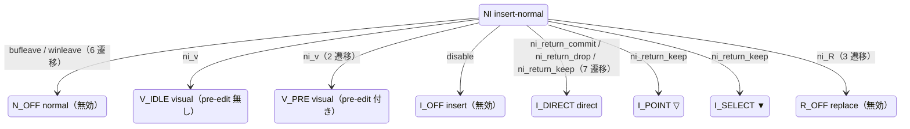


状態クラス 1 個、遷移の組 8 行（この節から出るもの）。

| 状態 | イベント | effects | 遷移先 | status | 根拠 |
| --- | --- | --- | --- | --- | --- |
| `NI` | `bufleave`, `winleave` | `clear_extmark`, `drop`, `reset_state`, `restore_mapping` | `N_OFF` | `gap 4 / unknown 2（既知: #169）` | `t.NI_DIRECT.bufleave` / #169, #191, cleanup.lua:269-281 |
| `NI` | `ni_v` | `keep` | `V_IDLE` | `unknown 1` | `t.NI_DIRECT.visual` / cleanup.lua:179-190 / 観測: `i` `<Plug>(skkeleton-enable)` `<C-o>` `v` |
| `NI` | `ni_v` | `keep`, `render` | `V_PRE` | `unknown 2` | `t.NI_POINT.visual` / cleanup.lua:179-190 / 観測: `i` `<Plug>(skkeleton-enable)` `K` `a` `n` `<C-o>` `v` |
| `NI` | `disable` | `clear_extmark`, `commit_reading`, `reset_state`, `restore_mapping` | `I_OFF` | `unknown 1` | `t.NI_POINT.disable` / main.lua:129-139 / 観測: `i` `<Plug>(skkeleton-enable)` `K` `a` `n` `<C-o>` `<Plug>(skkeleton-disable)` |
| `NI` | `ni_return_commit`, `ni_return_drop`, `ni_return_keep` | `clear_extmark`, `commit_candidate`, `commit_reading`, `drop`, `keep`, `render`, `reset_state` | `I_DIRECT` | `ok 3 / gap 2 / unknown 2（既知: #199）` | `t.NI_DIRECT.return_commit` / #117, #199, cleanup.lua:120-147,215-217 / 観測: `<Plug>(skkeleton-enable)` `K` `a` `n` `<C-o>` `x` |
| `NI` | `ni_return_keep` | `keep` | `I_POINT` | `ok 1` | `t.NI_POINT.return_keep` / #117 / 観測: `<Plug>(skkeleton-enable)` `K` `a` `n` `<C-o>` `l` |
| `NI` | `ni_return_keep` | `keep` | `I_SELECT` | `ok 1` | `t.NI_SELECT.return_keep` / #117 / 観測: `i` `<Plug>(skkeleton-enable)` `K` `a` `n` `<Space>` `<C-o>` `l` |
| `NI` | `ni_R` | `clear_extmark`, `commit_candidate`, `commit_reading`, `reset_state`, `restore_mapping` | `R_OFF` | `unknown 3` | `t.NI_DIRECT.replace` / cleanup.lua:179-190 / 観測: `i` `<Plug>(skkeleton-enable)` `<C-o>` `R` |

### 3.5 replace（`R`）

replace で skk が無効の状態。`<Insert>` の前後で `R_MID`（途中の状態）を通る。

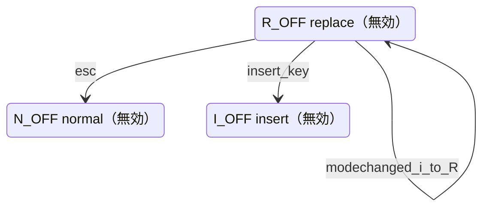


状態クラス 1 個、遷移の組 3 行（この節から出るもの）。

| 状態 | イベント | effects | 遷移先 | status | 根拠 |
| --- | --- | --- | --- | --- | --- |
| `R_OFF` | `esc` | `pass_key` | `N_OFF` | `ok 1` | `t.R_OFF.esc` / Vim 本体 / 観測: `i` `<Plug>(skkeleton-enable)` `<Insert>` `<Esc>` |
| `R_OFF` | `insert_key` | `pass_key` | `I_OFF` | `ok 1` | `t.R_OFF.insert_key` / #38 / 観測: `<Plug>(skkeleton-enable)` `K` `a` `n` `<Insert>` `<Insert>` |
| `R_OFF` | `modechanged_i_to_R` | `reset_state`, `restore_mapping` | `R_OFF` | `ok 1` | `t.R_MID.modechanged` / #156, cleanup.lua:207-214 / 観測: `<Plug>(skkeleton-enable)` `K` `a` `n` `<Insert>` |

### 3.6 cmdline（`c` / `cr`）

cmdline。pre-edit を extmark ではなく cmdline の本物の文字として書く。置換モード（`cr`）は `C_REPLACE`。

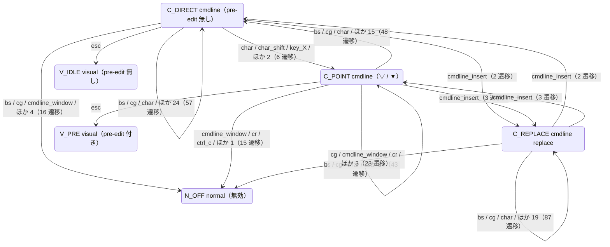


状態クラス 3 個、遷移の組 15 行（この節から出るもの）。

| 状態 | イベント | effects | 遷移先 | status | 根拠 |
| --- | --- | --- | --- | --- | --- |
| `C_DIRECT` | `bs`, `cg`, `cmdline_window`, `cr`, `ctrl_c`, `esc`, `nl` | `cancel`, `clean_cmdline`, `clear_extmark`, `feed_key`, `pass_key`, `reset_state`, `restore_mapping` | `N_OFF` | `ok 6 / unknown 10` | `t.C_DIRECT.bs.empty` / cleanup.lua:254-266, events.md, function/common.lua:18-45, ほか 3 / 観測: `:` `<Plug>(skkeleton-enable)` `<C-g>` |
| `C_DIRECT` | `esc` | `clean_cmdline`, `keep` | `V_IDLE` | `ok 1` | `t.C_IDLE.esc` / #28, map.lua:113-139 / 観測: `i` `<Plug>(skkeleton-enable)` `<C-o>v` `/` `<Esc>` |
| `C_DIRECT` | `bs`, `cg`, `char`, `char_shift`, `cmdline_ctrl_e`, `cmdline_ctrl_n`, `cmdline_ctrl_p`, `cmdline_ctrl_y`, ほか 19 | `cancel`, `clean_cmdline`, `clear_extmark`, `feed_key`, `install_mapping`, `pass_key`, `render`, `reset_state`, ほか 2 | `C_DIRECT` | `ok 12 / unknown 45` | `t.C_DIRECT.bs` / #46, cleanup.lua:269-281, function/disable.lua, ほか 13 / 観測: `:` `<Plug>(skkeleton-enable)` `a` |
| `C_DIRECT` | `char`, `char_shift`, `key_X`, `key_semicolon`, `key_slash` | `feed_key`, `render` | `C_POINT` | `ok 5 / unknown 1` | `t.C_DIRECT.char.romaji` / function/input.lua:85-120, keymap.lua:39, keymap.lua:40 / 観測: `:` `<Plug>(skkeleton-enable)` `X` |
| `C_DIRECT` | `cmdline_insert` | `pass_key` | `C_REPLACE` | `ok 2` | `t.C_DIRECT.cmdline_insert` / keys.md §1 / 観測: `:` `<Plug>(skkeleton-enable)` `<Insert>` |
| `C_POINT` | `cmdline_window`, `cr`, `ctrl_c`, `esc` | `cancel`, `clean_cmdline`, `clear_extmark`, `commit_candidate`, `commit_reading`, `drop`, `reset_state`, `restore_mapping` | `N_OFF` | `ok 6 / gap 4 / unknown 5（既知: #205）` | `t.C_IDLE_PRE.cmdline_window` / #205, cleanup.lua:254-266, events.md / 観測: `:` `<Plug>(skkeleton-enable)` `K` `a` `n` `<CR>` |
| `C_POINT` | `esc` | `clean_cmdline`, `keep` | `V_PRE` | `ok 1` | `t.C_IDLE_PRE.esc` / #28, render.lua / 観測: `i` `<Plug>(skkeleton-enable)` `K` `a` `n` `<C-o>v` `/` `<Esc>` |
| `C_POINT` | `bs`, `cg`, `char`, `char_shift`, `cmdline_ctrl_p`, `cmdline_ctrl_y`, `ctrl_at`, `ctrl_k`, ほか 10 | `cancel`, `clean_cmdline`, `clear_extmark`, `commit_candidate`, `commit_reading`, `drop`, `feed_key`, `reset_state`, ほか 1 | `C_DIRECT` | `ok 16 / gap 26 / unknown 6（既知: #8, #12, #206）` | `t.C_POINT.bs.empty` / #8, #12, #46, ほか 15 / 観測: `:` `<Plug>(skkeleton-enable)` `K` `a` `n` `<Space>` `<BS>` |
| `C_POINT` | `bs`, `cg`, `char`, `char_shift`, `cmdline_ctrl_e`, `cmdline_ctrl_n`, `cmdline_ctrl_p`, `ctrl_a`, ほか 9 | `commit_candidate`, `feed_key`, `keep`, `pass_key`, `render`, `reset_state` | `C_POINT` | `ok 19 / unknown 24` | `t.C_IDLE_PRE.cg` / function/henkan.lua:116-133, function/henkan.lua:137-162, function/henkan.lua:21-56, ほか 12 / 観測: `:` `<Plug>(skkeleton-enable)` `K` `a` `n` `<BS>` |
| `C_POINT` | `cmdline_insert` | `keep` | `C_REPLACE` | `ok 2 / unknown 1` | `t.C_POINT.cmdline_insert` / keys.md §1 / 観測: `:` `<Plug>(skkeleton-enable)` `K` `a` `n` `<Insert>` |
| `C_POINT` | `space` | `keep`, `render` | `P_PROMPT` | `unknown 2` | `t.C_POINT.space.register` / #189, function/henkan.lua:21-56, function/henkan.lua:90-113, ほか 1 |
| `C_REPLACE` | `cg`, `cmdline_window`, `cr`, `ctrl_c`, `esc`, `nl` | `cancel`, `clean_cmdline`, `clear_extmark`, `commit_candidate`, `commit_reading`, `drop`, `pass_key`, `reset_state`, ほか 1 | `N_OFF` | `ok 12 / gap 3 / unknown 8（既知: #205）` | `t.C_REPLACE_DIRECT.cg` / #205, cleanup.lua:254-266, events.md, ほか 2 / 観測: `:` `<Plug>(skkeleton-enable)` `K` `a` `n` `<Insert>` `<CR>` |
| `C_REPLACE` | `cmdline_insert` | `keep`, `pass_key` | `C_DIRECT` | `ok 1 / unknown 1` | `t.C_REPLACE_DIRECT.cmdline_insert` / keys.md §1 / 観測: `:` `<Plug>(skkeleton-enable)` `<Plug>(skkeleton-disable)` `<Insert>` `<Insert>` |
| `C_REPLACE` | `cmdline_insert` | `keep` | `C_POINT` | `ok 1 / unknown 2` | `t.C_REPLACE_POINT.cmdline_insert` / keys.md §1 / 観測: `:` `<Plug>(skkeleton-enable)` `K` `a` `n` `<Insert>` `<Insert>` |
| `C_REPLACE` | `bs`, `cg`, `char`, `char_shift`, `cmdline_ctrl_e`, `cmdline_ctrl_n`, `cmdline_ctrl_y`, `ctrl_a`, ほか 14 | `cancel`, `clean_cmdline`, `clear_extmark`, `commit_candidate`, `commit_reading`, `drop`, `feed_key`, `keep`, ほか 4 | `C_REPLACE` | `ok 13 / gap 24 / unknown 50（既知: #8, #12）` | `t.C_REPLACE_DIRECT.bs` / #8, #12, #46, ほか 15 / 観測: `:` `<Plug>(skkeleton-enable)` `K` `a` `n` `<Insert>` `<BS>` |

### 3.7 terminal（`t` / `nt`）

terminal。pre-edit を端末の行に本物の文字として書く。`nt` へ移っても読みとpre-edit を抱えたまま。

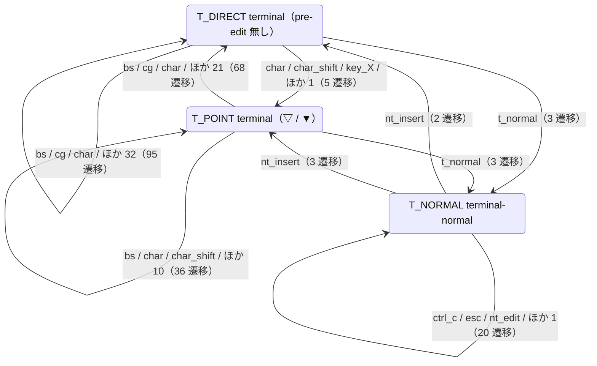


状態クラス 3 個、遷移の組 9 行（この節から出るもの）。

| 状態 | イベント | effects | 遷移先 | status | 根拠 |
| --- | --- | --- | --- | --- | --- |
| `T_DIRECT` | `bs`, `cg`, `char`, `char_shift`, `completion_accept`, `completion_open`, `cr`, `ctrl_a`, ほか 27 | `feed_key`, `install_mapping`, `pass_key`, `render`, `reset_state`, `restore_mapping`, `save_mapping` | `T_DIRECT` | `ok 14 / unknown 81` | `t.T_DIRECT.bs` / #67, function/common.lua:18-45, function/common.lua:59-68, ほか 20 / 観測: `:terminal` `<Plug>(skkeleton-enable)` `a` |
| `T_DIRECT` | `char`, `char_shift`, `key_X`, `key_semicolon` | `feed_key`, `render` | `T_POINT` | `ok 1 / unknown 4` | `t.T_DIRECT.char.romaji` / function/input.lua:147-, function/input.lua:85-120, keymap.lua:39 / 観測: `:terminal` `<Plug>(skkeleton-enable)` `K` |
| `T_DIRECT` | `t_normal` | `keep`, `reset_state` | `T_NORMAL` | `ok 3` | `t.T_DIRECT.t_normal` / #74, cleanup.lua:218-221, cleanup.lua:218-248, ほか 1 / 観測: `:terminal` `<Plug>(skkeleton-enable)` `<Plug>(skkeleton-disable)` `<C-\><C-n>` |
| `T_POINT` | `bs`, `cg`, `char`, `char_shift`, `completion_accept`, `completion_open`, `cr`, `ctrl_a`, ほか 16 | `cancel`, `commit_candidate`, `commit_reading`, `feed_key`, `pass_key`, `reset_state`, `restore_mapping` | `T_DIRECT` | `ok 34 / unknown 34` | `t.T_POINT.bs.empty` / #67, #87, function/common.lua:18-45, ほか 15 / 観測: `:terminal` `<Plug>(skkeleton-enable)` `K` `a` `n` `<BS>` `<BS>` `<BS>` |
| `T_POINT` | `bs`, `char`, `char_shift`, `insert_key`, `key_L`, `key_X`, `key_gt`, `key_q`, ほか 5 | `commit_candidate`, `feed_key`, `keep`, `pass_key`, `render` | `T_POINT` | `ok 11 / unknown 25` | `t.T_POINT.bs` / #129, function/henkan.lua:116-133, function/henkan.lua:137-162, ほか 15 / 観測: `:terminal` `<Plug>(skkeleton-enable)` `K` `a` `n` `<BS>` |
| `T_POINT` | `t_normal` | `keep` | `T_NORMAL` | `ok 3` | `t.T_POINT.t_normal` / #74, cleanup.lua:218-248, guard.lua:114-124,154-163 / 観測: `:terminal` `<Plug>(skkeleton-enable)` `K` `a` `n` `<C-\><C-n>` |
| `T_NORMAL` | `nt_insert` | — | `T_DIRECT` | `ok 2` | `t.T_NORMAL_DIRECT.nt_insert` / #74, tests/test_e2e_cmdline.lua:147-172 / 観測: `:terminal` `<Plug>(skkeleton-enable)` `<Plug>(skkeleton-disable)` `<C-\><C-n>` `i` |
| `T_NORMAL` | `nt_insert` | `keep` | `T_POINT` | `ok 3` | `t.T_NORMAL_POINT.nt_insert` / #74, tests/test_e2e_cmdline.lua:147-172 / 観測: `:terminal` `<Plug>(skkeleton-enable)` `K` `a` `n` `<C-\><C-n>` `i` |
| `T_NORMAL` | `ctrl_c`, `esc`, `nt_edit`, `t_normal` | `pass_key` | `T_NORMAL` | `ok 20` | `t.T_NORMAL_DIRECT.ctrl_c` / #188, Vim 本体, keys.md §5 / 観測: `:terminal` `<Plug>(skkeleton-enable)` `K` `a` `n` `<C-\><C-n>` `<C-\><C-n>` |

### 3.8 辞書登録のプロンプト（`@`）

辞書登録の `input()`（cmdtype は `@`）。外側の pre-edit は凍結し、欄の中は直接入力。入れ子は深さ 2 まで。

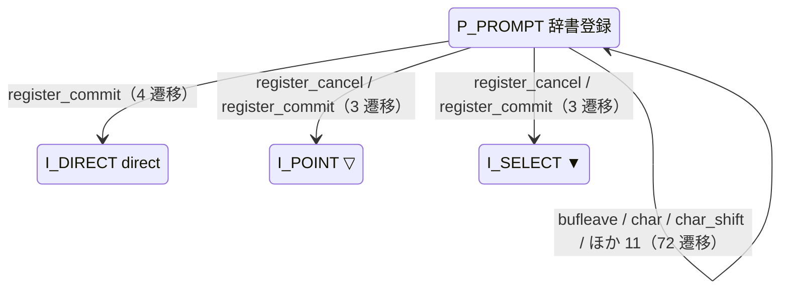


状態クラス 1 個、遷移の組 4 行（この節から出るもの）。

| 状態 | イベント | effects | 遷移先 | status | 根拠 |
| --- | --- | --- | --- | --- | --- |
| `P_PROMPT` | `register_commit` | `commit_reading`, `render`, `reset_state`, `restore_mapping` | `I_DIRECT` | `ok 4` | `t.P_PROMPT_POINT.commit` / #189, events.md O12, host.lua:125-162 / 観測: `<Plug>(skkeleton-enable)` `N` `u` `r` `u` `<Space>` `K` `a` … |
| `P_PROMPT` | `register_cancel`, `register_commit` | `cancel`, `keep`, `render`, `restore_mapping` | `I_POINT` | `ok 3` | `t.P_PROMPT_POINT.cancel` / #116, #154, #189, ほか 3 / 観測: `<Plug>(skkeleton-enable)` `N` `u` `r` `u` `<Space>` `<Esc>` |
| `P_PROMPT` | `register_cancel`, `register_commit` | `cancel`, `keep`, `render`, `restore_mapping` | `I_SELECT` | `ok 3` | `t.P_PROMPT_SELECT.cancel` / #116, #189, host.lua:125-162,166-169, ほか 1 / 観測: `<Plug>(skkeleton-enable)` `K` `a` `n` `<Space>` `<Space>` `<Space>` `<Space>` … |
| `P_PROMPT` | `bufleave`, `char`, `char_shift`, `cmdline_move`, `ctrl_r`, `ctrl_u`, `ctrl_w`, `prompt_cmdlineenter`, ほか 6 | `cancel`, `commit_reading`, `drop`, `install_mapping`, `keep`, `render`, `reset_state`, `restore_mapping`, ほか 1 | `P_PROMPT` | `ok 62 / gap 10（既知: #12, #116）` | `t.P_PROMPT_POINT.bufleave` / #12, #13, #54, ほか 22 / 観測: `<Plug>(skkeleton-enable)` `N` `u` `r` `u` `<Space>` `a` |

### 3.9 補完（`ic` / `ix` / blink）

補完のメニューが開いている状態。組み込み（`ic`）、`<C-x>` のキー待ち（`ix`）、blink.cmp（Vim のモードは `i` のまま）を、人が読むクラスでは `IC` にまとめる。

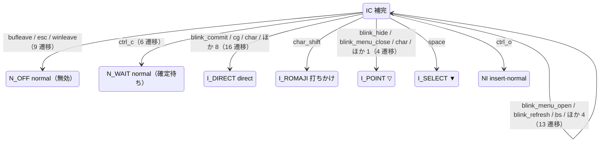


状態クラス 1 個、遷移の組 8 行（この節から出るもの）。

| 状態 | イベント | effects | 遷移先 | status | 根拠 |
| --- | --- | --- | --- | --- | --- |
| `IC` | `bufleave`, `esc`, `winleave` | `clear_extmark`, `commit_reading`, `drop`, `hide_completion`, `reset_state`, `restore_mapping` | `N_OFF` | `ok 6 / gap 1 / unknown 2（既知: #169, #190）` | `t.IC.bufleave` / #169, #190, cleanup.lua:192-251, ほか 2 / 観測: `<Plug>(skkeleton-enable)` `K` `a` `n` `j` `@blink_refresh` `<Esc>` |
| `IC` | `ctrl_c` | `hide_completion` | `N_WAIT` | `ok 6` | `t.IC.ctrl_c` / #70, #142, cleanup.lua:187, ほか 1 / 観測: `<Plug>(skkeleton-enable)` `K` `a` `n` `j` `@blink_refresh` `<C-c>` |
| `IC` | `blink_commit`, `cg`, `char`, `complete_done`, `completion_accept`, `completion_cancel`, `completion_newline`, `completion_tab`, ほか 3 | `cancel`, `clear_extmark`, `commit_candidate`, `commit_reading`, `drop`, `feed_key`, `hide_completion`, `pass_key`, ほか 1 | `I_DIRECT` | `ok 12 / gap 1 / unknown 3（既知: #8, #12, #190）` | `t.IC.char` / #8, #12, #56, ほか 8 / 観測: `<Plug>(skkeleton-enable)` `K` `a` `n` `j` `@blink_refresh` `<C-g>` |
| `IC` | `char_shift` | `feed_key`, `render` | `I_ROMAJI` | `ok 1` | `t.IC.char_shift` / #190 / 観測: `<Plug>(skkeleton-enable)` `K` `a` `n` `<C-n>` `R` |
| `IC` | `blink_hide`, `blink_menu_close`, `char`, `completion_cancel` | `feed_key`, `hide_completion`, `keep`, `render` | `I_POINT` | `ok 3 / unknown 1` | `t.I_BLINK_POINT.blink_hide` / #24, #143, #174, ほか 4 / 観測: `<Plug>(skkeleton-enable)` `K` `a` `n` `j` `@blink_refresh` `<C-e>` |
| `IC` | `space` | `hide_completion`, `keep`, `render` | `I_SELECT` | `ok 1` | `t.I_BLINK_POINT.space` / #190 / 観測: `<Plug>(skkeleton-enable)` `K` `a` `n` `j` `@blink_refresh` `<Space>` |
| `IC` | `ctrl_o` | `keep`, `render` | `NI` | `unknown 1` | `t.I_BLINK_POINT.ctrl_o` / #117, #190 / 観測: `<Plug>(skkeleton-enable)` `K` `a` `n` `j` `@blink_refresh` `<C-o>` |
| `IC` | `blink_menu_open`, `blink_refresh`, `bs`, `completion_accept`, `completion_key`, `completion_next`, `text_changed_p` | `clear_extmark`, `drop`, `keep`, `pass_key`, `render`, `reset_state`, `show_completion` | `IC` | `ok 9 / gap 3 / unknown 1（既知: #19, #190）` | `t.IC.bs` / #143, #174, #190, ほか 5 / 観測: `<Plug>(skkeleton-enable)` `K` `a` `n` `j` `@blink_refresh` `<BS>` |

## 4. モードをまたぐ遷移

Vim のモードが変わる遷移だけを集めた。モードの対応が無い遷移（`i` → `n`、`t` → `nt`、`c` → `cr` など）がここに入る。同じクラスの中でもモードが変わるもの（`T_DIRECT` の `t` → `T_NORMAL` の `nt` など）を含む。

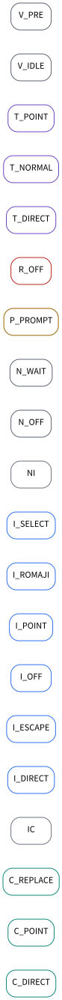

```mermaid
stateDiagram-v2
  state "N_OFF normal（無効）" as N_OFF
  state "N_WAIT normal（確定待ち）" as N_WAIT
  state "V_IDLE visual（pre-edit 無し）" as V_IDLE
  state "V_PRE visual（pre-edit 付き）" as V_PRE
  state "I_OFF insert（無効）" as I_OFF
  state "I_DIRECT direct" as I_DIRECT
  state "I_ROMAJI 打ちかけ" as I_ROMAJI
  state "I_POINT ▽" as I_POINT
  state "I_SELECT ▼" as I_SELECT
  state "I_ESCAPE escape（片付け待ち）" as I_ESCAPE
  state "NI insert-normal" as NI
  state "R_OFF replace（無効）" as R_OFF
  state "C_DIRECT cmdline（pre-edit 無し）" as C_DIRECT
  state "C_POINT cmdline（▽ / ▼）" as C_POINT
  state "C_REPLACE cmdline replace" as C_REPLACE
  state "T_DIRECT terminal（pre-edit 無し）" as T_DIRECT
  state "T_POINT terminal（▽ / ▼）" as T_POINT
  state "T_NORMAL terminal-normal" as T_NORMAL
  state "IC 補完" as IC
  state "P_PROMPT 辞書登録" as P_PROMPT
  N_OFF --> I_OFF: insert_enter / insert_key（4 遷移）
  N_OFF --> I_DIRECT: enable / insert_enter / toggle（3 遷移）
  N_OFF --> R_OFF: normal_R
  N_OFF --> C_DIRECT: cmdline_open
  N_OFF --> T_DIRECT: term_open
  V_IDLE --> I_DIRECT: esc
  V_IDLE --> C_DIRECT: cmdline_open
  V_PRE --> I_OFF: mouse_click_other（2 遷移）
  V_PRE --> I_POINT: esc
  V_PRE --> I_SELECT: esc
  V_PRE --> C_POINT: cmdline_open
  I_OFF --> N_OFF: ctrl_at / esc / mouse_select（4 遷移）
  I_OFF --> R_OFF: insert_key
  I_DIRECT --> N_OFF: ctrl_at / esc / mouse_select / ほか 1（4 遷移）
  I_DIRECT --> N_WAIT: ctrl_c
  I_DIRECT --> V_IDLE: ctrl_o_v
  I_DIRECT --> NI: ctrl_o
  I_DIRECT --> R_OFF: ctrl_o_R / insert_key（2 遷移）
  I_DIRECT --> IC: completion_key / completion_open（2 遷移）
  I_ROMAJI --> N_OFF: ctrl_at / esc / mouse_select / ほか 1（4 遷移）
  I_ROMAJI --> N_WAIT: ctrl_c
  I_ROMAJI --> V_PRE: ctrl_o_v
  I_ROMAJI --> NI: ctrl_o
  I_ROMAJI --> R_OFF: ctrl_o_R / insert_key（2 遷移）
  I_ROMAJI --> IC: completion_key / completion_open（2 遷移）
  I_POINT --> N_OFF: ctrl_at / esc / mouse_select / ほか 1（4 遷移）
  I_POINT --> N_WAIT: ctrl_c
  I_POINT --> V_PRE: ctrl_o_v
  I_POINT --> NI: ctrl_o
  I_POINT --> R_OFF: ctrl_o_R / insert_key（2 遷移）
  I_POINT --> IC: completion_key / completion_open（2 遷移）
  I_POINT --> P_PROMPT: space
  I_SELECT --> N_OFF: ctrl_at / esc / mouse_select / ほか 1（4 遷移）
  I_SELECT --> N_WAIT: ctrl_c
  I_SELECT --> V_PRE: ctrl_o_v
  I_SELECT --> NI: ctrl_o
  I_SELECT --> R_OFF: ctrl_o_R / insert_key（2 遷移）
  I_SELECT --> IC: completion_key / completion_open（2 遷移）
  I_SELECT --> P_PROMPT: space
  I_ESCAPE --> N_OFF: cleanup_escape
  NI --> N_OFF: bufleave / winleave（6 遷移）
  NI --> V_IDLE: ni_v
  NI --> V_PRE: ni_v（2 遷移）
  NI --> I_OFF: disable
  NI --> I_DIRECT: ni_return_commit / ni_return_drop / ni_return_keep（7 遷移）
  NI --> I_POINT: ni_return_keep
  NI --> I_SELECT: ni_return_keep
  NI --> R_OFF: ni_R（3 遷移）
  R_OFF --> N_OFF: esc
  R_OFF --> I_OFF: insert_key
  C_DIRECT --> N_OFF: bs / cg / cmdline_window / ほか 4（16 遷移）
  C_DIRECT --> V_IDLE: esc
  C_DIRECT --> C_REPLACE: cmdline_insert（2 遷移）
  C_POINT --> N_OFF: cmdline_window / cr / ctrl_c / ほか 1（15 遷移）
  C_POINT --> V_PRE: esc
  C_POINT --> C_REPLACE: cmdline_insert（3 遷移）
  C_REPLACE --> N_OFF: cg / cmdline_window / cr / ほか 3（23 遷移）
  C_REPLACE --> C_DIRECT: cmdline_insert（2 遷移）
  C_REPLACE --> C_POINT: cmdline_insert（3 遷移）
  T_DIRECT --> T_NORMAL: t_normal（3 遷移）
  T_POINT --> T_NORMAL: t_normal（3 遷移）
  T_NORMAL --> T_DIRECT: nt_insert（2 遷移）
  T_NORMAL --> T_POINT: nt_insert（3 遷移）
  IC --> N_OFF: bufleave / esc / winleave（9 遷移）
  IC --> N_WAIT: ctrl_c（6 遷移）
  IC --> I_DIRECT: char / complete_done / completion_accept / ほか 4（7 遷移）
  IC --> I_ROMAJI: char_shift
  IC --> NI: ctrl_o
  IC --> IC: completion_key / completion_next（5 遷移）
  P_PROMPT --> I_DIRECT: register_commit（4 遷移）
  P_PROMPT --> I_POINT: register_cancel / register_commit（3 遷移）
  P_PROMPT --> I_SELECT: register_cancel / register_commit（3 遷移）
```

| 状態 | イベント | effects | 遷移先 | status | 根拠 |
| --- | --- | --- | --- | --- | --- |
| `N_OFF` | `insert_enter`, `insert_key` | `pass_key` | `I_OFF` | `ok 4` | `t.N_KEEP.insert_enter` / #36, #152, #192, ほか 4 / 観測: `<Plug>(skkeleton-enable)` `K` `a` `n` `<Esc>` `i` |
| `N_OFF` | `enable`, `insert_enter`, `toggle` | `hide_completion`, `install_mapping`, `reset_state`, `save_mapping` | `I_DIRECT` | `ok 2 / unknown 1` | `t.N_KEEP.insert_enter.keepstate` / #152, #192, host.lua:235-244, ほか 2 / 観測: `<Plug>(skkeleton-enable)` |
| `N_OFF` | `normal_R` | `pass_key` | `R_OFF` | `ok 1` | `t.N_OFF.R` / 06 の観測 P.t.N_OFF.R, Vim 本体 / 観測: `R` |
| `N_OFF` | `cmdline_open` | — | `C_DIRECT` | `ok 1` | `t.N_OFF.cmdline_open` / events.md, keys.md §1 / 観測: `:` |
| `N_OFF` | `term_open` | `pass_key` | `T_DIRECT` | `ok 1` | `t.N_OFF.term_open` / explore.lua の terminal プロファイル, keys.md §5 |
| `V_IDLE` | `esc` | `keep` | `I_DIRECT` | `ok 1` | `t.V_IDLE.esc` / cleanup.lua:192-251 / 観測: `<Plug>(skkeleton-enable)` `<C-o>v` `<Esc>` |
| `V_IDLE` | `cmdline_open` | — | `C_DIRECT` | `ok 1` | `t.V_IDLE.cmdline_open` / #28, map.lua:113-139 / 観測: `i` `<Plug>(skkeleton-enable)` `<C-o>v` `/` |
| `V_PRE` | `mouse_click_other` | `clear_extmark`, `drop`, `reset_state`, `restore_mapping` | `I_OFF` | `gap 2（既知: #47, #169）` | `t.V_PRE_POINT.mouse_click_other` / #47, #169, #191, ほか 1 |
| `V_PRE` | `esc` | `keep`, `render` | `I_POINT` | `ok 1` | `t.V_PRE_POINT.esc` / cleanup.lua:192-251 / 観測: `<Plug>(skkeleton-enable)` `K` `a` `n` `<C-o>v` `<Esc>` |
| `V_PRE` | `esc` | `keep`, `render` | `I_SELECT` | `unknown 1` | `t.V_PRE_SELECT.esc` / cleanup.lua:192-251 / 観測: `i` `<Plug>(skkeleton-enable)` `K` `a` `n` `<Space>` `<C-o>` `v` … |
| `V_PRE` | `cmdline_open` | `keep` | `C_POINT` | `ok 1` | `t.V_PRE_POINT.cmdline_open` / #28, render.lua / 観測: `i` `<Plug>(skkeleton-enable)` `K` `a` `n` `<C-o>v` `/` |
| `I_OFF` | `ctrl_at`, `esc`, `mouse_select` | `clear_extmark`, `feed_key`, `hide_completion`, `pass_key`, `reset_state`, `restore_mapping` | `N_OFF` | `ok 2 / unknown 2` | `t.I_OFF.ctrl_at` / #24, #56, #191, ほか 3 / 観測: `i` `<C-@>` |
| `I_OFF` | `insert_key` | `pass_key` | `R_OFF` | `unknown 1` | `t.I_OFF.insert_key` / Vim 本体 / 観測: `i` `<Plug>(skkeleton-enable)` `<Esc>` `i` `<Insert>` |
| `I_DIRECT` | `ctrl_at`, `esc`, `mouse_select`, `stopinsert` | `clear_extmark`, `feed_key`, `reset_state`, `restore_mapping` | `N_OFF` | `ok 4` | `t.I_DIRECT.ctrl_at` / #47, #56, #70, ほか 9 / 観測: `<Plug>(skkeleton-enable)` `<C-@>` |
| `I_DIRECT` | `ctrl_c` | — | `N_WAIT` | `ok 1` | `t.I_DIRECT.ctrl_c` / #70, #142, cleanup.lua:187,225-248 / 観測: `i` `<Plug>(skkeleton-enable)` `<C-c>` |
| `I_DIRECT` | `ctrl_o_v` | `keep` | `V_IDLE` | `ok 1` | `t.I_DIRECT.ctrl_o_v` / cleanup.lua:179-190 / 観測: `<Plug>(skkeleton-enable)` `<C-o>v` |
| `I_DIRECT` | `ctrl_o` | `keep` | `NI` | `ok 1` | `t.I_DIRECT.ctrl_o` / #117 / 観測: `i` `<Plug>(skkeleton-enable)` `<C-o>` |
| `I_DIRECT` | `ctrl_o_R`, `insert_key` | `clear_extmark`, `reset_state`, `restore_mapping` | `R_OFF` | `ok 2` | `t.I_DIRECT.ctrl_o_R` / #29, #156, cleanup.lua:179-190, ほか 1 / 観測: `i` `<Plug>(skkeleton-enable)` `<C-o>R` |
| `I_DIRECT` | `completion_key`, `completion_open` | `keep`, `pass_key` | `IC` | `ok 2` | `t.I_DIRECT.completion_key` / #190, keys.md §5 / 観測: `<Plug>(skkeleton-enable)` `<C-n>` |
| `I_ROMAJI` | `ctrl_at`, `esc`, `mouse_select`, `stopinsert` | `clear_extmark`, `commit_reading`, `feed_key`, `reset_state`, `restore_mapping` | `N_OFF` | `ok 3 / unknown 1` | `t.I_ROMAJI.ctrl_at` / #47, #56, #70, ほか 8 / 観測: `<Plug>(skkeleton-enable)` `K` `<C-@>` |
| `I_ROMAJI` | `ctrl_c` | — | `N_WAIT` | `ok 1` | `t.I_ROMAJI.ctrl_c` / #70, #142, cleanup.lua:187,225-248 / 観測: `i` `<Plug>(skkeleton-enable)` `K` `<C-c>` |
| `I_ROMAJI` | `ctrl_o_v` | `keep`, `render` | `V_PRE` | `ok 1` | `t.I_ROMAJI.ctrl_o_v` / 06 の観測 P.t.I_ROMAJI.ctrl_o_v, cleanup.lua:179-190 / 観測: `i` `<Plug>(skkeleton-enable)` `K` `<C-o>v` |
| `I_ROMAJI` | `ctrl_o` | `keep` | `NI` | `ok 1` | `t.I_ROMAJI.ctrl_o` / #117, 06 の観測 P.t.I_ROMAJI.ctrl_o / 観測: `i` `<Plug>(skkeleton-enable)` `K` `<C-o>` |
| `I_ROMAJI` | `ctrl_o_R`, `insert_key` | `clear_extmark`, `commit_reading`, `reset_state`, `restore_mapping` | `R_OFF` | `ok 2` | `t.I_ROMAJI.ctrl_o_R` / #29, #156, 06 の観測 P.t.I_ROMAJI.ctrl_o_R, ほか 2 / 観測: `i` `<Plug>(skkeleton-enable)` `K` `<C-o>R` |
| `I_ROMAJI` | `completion_key`, `completion_open` | `clear_extmark`, `drop`, `keep`, `reset_state` | `IC` | `ok 1 / gap 1（既知: #18, #19, #190）` | `t.I_ROMAJI.completion_key` / #19, #190, keys.md §5 / 観測: `<Plug>(skkeleton-enable)` `K` `<C-n>` |
| `I_POINT` | `ctrl_at`, `esc`, `mouse_select`, `stopinsert` | `clear_extmark`, `commit_reading`, `feed_key`, `reset_state`, `restore_mapping` | `N_OFF` | `ok 4` | `t.I_POINT.ctrl_at` / #47, #56, #70, ほか 8 / 観測: `<Plug>(skkeleton-enable)` `K` `a` `n` `<C-@>` |
| `I_POINT` | `ctrl_c` | — | `N_WAIT` | `ok 1` | `t.I_POINT.ctrl_c` / #70, #142, cleanup.lua:187,225-248 / 観測: `<Plug>(skkeleton-enable)` `K` `a` `n` `<C-c>` |
| `I_POINT` | `ctrl_o_v` | `keep`, `render` | `V_PRE` | `ok 1` | `t.I_POINT.ctrl_o_v` / cleanup.lua:179-190 / 観測: `<Plug>(skkeleton-enable)` `K` `a` `n` `<C-o>v` |
| `I_POINT` | `ctrl_o` | `keep` | `NI` | `ok 1` | `t.I_POINT.ctrl_o` / #117 / 観測: `<Plug>(skkeleton-enable)` `K` `a` `n` `<C-o>` `l` |
| `I_POINT` | `ctrl_o_R`, `insert_key` | `clear_extmark`, `commit_reading`, `reset_state`, `restore_mapping` | `R_OFF` | `ok 2` | `t.I_POINT.ctrl_o_R` / #29, #156, cleanup.lua:179-190, ほか 1 / 観測: `<Plug>(skkeleton-enable)` `K` `a` `n` `<C-o>R` |
| `I_POINT` | `completion_key`, `completion_open` | `clear_extmark`, `drop`, `keep`, `reset_state` | `IC` | `ok 1 / gap 1（既知: #18, #19, #190）` | `t.I_POINT.completion_key` / #18, #19, #190, ほか 1 / 観測: `<Plug>(skkeleton-enable)` `K` `a` `n` `<C-n>` |
| `I_POINT` | `space` | `install_mapping`, `keep`, `render`, `save_mapping` | `P_PROMPT` | `ok 1` | `t.I_POINT.space.register` / #144, #189, function/henkan.lua:21-56, ほか 1 / 観測: `<Plug>(skkeleton-enable)` `N` `u` `r` `u` `<Space>` |
| `I_SELECT` | `ctrl_at`, `esc`, `mouse_select`, `stopinsert` | `clear_extmark`, `commit_candidate`, `commit_reading`, `feed_key`, `reset_state`, `restore_mapping` | `N_OFF` | `ok 4` | `t.I_SELECT.ctrl_at` / #47, #56, #70, ほか 8 / 観測: `<Plug>(skkeleton-enable)` `K` `a` `n` `<Space>` `<C-@>` |
| `I_SELECT` | `ctrl_c` | — | `N_WAIT` | `ok 1` | `t.I_SELECT.ctrl_c` / #70, #142, cleanup.lua:187,225-248 / 観測: `i` `<Plug>(skkeleton-enable)` `K` `a` `n` `<Space>` `<C-c>` |
| `I_SELECT` | `ctrl_o_v` | `keep`, `render` | `V_PRE` | `unknown 1` | `t.I_SELECT.ctrl_o_v` / cleanup.lua:179-190 / 観測: `i` `<Plug>(skkeleton-enable)` `K` `a` `n` `<Space>` `<C-o>v` |
| `I_SELECT` | `ctrl_o` | `keep` | `NI` | `ok 1` | `t.I_SELECT.ctrl_o` / #117 / 観測: `i` `<Plug>(skkeleton-enable)` `K` `a` `n` `<Space>` `<C-o>` |
| `I_SELECT` | `ctrl_o_R`, `insert_key` | `clear_extmark`, `commit_candidate`, `reset_state`, `restore_mapping` | `R_OFF` | `unknown 2` | `t.I_SELECT.ctrl_o_R` / #29, #156, cleanup.lua:179-190, ほか 1 / 観測: `i` `<Plug>(skkeleton-enable)` `K` `a` `n` `<Space>` `<C-o>R` |
| `I_SELECT` | `completion_key`, `completion_open` | `clear_extmark`, `drop`, `keep`, `reset_state` | `IC` | `gap 1 / unknown 1（既知: #18, #19, #190）` | `t.I_SELECT.completion_key` / #18, #190, keys.md §5 / 観測: `<Plug>(skkeleton-enable)` `K` `a` `n` `<Space>` `<C-n>` |
| `I_SELECT` | `space` | `install_mapping`, `keep`, `render`, `save_mapping` | `P_PROMPT` | `ok 1` | `t.I_SELECT.space.register` / #189, function/henkan.lua:90-113, host.lua:175-213 / 観測: `<Plug>(skkeleton-enable)` `K` `a` `n` `<Space>` `<Space>` `<Space>` `<Space>` … |
| `I_ESCAPE` | `cleanup_escape` | `reset_state` | `N_OFF` | `ok 1` | `t.I_ESCAPE.cleanup` / cleanup.lua:218-221 |
| `NI` | `bufleave`, `winleave` | `clear_extmark`, `drop`, `reset_state`, `restore_mapping` | `N_OFF` | `gap 4 / unknown 2（既知: #169）` | `t.NI_DIRECT.bufleave` / #169, #191, cleanup.lua:269-281 |
| `NI` | `ni_v` | `keep` | `V_IDLE` | `unknown 1` | `t.NI_DIRECT.visual` / cleanup.lua:179-190 / 観測: `i` `<Plug>(skkeleton-enable)` `<C-o>` `v` |
| `NI` | `ni_v` | `keep`, `render` | `V_PRE` | `unknown 2` | `t.NI_POINT.visual` / cleanup.lua:179-190 / 観測: `i` `<Plug>(skkeleton-enable)` `K` `a` `n` `<C-o>` `v` |
| `NI` | `disable` | `clear_extmark`, `commit_reading`, `reset_state`, `restore_mapping` | `I_OFF` | `unknown 1` | `t.NI_POINT.disable` / main.lua:129-139 / 観測: `i` `<Plug>(skkeleton-enable)` `K` `a` `n` `<C-o>` `<Plug>(skkeleton-disable)` |
| `NI` | `ni_return_commit`, `ni_return_drop`, `ni_return_keep` | `clear_extmark`, `commit_candidate`, `commit_reading`, `drop`, `keep`, `render`, `reset_state` | `I_DIRECT` | `ok 3 / gap 2 / unknown 2（既知: #199）` | `t.NI_DIRECT.return_commit` / #117, #199, cleanup.lua:120-147,215-217 / 観測: `<Plug>(skkeleton-enable)` `K` `a` `n` `<C-o>` `x` |
| `NI` | `ni_return_keep` | `keep` | `I_POINT` | `ok 1` | `t.NI_POINT.return_keep` / #117 / 観測: `<Plug>(skkeleton-enable)` `K` `a` `n` `<C-o>` `l` |
| `NI` | `ni_return_keep` | `keep` | `I_SELECT` | `ok 1` | `t.NI_SELECT.return_keep` / #117 / 観測: `i` `<Plug>(skkeleton-enable)` `K` `a` `n` `<Space>` `<C-o>` `l` |
| `NI` | `ni_R` | `clear_extmark`, `commit_candidate`, `commit_reading`, `reset_state`, `restore_mapping` | `R_OFF` | `unknown 3` | `t.NI_DIRECT.replace` / cleanup.lua:179-190 / 観測: `i` `<Plug>(skkeleton-enable)` `<C-o>` `R` |
| `R_OFF` | `esc` | `pass_key` | `N_OFF` | `ok 1` | `t.R_OFF.esc` / Vim 本体 / 観測: `i` `<Plug>(skkeleton-enable)` `<Insert>` `<Esc>` |
| `R_OFF` | `insert_key` | `pass_key` | `I_OFF` | `ok 1` | `t.R_OFF.insert_key` / #38 / 観測: `<Plug>(skkeleton-enable)` `K` `a` `n` `<Insert>` `<Insert>` |
| `C_DIRECT` | `bs`, `cg`, `cmdline_window`, `cr`, `ctrl_c`, `esc`, `nl` | `cancel`, `clean_cmdline`, `clear_extmark`, `feed_key`, `pass_key`, `reset_state`, `restore_mapping` | `N_OFF` | `ok 6 / unknown 10` | `t.C_DIRECT.bs.empty` / cleanup.lua:254-266, events.md, function/common.lua:18-45, ほか 3 / 観測: `:` `<Plug>(skkeleton-enable)` `<C-g>` |
| `C_DIRECT` | `esc` | `clean_cmdline`, `keep` | `V_IDLE` | `ok 1` | `t.C_IDLE.esc` / #28, map.lua:113-139 / 観測: `i` `<Plug>(skkeleton-enable)` `<C-o>v` `/` `<Esc>` |
| `C_DIRECT` | `cmdline_insert` | `pass_key` | `C_REPLACE` | `ok 2` | `t.C_DIRECT.cmdline_insert` / keys.md §1 / 観測: `:` `<Plug>(skkeleton-enable)` `<Insert>` |
| `C_POINT` | `cmdline_window`, `cr`, `ctrl_c`, `esc` | `cancel`, `clean_cmdline`, `clear_extmark`, `commit_candidate`, `commit_reading`, `drop`, `reset_state`, `restore_mapping` | `N_OFF` | `ok 6 / gap 4 / unknown 5（既知: #205）` | `t.C_IDLE_PRE.cmdline_window` / #205, cleanup.lua:254-266, events.md / 観測: `:` `<Plug>(skkeleton-enable)` `K` `a` `n` `<CR>` |
| `C_POINT` | `esc` | `clean_cmdline`, `keep` | `V_PRE` | `ok 1` | `t.C_IDLE_PRE.esc` / #28, render.lua / 観測: `i` `<Plug>(skkeleton-enable)` `K` `a` `n` `<C-o>v` `/` `<Esc>` |
| `C_POINT` | `cmdline_insert` | `keep` | `C_REPLACE` | `ok 2 / unknown 1` | `t.C_POINT.cmdline_insert` / keys.md §1 / 観測: `:` `<Plug>(skkeleton-enable)` `K` `a` `n` `<Insert>` |
| `C_REPLACE` | `cg`, `cmdline_window`, `cr`, `ctrl_c`, `esc`, `nl` | `cancel`, `clean_cmdline`, `clear_extmark`, `commit_candidate`, `commit_reading`, `drop`, `pass_key`, `reset_state`, ほか 1 | `N_OFF` | `ok 12 / gap 3 / unknown 8（既知: #205）` | `t.C_REPLACE_DIRECT.cg` / #205, cleanup.lua:254-266, events.md, ほか 2 / 観測: `:` `<Plug>(skkeleton-enable)` `K` `a` `n` `<Insert>` `<CR>` |
| `C_REPLACE` | `cmdline_insert` | `keep`, `pass_key` | `C_DIRECT` | `ok 1 / unknown 1` | `t.C_REPLACE_DIRECT.cmdline_insert` / keys.md §1 / 観測: `:` `<Plug>(skkeleton-enable)` `<Plug>(skkeleton-disable)` `<Insert>` `<Insert>` |
| `C_REPLACE` | `cmdline_insert` | `keep` | `C_POINT` | `ok 1 / unknown 2` | `t.C_REPLACE_POINT.cmdline_insert` / keys.md §1 / 観測: `:` `<Plug>(skkeleton-enable)` `K` `a` `n` `<Insert>` `<Insert>` |
| `T_DIRECT` | `t_normal` | `keep`, `reset_state` | `T_NORMAL` | `ok 3` | `t.T_DIRECT.t_normal` / #74, cleanup.lua:218-221, cleanup.lua:218-248, ほか 1 / 観測: `:terminal` `<Plug>(skkeleton-enable)` `<Plug>(skkeleton-disable)` `<C-\><C-n>` |
| `T_POINT` | `t_normal` | `keep` | `T_NORMAL` | `ok 3` | `t.T_POINT.t_normal` / #74, cleanup.lua:218-248, guard.lua:114-124,154-163 / 観測: `:terminal` `<Plug>(skkeleton-enable)` `K` `a` `n` `<C-\><C-n>` |
| `T_NORMAL` | `nt_insert` | — | `T_DIRECT` | `ok 2` | `t.T_NORMAL_DIRECT.nt_insert` / #74, tests/test_e2e_cmdline.lua:147-172 / 観測: `:terminal` `<Plug>(skkeleton-enable)` `<Plug>(skkeleton-disable)` `<C-\><C-n>` `i` |
| `T_NORMAL` | `nt_insert` | `keep` | `T_POINT` | `ok 3` | `t.T_NORMAL_POINT.nt_insert` / #74, tests/test_e2e_cmdline.lua:147-172 / 観測: `:terminal` `<Plug>(skkeleton-enable)` `K` `a` `n` `<C-\><C-n>` `i` |
| `IC` | `bufleave`, `esc`, `winleave` | `clear_extmark`, `commit_reading`, `drop`, `hide_completion`, `reset_state`, `restore_mapping` | `N_OFF` | `ok 6 / gap 1 / unknown 2（既知: #169, #190）` | `t.IC.bufleave` / #169, #190, cleanup.lua:192-251, ほか 2 / 観測: `<Plug>(skkeleton-enable)` `K` `a` `n` `j` `@blink_refresh` `<Esc>` |
| `IC` | `ctrl_c` | `hide_completion` | `N_WAIT` | `ok 6` | `t.IC.ctrl_c` / #70, #142, cleanup.lua:187, ほか 1 / 観測: `<Plug>(skkeleton-enable)` `K` `a` `n` `j` `@blink_refresh` `<C-c>` |
| `IC` | `char`, `complete_done`, `completion_accept`, `completion_cancel`, `completion_newline`, `completion_tab`, `key_q` | `feed_key`, `pass_key`, `reset_state` | `I_DIRECT` | `ok 5 / unknown 2` | `t.IC.char` / #174, #190, cleanup.lua:150-165,283-286 / 観測: `<Plug>(skkeleton-enable)` `K` `a` `n` `<C-n>` `<C-y>` |
| `IC` | `char_shift` | `feed_key`, `render` | `I_ROMAJI` | `ok 1` | `t.IC.char_shift` / #190 / 観測: `<Plug>(skkeleton-enable)` `K` `a` `n` `<C-n>` `R` |
| `IC` | `ctrl_o` | `keep`, `render` | `NI` | `unknown 1` | `t.I_BLINK_POINT.ctrl_o` / #117, #190 / 観測: `<Plug>(skkeleton-enable)` `K` `a` `n` `j` `@blink_refresh` `<C-o>` |
| `IC` | `completion_key`, `completion_next` | `clear_extmark`, `drop`, `pass_key`, `reset_state` | `IC` | `ok 2 / gap 3（既知: #19, #190）` | `t.IC.completion_key` / #190, keys.md §5 / 観測: `<Plug>(skkeleton-enable)` `K` `a` `n` `<C-n>` `<C-x>` |
| `P_PROMPT` | `register_commit` | `commit_reading`, `render`, `reset_state`, `restore_mapping` | `I_DIRECT` | `ok 4` | `t.P_PROMPT_POINT.commit` / #189, events.md O12, host.lua:125-162 / 観測: `<Plug>(skkeleton-enable)` `N` `u` `r` `u` `<Space>` `K` `a` … |
| `P_PROMPT` | `register_cancel`, `register_commit` | `cancel`, `keep`, `render`, `restore_mapping` | `I_POINT` | `ok 3` | `t.P_PROMPT_POINT.cancel` / #116, #154, #189, ほか 3 / 観測: `<Plug>(skkeleton-enable)` `N` `u` `r` `u` `<Space>` `<Esc>` |
| `P_PROMPT` | `register_cancel`, `register_commit` | `cancel`, `keep`, `render`, `restore_mapping` | `I_SELECT` | `ok 3` | `t.P_PROMPT_SELECT.cancel` / #116, #189, host.lua:125-162,166-169, ほか 1 / 観測: `<Plug>(skkeleton-enable)` `K` `a` `n` `<Space>` `<Space>` `<Space>` `<Space>` … |

## 5. 性質 P1–P15

性質は [GLOSSARY.md](GLOSSARY.md) の P1–P15。`model.lua` の `M.properties` が、このモデルで決められるか（`decided`）と、決められない理由を持つ。決められる性質は `semantics/model/model_check.lua` が検査する。

| 性質 | 内容 | いまのモデルでの判定 | model_check | 根拠・理由 |
| --- | --- | --- | --- | --- |
| `P1` | 読みが黙って消えない | 破れている（既知） | 検査する | 119 件の遷移が破れている。根拠: #8, #12, #18, #19, #20, #47, #67, #116, ほか 8 |
| `P2` | pre-edit は 1 つだけで、置き場所が正しく、中身が state と一致する | 決められない | 検査しない | extmark の数と位置を状態クラスに持っていない（05 の探索器と 06 の比較で見る）。07d で blink.cmp のメニューの位置も観測の JSONL に残した。 |
| `P3` | n / v / s / R では、状態とマッピングが元に戻っている | いまのモデルで決められる | 検査する | model_check の検査が通る。 |
| `P4` | cmdline / terminal を抜けたら、何も残っていない | いまのモデルで決められる | 検査する | model_check の検査が通る。 |
| `P5` | 1 つのキーを二重に処理しない | いまのモデルで決められる | 検査する | model_check の検査が通る。 |
| `P6` | 決定的に振る舞う（タイミングに左右されるものには印を付ける） | 決められない | 検査しない | モデルの分岐はタイミングではなく、辞書・バッファ・設定という持っていない条件。分かれる組は検査の最後に一覧で出す。blink.cmp のメニューは User skkeleton-handled のあとにタイマーで開くので、同じキー列でも観測の時点で開いていないことがある（07d）。 |
| `P7` | 片付けは何度やっても同じ結果になる | 決められない | 検査しない | 同じ片付けを 2 度流す遷移の対を持っていない（reset_state の自己遷移を足せば見られる）。 |
| `P8` | enable のあと disable すると元に戻る | いまのモデルで決められる | 検査する | model_check の検査が通る。 |
| `P9` | 辞書登録の入れ子から漏れずに戻れる | いまのモデルで決められる | 検査する | model_check の検査が通る。 |
| `P10` | 同じ読みを 2 度確定しない | いまのモデルで決められる | 検査する | model_check の検査が通る。 |
| `P11` | g:skkeleton#mode が中の状態と一致する | 決められない | 検査しない | かなモード（hira / kata / ...）を状態クラスに持っていない。 |
| `P12` | マッピングの範囲が正しい | 決められない | 検査しない | マッピングの数と範囲を状態クラスに持っていない。出口の restore_mapping だけ P3 で見る。 |
| `P13` | pending が片付く | いまのモデルで決められる | 検査する | model_check の検査が通る。 |
| `P14` | terminal の Ctrl を正しく扱う | いまのモデルで決められる | 検査する | model_check の検査が通る。 |
| `P15` | state が空でないなら、pre-edit が見えている | 決められない | 検査しない | 表示（extmark）を状態クラスに持っていない。補完のメニューだけが開いている状態はpre-edit が無いので、この性質の対象外（07d）。 |

`model_check.lua` の現在の結果は失敗 0。P1 は既知の破れ 119 件だけで、知らない破れは無い。P2 / P6 / P7 / P11 / P12 / P15 は、状態クラスに持っていない層（表示・かなモード・マッピング・タイミング）が要るので、このモデルでは決めない。

### 5.1 P1 の既知の破れ

P1（読みが黙って消えない）の破れは 119 件。すべて `M.known` に issue か棚卸しの節が付いている。1 つの遷移が複数の根拠を持つので、下の件数の合計は 119 と一致しない。

| 根拠 | 性質 | 遷移数 | 遷移（先頭 3 件） |
| --- | --- | --- | --- |
| #8 | `P1` | 64 | `t.I_ROMAJI.ctrl_k`, `t.I_ROMAJI.ctrl_r`, `t.I_ROMAJI.ctrl_u`, ほか 61 |
| #12 | `P1` | 75 | `t.I_ROMAJI.ctrl_k`, `t.I_ROMAJI.ctrl_r`, `t.I_ROMAJI.ctrl_u`, ほか 72 |
| #18 | `P1` | 3 | `t.I_ROMAJI.completion_open`, `t.I_SELECT.completion_open`, `t.I_POINT.completion_open` |
| #19 | `P1` | 6 | `t.I_ROMAJI.completion_open`, `t.I_SELECT.completion_open`, `t.IX_ROMAJI.completion_next`, ほか 3 |
| #20 | `P1` | 2 | `t.I_ROMAJI.ctrl_r`, `t.I_POINT.ctrl_r` |
| #47 | `P1` | 2 | `t.V_PRE_POINT.mouse_click_other`, `t.V_PRE_SELECT.mouse_click_other` |
| #67 | `P1` | 1 | `t.I_ROMAJI.key_l` |
| #116 | `P1` | 2 | `t.P_PROMPT_POINT_READING.ctrl_w`, `t.P_PROMPT_SELECT_READING.ctrl_w` |
| #169 | `P1` | 20 | `t.I_ROMAJI.bufleave`, `t.I_ROMAJI.winleave`, `t.I_ROMAJI.mouse_click_other`, ほか 17 |
| #190 | `P1` | 8 | `t.I_ROMAJI.completion_open`, `t.I_SELECT.completion_open`, `t.IX_ROMAJI.completion_next`, ほか 5 |
| #199 | `P1` | 2 | `t.NI_POINT.return_drop`, `t.NI_SELECT.return_drop` |
| #205 | `P1` | 7 | `t.C_IDLE_PRE.cmdline_window`, `t.C_ROMAJI.cmdline_window`, `t.C_POINT.cmdline_window`, ほか 4 |
| #206 | `P1` | 1 | `t.C_POINT.ctrl_r.eq` |
| #210 | `P1` | 3 | `t.I_ROMAJI.enable`, `t.I_POINT.enable`, `t.I_SELECT.enable` |
| 06 の観測 | `P1` | 1 | `t.I_ROMAJI.key_l` |
| keys.md §6 | `P1` | 4 | `t.I_ROMAJI.ctrl_a`, `t.I_ROMAJI.ctrl_t`, `t.I_POINT.ctrl_a`, ほか 1 |

<details>
<summary>P1 の既知の遷移をすべて出す</summary>

- #8: `t.C_POINT.cmdline_ctrl_y` `t.C_POINT.ctrl_at` `t.C_POINT.ctrl_k` `t.C_POINT.ctrl_r` `t.C_POINT.ctrl_t` `t.C_POINT.ctrl_u` `t.C_POINT.ctrl_v` `t.C_POINT.ctrl_w` `t.C_REPLACE_POINT.cmdline_ctrl_y` `t.C_REPLACE_POINT.ctrl_at` `t.C_REPLACE_POINT.ctrl_k` `t.C_REPLACE_POINT.ctrl_r` `t.C_REPLACE_POINT.ctrl_t` `t.C_REPLACE_POINT.ctrl_u` `t.C_REPLACE_POINT.ctrl_v` `t.C_REPLACE_POINT.ctrl_w` `t.C_REPLACE_ROMAJI.cmdline_ctrl_y` `t.C_REPLACE_ROMAJI.ctrl_at` `t.C_REPLACE_ROMAJI.ctrl_k` `t.C_REPLACE_ROMAJI.ctrl_r` `t.C_REPLACE_ROMAJI.ctrl_t` `t.C_REPLACE_ROMAJI.ctrl_u` `t.C_REPLACE_ROMAJI.ctrl_v` `t.C_REPLACE_ROMAJI.ctrl_w` `t.C_REPLACE_SELECT.cmdline_ctrl_y` `t.C_REPLACE_SELECT.ctrl_at` `t.C_REPLACE_SELECT.ctrl_k` `t.C_REPLACE_SELECT.ctrl_r` `t.C_REPLACE_SELECT.ctrl_t` `t.C_REPLACE_SELECT.ctrl_u` `t.C_REPLACE_SELECT.ctrl_v` `t.C_REPLACE_SELECT.ctrl_w` `t.C_ROMAJI.cmdline_ctrl_y` `t.C_ROMAJI.ctrl_at` `t.C_ROMAJI.ctrl_k` `t.C_ROMAJI.ctrl_r` `t.C_ROMAJI.ctrl_t` `t.C_ROMAJI.ctrl_u` `t.C_ROMAJI.ctrl_v` `t.C_ROMAJI.ctrl_w` `t.C_SELECT.cmdline_ctrl_y` `t.C_SELECT.ctrl_at` `t.C_SELECT.ctrl_k` `t.C_SELECT.ctrl_r` `t.C_SELECT.ctrl_t` `t.C_SELECT.ctrl_u` `t.C_SELECT.ctrl_v` `t.C_SELECT.ctrl_w` `t.I_BLINK_POINT.ctrl_w` `t.I_POINT.ctrl_k` `t.I_POINT.ctrl_r` `t.I_POINT.ctrl_u` `t.I_POINT.ctrl_v` `t.I_POINT.ctrl_w` `t.I_POINT.stale.buffer` `t.I_POINT.tab` `t.I_ROMAJI.ctrl_k` `t.I_ROMAJI.ctrl_r` `t.I_ROMAJI.ctrl_u` `t.I_ROMAJI.ctrl_v` `t.I_ROMAJI.ctrl_w` `t.I_ROMAJI.stale.buffer` `t.I_ROMAJI.tab` `t.I_SELECT.stale.buffer`
- #12: `t.C_POINT.cmdline_ctrl_p.history` `t.C_POINT.cmdline_ctrl_y` `t.C_POINT.ctrl_at` `t.C_POINT.ctrl_k` `t.C_POINT.ctrl_r` `t.C_POINT.ctrl_t` `t.C_POINT.ctrl_u` `t.C_POINT.ctrl_v` `t.C_POINT.ctrl_w` `t.C_REPLACE_POINT.cmdline_ctrl_y` `t.C_REPLACE_POINT.ctrl_at` `t.C_REPLACE_POINT.ctrl_k` `t.C_REPLACE_POINT.ctrl_r` `t.C_REPLACE_POINT.ctrl_t` `t.C_REPLACE_POINT.ctrl_u` `t.C_REPLACE_POINT.ctrl_v` `t.C_REPLACE_POINT.ctrl_w` `t.C_REPLACE_ROMAJI.cmdline_ctrl_y` `t.C_REPLACE_ROMAJI.ctrl_at` `t.C_REPLACE_ROMAJI.ctrl_k` `t.C_REPLACE_ROMAJI.ctrl_r` `t.C_REPLACE_ROMAJI.ctrl_t` `t.C_REPLACE_ROMAJI.ctrl_u` `t.C_REPLACE_ROMAJI.ctrl_v` `t.C_REPLACE_ROMAJI.ctrl_w` `t.C_REPLACE_SELECT.cmdline_ctrl_y` `t.C_REPLACE_SELECT.ctrl_at` `t.C_REPLACE_SELECT.ctrl_k` `t.C_REPLACE_SELECT.ctrl_r` `t.C_REPLACE_SELECT.ctrl_t` `t.C_REPLACE_SELECT.ctrl_u` `t.C_REPLACE_SELECT.ctrl_v` `t.C_REPLACE_SELECT.ctrl_w` `t.C_ROMAJI.cmdline_ctrl_y` `t.C_ROMAJI.ctrl_at` `t.C_ROMAJI.ctrl_k` `t.C_ROMAJI.ctrl_r` `t.C_ROMAJI.ctrl_t` `t.C_ROMAJI.ctrl_u` `t.C_ROMAJI.ctrl_v` `t.C_ROMAJI.ctrl_w` `t.C_SELECT.cmdline_ctrl_y` `t.C_SELECT.ctrl_at` `t.C_SELECT.ctrl_k` `t.C_SELECT.ctrl_r` `t.C_SELECT.ctrl_t` `t.C_SELECT.ctrl_u` `t.C_SELECT.ctrl_v` `t.C_SELECT.ctrl_w` `t.I_BLINK_POINT.ctrl_w` `t.I_POINT.ctrl_k` `t.I_POINT.ctrl_r` `t.I_POINT.ctrl_u` `t.I_POINT.ctrl_v` `t.I_POINT.ctrl_w` `t.I_POINT.stale.buffer` `t.I_POINT.tab` `t.I_ROMAJI.ctrl_k` `t.I_ROMAJI.ctrl_r` `t.I_ROMAJI.ctrl_u` `t.I_ROMAJI.ctrl_v` `t.I_ROMAJI.ctrl_w` `t.I_ROMAJI.stale.buffer` `t.I_ROMAJI.tab` `t.I_SELECT.stale.buffer` `t.P_PROMPT_POINT_READING.ctrl_r` `t.P_PROMPT_POINT_READING.ctrl_u` `t.P_PROMPT_POINT_READING.ctrl_w` `t.P_PROMPT_POINT_READING.move` `t.P_PROMPT_POINT_READING.tab` `t.P_PROMPT_SELECT_READING.ctrl_r` `t.P_PROMPT_SELECT_READING.ctrl_u` `t.P_PROMPT_SELECT_READING.ctrl_w` `t.P_PROMPT_SELECT_READING.move` `t.P_PROMPT_SELECT_READING.tab`
- #18: `t.I_POINT.completion_open` `t.I_ROMAJI.completion_open` `t.I_SELECT.completion_open`
- #19: `t.IX_POINT.completion_next` `t.IX_ROMAJI.completion_next` `t.IX_SELECT.completion_next` `t.I_POINT.completion_open` `t.I_ROMAJI.completion_open` `t.I_SELECT.completion_open`
- #20: `t.I_POINT.ctrl_r` `t.I_ROMAJI.ctrl_r`
- #47: `t.V_PRE_POINT.mouse_click_other` `t.V_PRE_SELECT.mouse_click_other`
- #67: `t.I_ROMAJI.key_l`
- #116: `t.P_PROMPT_POINT_READING.ctrl_w` `t.P_PROMPT_SELECT_READING.ctrl_w`
- #169: `t.I_BLINK_POINT.winleave` `t.I_POINT.bufleave` `t.I_POINT.mouse_click_other` `t.I_POINT.winleave` `t.I_ROMAJI.bufleave` `t.I_ROMAJI.mouse_click_other` `t.I_ROMAJI.winleave` `t.I_SELECT.bufleave` `t.I_SELECT.mouse_click_other` `t.I_SELECT.winleave` `t.NI_POINT.bufleave` `t.NI_POINT.winleave` `t.NI_SELECT.bufleave` `t.NI_SELECT.winleave` `t.V_PRE_POINT.bufleave` `t.V_PRE_POINT.mouse_click_other` `t.V_PRE_POINT.winleave` `t.V_PRE_SELECT.bufleave` `t.V_PRE_SELECT.mouse_click_other` `t.V_PRE_SELECT.winleave`
- #190: `t.IX_POINT.completion_next` `t.IX_ROMAJI.completion_next` `t.IX_SELECT.completion_next` `t.I_BLINK_POINT.ctrl_w` `t.I_BLINK_POINT.winleave` `t.I_POINT.completion_open` `t.I_ROMAJI.completion_open` `t.I_SELECT.completion_open`
- #199: `t.NI_POINT.return_drop` `t.NI_SELECT.return_drop`
- #205: `t.C_IDLE_PRE.cmdline_window` `t.C_POINT.cmdline_window` `t.C_REPLACE_POINT.cmdline_window` `t.C_REPLACE_ROMAJI.cmdline_window` `t.C_REPLACE_SELECT.cmdline_window` `t.C_ROMAJI.cmdline_window` `t.C_SELECT.cmdline_window`
- #206: `t.C_POINT.ctrl_r.eq`
- #210: `t.I_POINT.enable` `t.I_ROMAJI.enable` `t.I_SELECT.enable`
- 06 の観測: `t.I_ROMAJI.key_l`
- keys.md §6: `t.I_POINT.ctrl_a` `t.I_POINT.ctrl_t` `t.I_ROMAJI.ctrl_a` `t.I_ROMAJI.ctrl_t`

</details>

## 6. 未解決の gap と過去のバグ

### 6.1 いまの gap（`M.known`）

`M.known` の項目は 119 件で、すべて P1。既知の破れとして `model_check.lua` が △ で出す。

| 根拠 | 題（issue の題。棚卸しの節には無い） | 遷移数 |
| --- | --- | --- |
| #8 | 変換中の <C-u> でバッファだけ消え、pre-edit と状態が残る | 64 |
| #12 | 辞書登録の欄でカーソルを動かすと、▽ ごと語が登録・確定される | 75 |
| #18 | 補完で候補が入ると、インジケータが元の位置に残る | 3 |
| #19 | ▽ の入力中に補完を入れたり取り消したりすると、pre-edit が行の途中に描かれる | 6 |
| #20 | ▽ の入力中に <C-r>= で式を入れると、pre-edit の表示だけが残る | 2 |
| #47 | マウスで visual から insert に戻ると、インジケータがクリック前のカーソル位置に残る | 2 |
| #67 | 変換などの関数はキーマップだけに置き、かなテーブルは文字だけにする | 1 |
| #116 | 辞書登録の欄で <C-w> のあと <C-g> で取り消すと、取り消しの印が崩れて語として登録される | 2 |
| #169 | 変換中にマウスで別のウィンドウに移ると変換中の文字が消える | 20 |
| #190 | formal-semantics: 組み込みの補完（ic）と blink の状態機械をモデルに足して探索する | 8 |
| #199 | pre-edit のときにバッファが変わると、打った読みが黙って消える（<C-o>x、外部からの変更） | 2 |
| #205 | cmdline の ▽ で <C-f> を押すと、cmdline window に pre-edit が引き継がれず消える | 7 |
| #206 | cmdline の ▽ で <C-r>= を使うと、cmdline に ▽ と読みが残り、そのまま実行される | 1 |
| #210 | 変換中に <Plug>(skkeleton-enable) を押すと、打った読みが確定せずに消える | 3 |
| 06 の観測 | —（棚卸し・観測の節） | 1 |
| keys.md §6 | —（棚卸し・観測の節） | 4 |

題は生成時点のもの。issue の状態（OPEN / CLOSED）は GitHub で見る。

### 6.2 未考慮の遷移（`M.out_of_scope`）

このモデルが対象にしていない遷移は 27 件。どれも理由と根拠が付いている。

| id | 何を | なぜ対象外か | 根拠 | キー |
| --- | --- | --- | --- | --- |
| `oos.terminal_register` | terminal から辞書登録のプロンプトへ入る道（候補の無い読みで <Space> など） | 07c（#189）。入口の外側の pre-edit は凍結して残るが、中と戻り先は 07c。 | `#189` | — |
| `oos.terminal_visual` | terminal-normal から visual / select へ入る道（v / V） | 07e（#191）。visual の V_PRE は insert から入る道を前提にしているので、terminal からの道はここでは足さない（観測では v で V_PRE になった）。 | `#191` | — |
| `oos.terminal_cmdline` | terminal-normal から cmdline へ入る道（`:`）と、そこから terminal を抜ける道 | 07a（#187）。terminal-normal → cmdline のときに skk の状態は c のクラスで観測される。 | `#187` | — |
| `oos.terminal_leave` | terminal を完全に抜ける道（:hide / :q / ウィンドウを閉じる） | cmdline・ウィンドウ操作は 07a / 07e。nt → n で skk は無効になり状態も捨てるが、端末の行に本物の文字として残っている読みは消えない（端末の表示層の話）。 | `#187`, `#191` | — |
| `oos.terminal_mouse` | terminal のマウス・ホイール | 07e（#191）。観測では t のホイールで Vim のモードが nt に変わった（pre-edit は残る）。 | `#191` | — |
| `oos.terminal_control_other` | terminal のその他の単バイト制御（<C-b> <C-f> <C-l> <C-s> <C-z> など） | guard.lua:89-112 の同じ道（確定してからジョブへ渡す）なので、代表の <C-a> / <C-r> / <C-w> / <C-u> / <C-n> / <C-y> だけ遷移にした。 | `guard.lua:89-112`, `keys.md §4` | — |
| `oos.terminal_insert_job` | terminal でジョブが終了したあと（<C-c> で cat が 130 で終わるなど） | cat の終了は端末のジョブの話で、skk の状態は t のまま。シェルでは <C-c> はジョブを止めるだけで端末は続く。 | `keys.md §4` | — |
| `oos.register` | 辞書登録のプロンプトの中の、次のもの以外の遷移 | 07c（#189）で、プロンプトの開閉・<CR>・空の <CR>・<Esc> / <C-g> / <C-c>・<C-r>・<Tab>・<C-w> / <C-u>・<C-f> 以外のカーソル移動・入れ子（深さ 2）までを遷移にした。残りは下の項目（cmdwin・履歴・purge の確認・深さ 3 以上・cmdline の補完キー）に分けた。 | `#189` | — |
| `oos.register_cmdwin` | 辞書登録の欄の <C-f>（cmdline window）の中の編集 | 07c（#189）の対象外。いまは <C-f> で cmdline window が開き（mode=n、win が 1 つ増える）、登録の input() は待ったままになる（#54 の直し）。cmdline window の中は Neovim の cmdline window の状態機械で、このモデルの状態クラスを持っていない。観測は semantics/explore/observations/register.jsonl の register.cmdwin。 | `#54`, `#189`, `events.md` | `<C-f>` |
| `oos.register_history` | 辞書登録の欄の <Up> / <Down>（input() の履歴） | 07c（#189）の対象外。履歴は Vim の input() が持ち、P_PROMPT の状態クラスを変えない。#44 で、取り消した欄の文字列が履歴に残らないようマーカーを掃除している。 | `#44`, `#189` | `<Up>`, `<Down>` |
| `oos.register_purge_confirm` | ▼ の X（purgeCandidate）の確認ダイアログ | 07c（#189）の対象外。X は辞書登録ではなく、host.confirm の確認ダイアログを開く（#129）。06 の観測でも、候補の最後で X を打っても辞書登録には入らなかった（semantics/compare/README.md）。確認のあとの状態は、辞書の purge の層で扱う。 | `#129`, `#189` | `X` |
| `oos.register_depth` | 辞書登録の入れ子の深さ 3 以上 | 07c（#189）では深さ 2 までを遷移にした。深さ 3 以上は同じ入れ子の繰り返しで、外側のプロンプトがもう 1 段増えるだけ。観測では深さ 3 でも <Esc> が 1 段ずつ戻る（semantics/explore/observations/register.jsonl の register.depth3）。深さを無制限にすると状態クラスが増え続けるので、モデルでは深さ 2 までにした。 | `#189` | — |
| `oos.register_cmdline_keys` | 辞書登録の欄の中の、cmdline の補完・レジスタ・マウスのキー | 07c（#189）の対象外。欄は cmdline（cmdtype は @）なので、<C-n> / <C-p> / <C-y> / <C-e>、<C-v> / <C-k> / <C-t> / <C-a> / <C-@>、<Insert>、マウス、ホイールは Neovim の cmdline の動きになる。pre-edit のずれは CmdlineChanged の掃除で直り、読みは捨てられる（P1 の既知。#12）。 | `#12`, `#189`, `keys.md §5` | `<C-n>`, `<C-p>`, `<C-y>`, `<C-e>`, ほか 6 |
| `oos.completion` | 補完の候補の並び・絞り込み・メニューの描画 | 状態機械ではなく、辞書と blink の表示の話。候補の確定・取消は 07d（#190）で遷移にした。 | `#190`, `#159` | — |
| `oos.native_completion` | completefunc / <C-x><C-u> の組み込み補完（#45） | 実装から消えている（#69 で補完は blink.cmp だけ）。Vim の completefunc を利用者が自前でつないだ場合の動きは skkeleton の状態機械ではない。 | `#45`, `#69` | `<C-x><C-u>` |
| `oos.blink_position` | blink.cmp のメニューの画面の位置（#143、#174） | 状態クラスに画面の位置を持っていない。観測の JSONL で menu の row / col を取り、いまは pre-edit の近くに出ることを確かめた。位置そのものは P2 / P15 の表示の層。 | `#143`, `#174`, `#190` | — |
| `oos.buffer_completion` | 無効のあいだの blink.cmp の buffer 補完の候補（#24） | 候補は blink の buffer source が作る。ここではメニューが開いている状態（I_OFF_MENU）と、有効化・無効化で閉じる遷移だけを書いた。 | `#24`, `#190` | — |
| `oos.macro_register` | マクロのレジスタに入るキーの種類（skk が流したキー・render.finish が混ざるか） | レジスタの中身は状態クラスに持っていない。07f で repeat.jsonl に記録した。insert では #36 の修正で混ざらない。cmdline と terminal では混ざり、再生するとエラーになる（#214）。 | `#36`, `#192`, `#214` | — |
| `oos.repeat_undo` | マクロの再生と `.` の undo の単位 | undo の区切りは状態クラスに持っていない。07f の観測では、skk の確定ごとに`<C-g>u` の区切りがあり、`u` 1 回で確定 1 つぶんが戻った（#57、#158）。 | `#36`, `#57`, `#152`, ほか 2 | — |
| `oos.macro_nested` | 記録中の再生（入れ子の @）と、記録中の insert の中の状態 | 記録中かどうかは観測の状態クラスに出ない（N_REC の class は N_OFF）。記録は insert をまたいで続くが、insert の中の skk の状態は記録の有無で変わらない。 | `#192` | — |
| `oos.mouse_position` | #47 のインジケータの位置（visual から insert に戻ったとき） | 表示（インジケータ）の位置は P2 / P15 の層で、このモデルの状態クラスには持っていない。マウスの遷移そのものは mouse_click / mouse_select に書いた。 | `#47` | `<ClickOtherWin>`, `<DragRight>`, `<ClickLine3>` |
| `oos.paste_undo` | #57 の貼り付けの undo のまとまり | undo の区切りは P1–P15 の外。貼り付けの遷移と、貼る前の確定は paste に書いた。観測では u 1 回で貼り付け以降だけが戻り、打った読みは残る。 | `#57` | `<Paste>` |
| `oos.mouse_coords` | マウスの座標（どの列をクリックしたか）と、確定した文字の置き場所 | ダブルクリックでは、確定した読みがクリックした位置に入る（観測）。文字の位置は状態クラスに持っていない（P2 の層）。 | `#47`, `#191` | `<2-LeftMouse>` |
| `oos.mapped_keys` | g:skkeleton#mapped_keys で利用者が足すキー | 割り当てる関数しだいで、モデルのイベントが決まらない。 | `keys.md §2` | — |
| `oos.blink_keys` | blink.cmp が skkeleton の外で持つキー（snippet の移動など） | 利用者の blink のキーマップしだい。skkeleton が関わる <Tab> / <CR> は 07d（#190）で遷移にした。 | `#190`, `blink.cmp keymap super-tab` | — |
| `oos.alt_meta` | <M-a> などの Alt / Meta 付きのキー | 端末では <Esc> と文字の 2 キーになり、1 キーの遷移として扱えない（#155）。 | `#155` | `<M-a>` |
| `oos.vimleave` | VimLeavePre | ユーザー辞書を保存するだけで、入力状態を変えない（events.md）。 | `events.md` | — |

### 6.3 過去のバグ（`semantics/issues.md`）

`issues.md` は 78 件のバグの issue を、状態クラス・イベント・性質で引けるようにした表。P1–P15 の外の話（辞書層・入力エンジン・undo のまとまりなど）も含む。

| 性質 | 件数 | issue |
| --- | ---: | --- |
| `P1` | 8 | #44, #56, #70, #111, #117, #125, #154, #169 |
| `P2` | 34 | #6, #8, #12, #13, #14, #16, #18, #19, #20, #21, #23, #24, #26, #29, #30, #35, #38, #39, #45, #46, #47, #85, #86, #115, #142, #143, #144, #145, #148, #149, #150, #151, #156, #174 |
| `P3` | 8 | #27, #28, #29, #32, #70, #111, #117, #153 |
| `P4` | 5 | #12, #46, #74, #121, #169 |
| `P5` | 2 | #36, #41 |
| `P6` | 5 | #25, #31, #170, #172, #174 |
| `P7` | 1 | #138 |
| `P8` | 5 | #24, #28, #92, #152, #155 |
| `P9` | 6 | #13, #44, #54, #55, #116, #154 |
| `P10` | 2 | #36, #116 |
| `P11` | 7 | #15, #17, #27, #32, #40, #86, #87 |
| `P12` | 5 | #13, #28, #29, #43, #153 |
| `P13` | 2 | #14, #115 |
| `P14` | 1 | #121 |
| `P15` | 9 | #20, #26, #34, #35, #38, #86, #144, #151, #170 |

直していない・再現しなかった・仕様として受け入れたもの（`issues.md` の表から）。

| issue | 状態 | 理由 |
| --- | --- | --- |
| #148 | OPEN | Neovim 本体の不具合（inline virtual text の折り返しとカーソル）。プラグイン側では直さない |
| #150 | OPEN | Neovim 本体の不具合（折り返した全角文字のハイライト）。プラグイン側では直さない |
| #149 | CLOSED | ヘッドレスの検査だけで出ていたもので、実機（blink を入れた Neovim）では再現しなかった。検査側を直した |
| #152 | CLOSED | `.` が先に `InsertEnter` を起こして `keepState` を使い切るため、2 回目の insert は仕様どおり。検査側を直した |
| #153 | CLOSED | which-key.nvim の normal のトリガーマッピングの不具合。プラグイン側では直さず、`M.known` に残した |
| #155 | CLOSED | `<M-a>` は `<Esc>` と `a` の 2 キーで、1 キーの遷移を前提にした検査の対象外にした |
| #158 | CLOSED | undo のまとまりの違いは受け入れた（案 3）。本体は変えない |
| #159 | OPEN | 未修正。`completionRankFile` の並び・読み直し・ヘルプを denops 版と比べたもの |
| #169 | OPEN | 未修正。変換中にマウスで別のウィンドウに移ると、変換中の文字が消える |
| #25 | OPEN | 検査の道具の issue（ちらつきの検出） |
| #172 | OPEN | 検査の道具の issue（キーの途中のフレームの検出） |

`issues.md` に無い新しい gap（#199・#205・#206・#210）は `M.known` に直接書いてある（§6.1）。

### 6.4 観測との差（`semantics/compare/diff.md`）

06（#186）の比較の結果。

- 観測: 616 件（一致 178 / 不一致 0 / 観測できず 38）
- モデルにだけある遷移: 332
- 観測にだけある遷移: 328（説明付き 328 / 説明なし 0）
- effects の食い違い: 0
- 非決定: 36 組

この差は、モデルが状態クラスに持っていない条件（辞書・バッファ・設定・タイミング）で説明できるものを含む。説明の付いていない差は `diff.md` を見る。

### 6.5 同じ状態・イベントで分かれる組

`model_check.lua` は、同じ `from` と `event` で遷移先が複数ある組を 57 組と数える。辞書に候補があるか、バッファに文字があるか、設定がどちらか、といった状態クラスに持っていない条件で分かれる。P6（決定的に振る舞う）を決められない理由の 1 つ。

## 7. ここでは決めないこと

以下は #179 の節をそのまま写したもの。望ましい振る舞いの判断は作者に委ねる。

- #169 の 2 案
- insert の制御キー（`<C-r>` `<C-v>` `<C-k>` `<C-t>` `<Tab>`）を確定してから流すか、今のとおり捨てるか
- `<C-o>` から visual / replace に入ったときの扱い
- 組み込みの補完を対象外にするか
- `<C-a>` / `<C-@>` の E29

## 8. 付録: 作者の判断（`M.decisions`）

モデルの粒度を決めた作者の判断。仕様書はこの判断に合わせてクラスを書いている。

| # | 題 | 判断 | 反映先 |
| --- | --- | --- | --- |
| 1 | I_OFF（insert・無効）を足す | 足す。無効な insert は、有効な insert と同じキーで結果が違うので分ける。 | I_OFF |
| 2 | V_IDLE（visual・有効・pre-edit 無し）を足す | 足す。visual で有効のままなのは、N_OFF と戻ったあとの結果が違うので分ける。 | V_IDLE, O-ctrl-o-v-direct |
| 3 | N_KEEP はクラスにしない | N_OFF のまま、遷移の guard の config.keepState で表す。 | N_OFF, t.N_OFF.insert_enter.keepstate, t.I_DIRECT.esc.keepstate |
| 4 | NI / V_PRE / P_PROMPT の粒度 | 人が読むクラスは 1 つのまま、抱えている相（direct / point / select）を属性で持つ。モデルの中で NI_POINT などに分けるのは可。仕様書では NI（point）のように書く。 | NI_DIRECT, NI_POINT, NI_SELECT, V_PRE_POINT, V_PRE_SELECT, P_PROMPT_POINT, ほか 7 |
| 5 | N_LOST は状態から外す | 読みが消えるのは遷移の結果なので、effects の drop と P1 の破れで表す。GLOSSARY と events.md も合わせる。 | M.known（P1）, semantics/GLOSSARY.md, semantics/inventory/events.md |
| 6 | 「ローマ字の打ちかけ」は I_ROMAJI に改名 | pending は render.is_pending() の意味だけに使う。 | I_ROMAJI |
| 7 | ▽ と ▽* は今はまとめる | 06 で結果が割れたら分ける。 | I_POINT |
| 8 | R_MID は観測のクラスから外す | 途中の状態（transient）としてだけ残す。 | R_MID |
| 9 | effects に install_mapping と save_mapping を足す | GLOSSARY にも足す。 | semantics/GLOSSARY.md, t.N_OFF.enable, t.I_OFF.enable, t.N_OFF.insert_enter.keepstate |
| 10 | V_PRE の意味 | <C-o>v で残り続ける状態の意味にする。マウスのドラッグで ModeChanged の確定より前に一瞬残るもの（events.md の O18）は、途中の状態として扱う。base を rebase して events.md も合わせる。 | V_PRE_POINT, V_PRE_SELECT, semantics/inventory/events.md |

## 9. 図の一覧

`semantics/figures/` に Graphviz の `.dot` と `.svg` がある。生成は `semantics/figures/gen.lua`。

| ファイル | 内容 |
| --- | --- |
| `figures/state_machine.svg` | 状態クラス全体（モードをまたぐ遷移） |
| `figures/mode_normal.svg` | normal |
| `figures/mode_visual.svg` | visual / select |
| `figures/mode_insert.svg` | insert |
| `figures/mode_insert_normal.svg` | insert-normal（`ni`） |
| `figures/mode_replace.svg` | replace（`R`） |
| `figures/mode_cmdline.svg` | cmdline（`c` / `cr`） |
| `figures/mode_terminal.svg` | terminal（`t` / `nt`） |
| `figures/mode_prompt.svg` | 辞書登録のプロンプト（`@`） |
| `figures/mode_completion.svg` | 補完（`ic` / `ix` / blink） |

