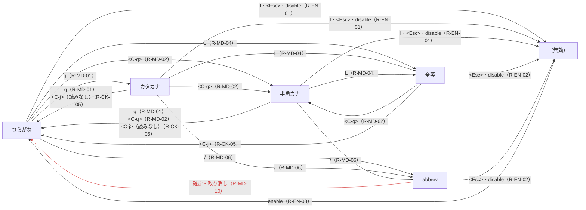
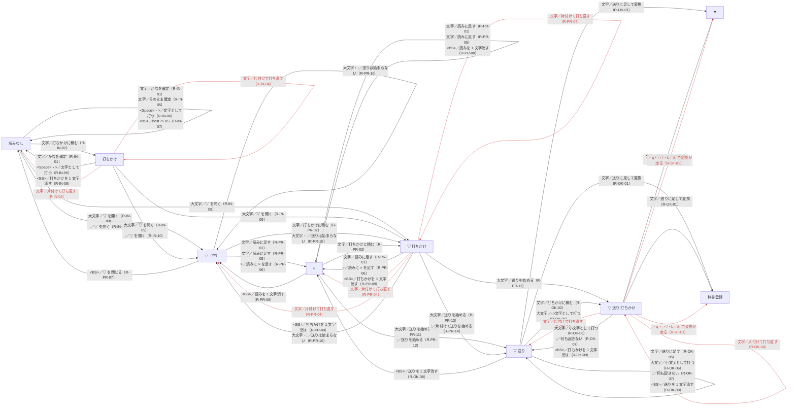
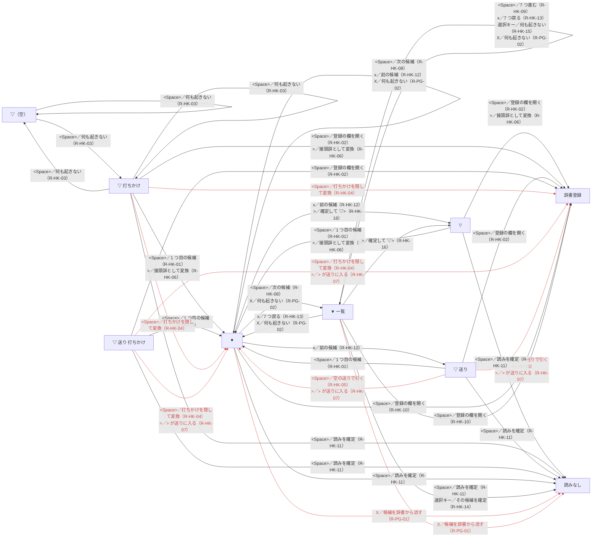
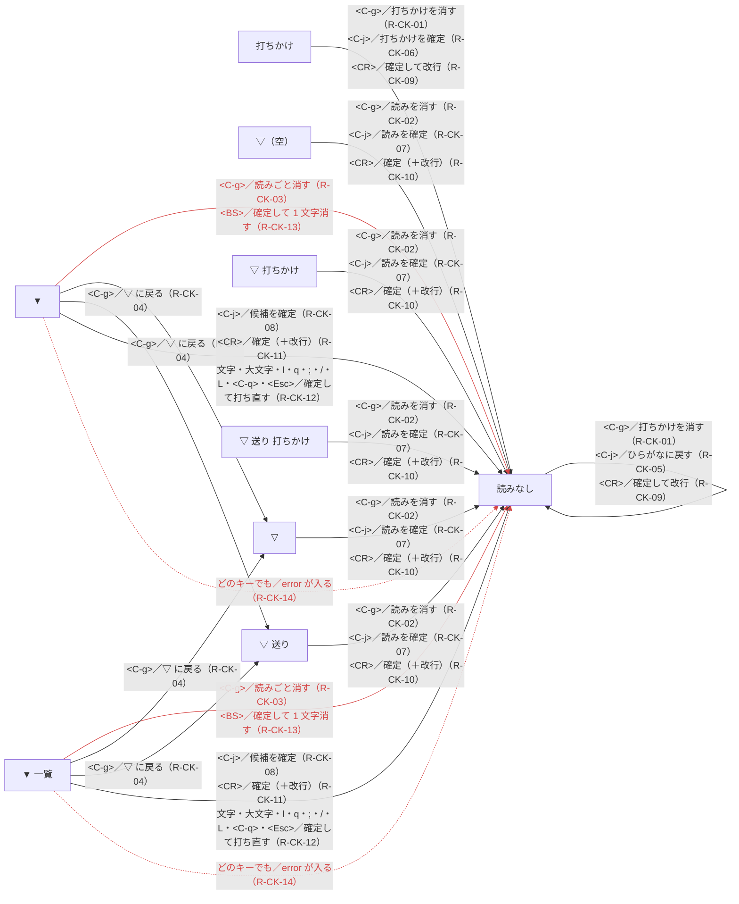
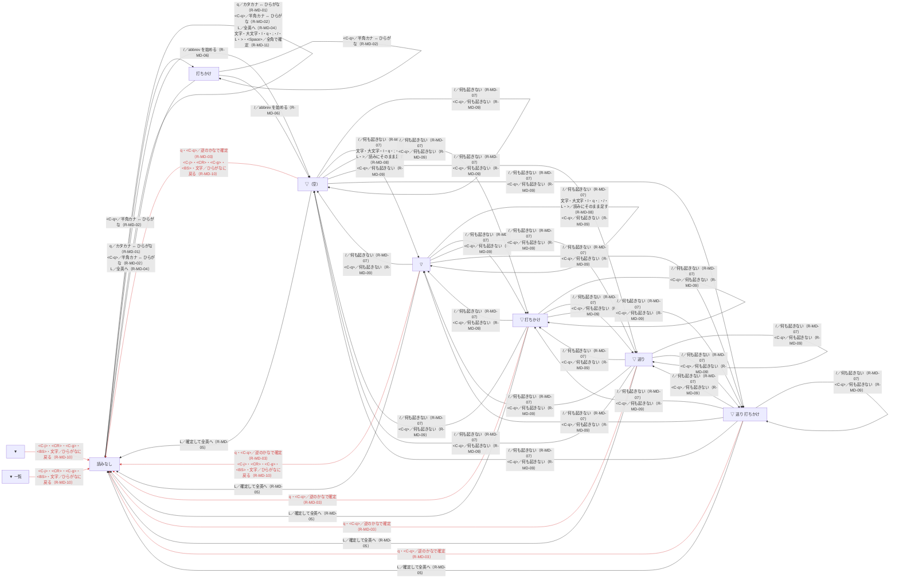
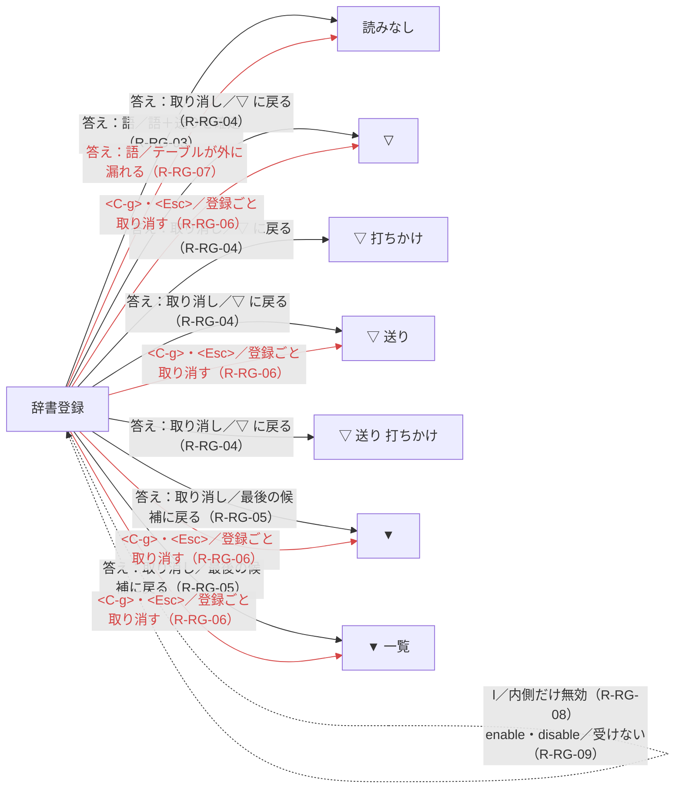
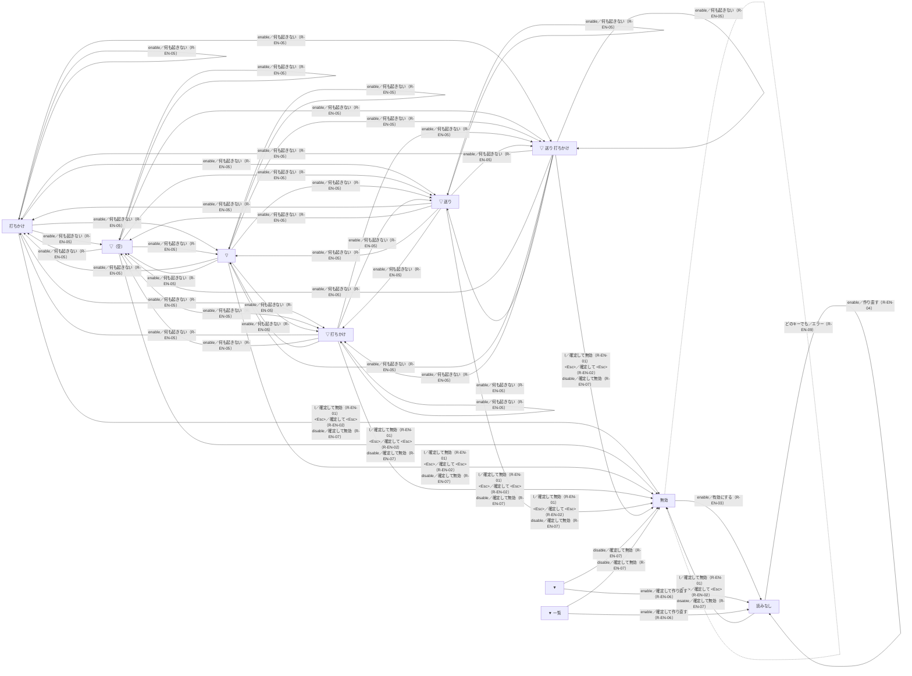

# SKK の入力エンジン（core）の意味論

skkeleton.nvim の入力エンジンを、Vim から切り離した状態機械として書いたものです（#260、親は #179）。書いてあるのは今の動きです。決まっていないところと、視点を破っているところには、推奨の動きを付けました。

<!-- gen:stats -->
状態 11 個、モード 5 個、キーの種類 23 個、規則 95 個（読んだ 80、推測 13、分からない 2）。未定義 4 個、視点を破る規則 16 個、推奨を付けた規則 19 個（推奨は 16 種類）。src は main の c2a78ff。
<!-- /gen:stats -->

- 規則の元は [rules.lua](rules.lua) です。この文書の表と図は [figures.lua](figures.lua) が `rules.lua` から作ります。`<!-- gen:… -->` の間は手で直さないでください。作り直すには、リポジトリの一番上で `nvim --headless -u NONE -i NONE -l semantics/core/figures.lua` を流します。
- 実行できる参照モデルは [model.lua](model.lua)、確かめ方は [VERIFY.md](VERIFY.md)、core と UI の分け方の提案は [DESIGN.md](DESIGN.md) です。
- **この文書はコードを読んで書いただけで、動かして確かめていません。** 規則ごとに確度（読んだ / 推測 / 分からない）を付けています。確かめるのは次の段です。
- 図は、今の動きを実線、未定義の規則を破線、視点を破る規則を赤で描いています。Graphviz の図は [figures/](figures/) の `.dot` にあります。

## 0. プロンプトの前提から変えたこと

#260 とこの作業の指示は、コードを全部は読まずに書かれたものでした。読んだうえで、次のところを変えています。

1. **状態は「段」と「打ちかけの有無」の積で書いた。** 段は 無効・読みなし・▽（空）・▽・▽ 送り・▼・▼ 一覧・辞書登録 で、▽ までの段には「打ちかけ（ローマ字の途中）」が重なります。§2 の 11 個の状態は、この積に名前を付けたものです。こうすると、文字を打つ規則がどの段でも同じ 4 つの形（かなに決まる / 続きがありうる / かな＋残り / 続かない）になり、関数のキーは「打ちかけを片付けてから、段に効く」という 1 つの形になります。
2. **「打ちかけの片付け方」を、規則とは別の概念にした。** 指示では「確定のときの打ちかけの n の扱い」を 1 つの規則として挙げていましたが、実装ではキーごとに片付け方が 5 通りあります（§4.0）。規則には `pending` のフィールドでどれを使うかを書きました。今の動きが割れているところは、この表 1 枚で見えます。
3. **`rules.lua` の 1 行は「実装の 1 つの分岐」にした。** 指示は「1 行 = 図の 1 本の辺」でしたが、同じ分岐が複数の状態から同じ形で出ます（`<C-g>` は ▽ 系の 5 つの状態から読みなしへ）。そこで `from` と `to` を配列にし、図を作るときに辺に広げています。行き先が読みの長さで分かれる規則（`<BS>` など）は、`to` に両方を書いています。
4. **「無効」と「辞書登録」は、実装の core には状態として無い。** 有効かどうかは `g:skkeleton#enabled` にあり、辞書登録は `host.input` の呼び出しの途中です。意味論では状態として書きましたが、参照モデルの `step` は実装と同じく、登録の欄が閉じるまで戻りません。`st.type == "escape"` は状態ではなく、「host に `<Esc>` を通させる」という出力として扱いました。
5. **かなモードは状態と掛け合わせないが、取りうる状態を縛る。** 全英は読みなしだけ、abbrev は ▽・▼・辞書登録だけです。モードの表に「取りうる状態」を足しました。
6. **キーの種類に、選択キーと、キーでない入力を足した。** ▼ 一覧の選択キー（`asdfjkl`）、enable / disable、host の答え（登録の語、取り消し）です。
7. **視点はいくつかが重なっていて、1 つ足りない。**
   - V2 と P1 は同じものです。
   - V1・V6・P11 の破れは、どれも「モードの表示」と「かなテーブルと converter の組」がずれる、という 1 つの形でした（R-PG-01、R-RG-01、R-RG-07）。`ctx.mode` と converter とテーブルを別々に持っていて、片方だけを戻す道があるのが原因です。
   - 足りないのは **V11「入れ子の機械と外の機械は、互いに書き換えない」** です。辞書登録の中で替えたかなテーブルが外に漏れる（R-RG-07）、外のモードの表示が内側で使われる（R-RG-01）は、V1〜V10 のどれにもきれいには当たりません。
   - V7 は「`<C-j>` を 1 打で」まで求めるのかが書かれていないので、結論を出せませんでした（§5）。
8. **`src` の行番号は main（c2a78ff）のもの。** `formal-semantics` ブランチの `lua/` は main より古いので、main を読みました。

#260 の本文を直すなら、次の 3 点です（issue は書き換えていません）。

- 「図にできる粒度で書く」の状態の例に、▽（空）・▼ 一覧・無効 を足し、「段 × 打ちかけ」で書くと明記する。
- 視点に V11 を足し、V7 に「読みがあるときの `<C-j>` は確定で、ひらがなに戻るのは次の 1 打」でよいかを書く。
- 「作るもの」に `DESIGN.md` を足す。

## 1. 範囲

core に含めるのは、キーを受けて、読み・候補・モードを変え、確定する文字列を出すところです。実装では `state`、`context`、`keymap`、`function/*`、`kana`、`okuri`、`candidate`、`mode` に当たります。

外とのつなぎ目は、次のものだけにします。

| 向き | 中身 | 実装 |
|---|---|---|
| 入力 | 正規化したキー | `keymap.handle_key(ctx, key)` |
| 入力 | enable / disable / toggle | `main.handle`（今は core の外にある。[DESIGN.md](DESIGN.md)） |
| 入力 | 辞書の答え（候補の配列） | `Library:get_henkan_result(type, word)` |
| 入力 | host の答え | `host.input`（登録の語か取り消し）、`host.confirm`（はい / いいえ）、`host.is_in_expression` |
| 出力 | 確定する文字列 | `ctx.preedit` に貯める。BS・改行・`<C-c>`・undo の区切りも、この文字列に混ぜて出している |
| 出力 | pre-edit | `state.segments(st)`（印・本体・ローマ字・送り の断片） |
| 出力 | host への呼び出し | `mode_changed`、`disable`、`show_candidates`、`keep_state_on_insert_enter` |
| 出力 | 辞書への書き込み | `register_henkan_result`、`purge_candidate` |

pre-edit の描き方（extmark、cmdline、terminal）、マッピング、補完、インジケータ、片付け（`cleanup`、`guard`）は外です。結合の層の仕様（`semantics/STATE_MACHINE.md`）は作り直しません。§2 の表に、core の状態から結合の層の `reading` と `phase` への対応を書いています。

## 2. 状態とモード

### 2.1 状態

<!-- gen:states -->
| id | 状態 | 説明 | 実装の条件 | 結合の層の reading | phase |
|---|---|---|---|---|---|
| `off` | 無効 | skkeleton が切れている。キーは core に届かない。&lt;Esc> で抜けた直後もここ | g:skkeleton#enabled が偽（core の中には持っていない。lua/skkeleton/host.lua:23-33）。&lt;Esc> の直後は st.type == "escape"（lua/skkeleton/function/disable.lua:26） | none | input / escape |
| `direct` | 読みなし | 打った文字がそのまま確定される。変換する読みは無い | st.type == "input" and st.mode == "direct" and st.feed == ""（lua/skkeleton/state.lua:51-62） | none | input |
| `pending` | 打ちかけ | ローマ字の途中（k、n など）。まだかなになっていない | st.type == "input" and st.mode == "direct" and st.feed ~= ""（lua/skkeleton/function/input.lua:107-109） | romaji | input |
| `pre0` | ▽（空） | ▽ を開いたところ。読みはまだ無い | st.mode == "okurinasi" and st.henkan_feed == "" and st.feed == ""（lua/skkeleton/function/input.lua:157-163） | point | input:okurinasi |
| `pre` | ▽ | 読みを打っている（▽かき） | st.mode == "okurinasi" and st.henkan_feed ~= "" and st.feed == ""（lua/skkeleton/function/input.lua:35-36） | point | input:okurinasi |
| `prep` | ▽ 打ちかけ | 読みの途中でローマ字が残っている（▽かk、▽k） | st.mode == "okurinasi" and st.feed ~= "" | point | input:okurinasi |
| `oku` | ▽ 送り | 送りを始めたところ（▽か\*）。▼ から戻ったときは送りが残る（▽か\*く） | st.mode == "okuriari" and st.feed == ""。送りは st.okuri_feed（lua/skkeleton/function/input.lua:164-173） | point | input:okuriari |
| `okup` | ▽ 送り 打ちかけ | 送りのローマ字の途中（▽か\*k）。送りの前の打ちかけ（▽さs\*）もここ | st.mode == "okuriari" and st.feed ~= ""。送りの前の打ちかけは st.previous_feed（lua/skkeleton/function/input.lua:171） | point | input:okuriari |
| `sel` | ▼ | 候補を 1 つずつ見ている | st.type == "henkan" and st.candidate_index &lt; showCandidatesCount（lua/skkeleton/function/henkan.lua:46-48） | henkan | henkan |
| `list` | ▼ 一覧 | 候補を 7 つずつ並べて、選択キーで選ぶ | st.type == "henkan" and st.candidate_index >= showCandidatesCount（lua/skkeleton/function/henkan.lua:123-125） | henkan | henkan |
| `reg` | 辞書登録 | 候補が尽きて、登録の欄が開いている。欄の中では同じ機械がもう 1 つ動く | host.input の呼び出しの中（lua/skkeleton/function/dictionary.lua:20、lua/skkeleton/host.lua:181-231）。外の Context は host がスタックに退避する | henkan（結合の層では P_PROMPT。aspect は入る前の ▽ / ▼） | henkan |
<!-- /gen:states -->

どの状態にも、次の属性が付きます。

- **かなモード**（§2.2）
- **接頭辞・接尾辞**（`st.affix`）：▽ の読みが `>` で終われば接頭辞、`>` で始まれば接尾辞。候補の `>` は出さない
- **候補の位置**（`st.candidate_index`）：▼ と ▼ 一覧だけ
- **直前に確定した候補**（`ctx.last_candidate`）：`purgeCandidate` を入力の状態から呼んだときに使う

全部の規則を 1 枚にした図です。読みにくいので、節ごとの図（§4）を先に見てください。

```mermaid
flowchart LR
  off["無効"]
  direct["読みなし"]
  pending["打ちかけ"]
  pre0["▽（空）"]
  pre["▽"]
  prep["▽ 打ちかけ"]
  oku["▽ 送り"]
  okup["▽ 送り 打ちかけ"]
  sel["▼"]
  list["▼ 一覧"]
  reg["辞書登録"]
  direct -->|"文字（R-IN-01）<br/>文字（R-IN-05）<br/>#lt;Space#gt;・#gt;（R-IN-06）<br/>#lt;BS#gt;（R-IN-07）<br/>#lt;C-g#gt;（R-CK-01）<br/>#lt;C-j#gt;（R-CK-05）<br/>#lt;CR#gt;（R-CK-09）<br/>q（R-MD-01）<br/>#lt;C-q#gt;（R-MD-02）<br/>L（R-MD-04）<br/>文字・大文字・l・q・#59;・/・L・#gt;・#lt;Space#gt;（R-MD-11）<br/>enable（R-EN-04）"| direct
  pending -->|"文字（R-IN-01）<br/>#lt;Space#gt;・#gt;（R-IN-06）<br/>#lt;BS#gt;（R-IN-08）<br/>#lt;C-g#gt;（R-CK-01）<br/>#lt;C-j#gt;（R-CK-06）<br/>#lt;CR#gt;（R-CK-09）<br/>q（R-MD-01）<br/>#lt;C-q#gt;（R-MD-02）<br/>L（R-MD-04）"| direct
  direct -->|"文字（R-IN-02）<br/>#lt;C-q#gt;（R-MD-02）"| pending
  pending -->|"文字（R-IN-02）<br/>文字（R-IN-03）<br/>#lt;BS#gt;（R-IN-08）<br/>#lt;C-q#gt;（R-MD-02）<br/>enable（R-EN-05）"| pending
  pending -->|"文字（R-IN-04）"| direct
  pending -->|"文字（R-IN-04）"| pending
  direct -->|"大文字（R-IN-09）<br/>#59;（R-IN-10）<br/>/（R-MD-06）"| pre0
  direct -->|"大文字（R-IN-09）"| prep
  pending -->|"大文字（R-IN-09）<br/>#59;（R-IN-10）<br/>/（R-MD-06）<br/>enable（R-EN-05）"| pre0
  pending -->|"大文字（R-IN-09）<br/>enable（R-EN-05）"| prep
  pre0 -->|"文字（R-PR-01）<br/>文字（R-PR-05）<br/>#gt;（R-PR-06）<br/>/（R-MD-07）<br/>文字・大文字・l・q・#59;・/・L・#gt;（R-MD-08）<br/>#lt;C-q#gt;（R-MD-09）<br/>enable（R-EN-05）"| pre
  pre -->|"文字（R-PR-01）<br/>文字（R-PR-05）<br/>#lt;BS#gt;（R-PR-08）<br/>/（R-MD-07）<br/>文字・大文字・l・q・#59;・/・L・#gt;（R-MD-08）<br/>#lt;C-q#gt;（R-MD-09）<br/>enable（R-EN-05）"| pre
  prep -->|"文字（R-PR-01）<br/>#gt;（R-PR-06）<br/>#lt;BS#gt;（R-PR-09）<br/>/（R-MD-07）<br/>#lt;C-q#gt;（R-MD-09）<br/>enable（R-EN-05）"| pre
  pre0 -->|"文字（R-PR-02）<br/>大文字・#59;（R-PR-10）<br/>#lt;Space#gt;（R-HK-03）<br/>/（R-MD-07）<br/>#lt;C-q#gt;（R-MD-09）<br/>enable（R-EN-05）"| prep
  pre -->|"文字（R-PR-02）<br/>/（R-MD-07）<br/>#lt;C-q#gt;（R-MD-09）<br/>enable（R-EN-05）"| prep
  prep -->|"文字（R-PR-02）<br/>文字（R-PR-03）<br/>#lt;BS#gt;（R-PR-09）<br/>大文字・#59;（R-PR-10）<br/>#lt;Space#gt;（R-HK-03）<br/>/（R-MD-07）<br/>#lt;C-q#gt;（R-MD-09）<br/>enable（R-EN-05）"| prep
  prep -->|"文字（R-PR-04）"| pre
  prep -->|"文字（R-PR-04）"| prep
  prep -->|"文字（R-PR-04）"| pre0
  pre0 -->|"#lt;BS#gt;（R-PR-07）<br/>#lt;C-g#gt;（R-CK-02）<br/>#lt;C-j#gt;（R-CK-07）<br/>#lt;CR#gt;（R-CK-10）<br/>L（R-MD-05）"| direct
  pre -->|"#lt;BS#gt;（R-PR-08）<br/>/（R-MD-07）<br/>#lt;C-q#gt;（R-MD-09）<br/>enable（R-EN-05）"| pre0
  prep -->|"#lt;BS#gt;（R-PR-09）<br/>大文字・#59;（R-PR-10）<br/>#lt;Space#gt;（R-HK-03）<br/>/（R-MD-07）<br/>#lt;C-q#gt;（R-MD-09）<br/>enable（R-EN-05）"| pre0
  pre0 -->|"大文字・#59;（R-PR-10）<br/>#lt;Space#gt;（R-HK-03）<br/>/（R-MD-07）<br/>#lt;C-q#gt;（R-MD-09）<br/>enable（R-EN-05）"| pre0
  pre -->|"大文字（R-PR-11）<br/>#59;（R-PR-12）<br/>/（R-MD-07）<br/>#lt;C-q#gt;（R-MD-09）<br/>enable（R-EN-05）"| oku
  prep -->|"大文字（R-PR-13）<br/>#59;（R-PR-14）<br/>/（R-MD-07）<br/>#lt;C-q#gt;（R-MD-09）<br/>enable（R-EN-05）"| oku
  prep -->|"大文字（R-PR-13）<br/>/（R-MD-07）<br/>#lt;C-q#gt;（R-MD-09）<br/>enable（R-EN-05）"| okup
  oku -->|"文字（R-OK-01）<br/>#lt;Space#gt;（R-HK-01）"| sel
  oku -->|"文字（R-OK-01）<br/>#lt;Space#gt;（R-HK-02）"| reg
  okup -->|"文字（R-OK-01）<br/>#lt;Space#gt;（R-HK-01）"| sel
  okup -->|"文字（R-OK-01）<br/>#lt;Space#gt;（R-HK-02）"| reg
  oku -->|"文字（R-OK-02）<br/>大文字（R-OK-06）<br/>/（R-MD-07）<br/>#lt;C-q#gt;（R-MD-09）<br/>enable（R-EN-05）"| okup
  okup -->|"文字（R-OK-02）<br/>文字（R-OK-03）<br/>大文字（R-OK-06）<br/>#lt;BS#gt;（R-OK-09）<br/>/（R-MD-07）<br/>#lt;C-q#gt;（R-MD-09）<br/>enable（R-EN-05）"| okup
  okup -->|"文字（R-OK-04）"| okup
  okup -->|"文字（R-OK-04）"| oku
  oku -->|"文字（R-OK-05）<br/>大文字（R-OK-06）<br/>#59;（R-OK-07）<br/>#lt;BS#gt;（R-OK-08）<br/>/（R-MD-07）<br/>#lt;C-q#gt;（R-MD-09）<br/>enable（R-EN-05）"| oku
  okup -->|"大文字（R-OK-06）<br/>#59;（R-OK-07）<br/>#lt;BS#gt;（R-OK-09）<br/>/（R-MD-07）<br/>#lt;C-q#gt;（R-MD-09）<br/>enable（R-EN-05）"| oku
  oku -->|"#lt;BS#gt;（R-OK-08）<br/>/（R-MD-07）<br/>#lt;C-q#gt;（R-MD-09）<br/>enable（R-EN-05）"| pre
  okup -->|"l・q・#59;・/・L（R-ST-01）<br/>#lt;Space#gt;（R-HK-04）<br/>#gt;（R-HK-07）"| sel
  okup -->|"l・q・#59;・/・L（R-ST-01）<br/>#lt;Space#gt;（R-HK-04）<br/>#gt;（R-HK-07）"| reg
  pre -->|"#lt;Space#gt;（R-HK-01）<br/>#gt;（R-HK-06）"| sel
  prep -->|"#lt;Space#gt;（R-HK-01）<br/>#gt;（R-HK-06）"| sel
  pre -->|"#lt;Space#gt;（R-HK-02）<br/>#gt;（R-HK-06）"| reg
  prep -->|"#lt;Space#gt;（R-HK-02）<br/>#gt;（R-HK-06）"| reg
  prep -->|"#lt;Space#gt;（R-HK-04）"| sel
  prep -->|"#lt;Space#gt;（R-HK-04）"| reg
  oku -->|"#lt;Space#gt;（R-HK-05）<br/>#gt;（R-HK-07）"| reg
  oku -->|"#lt;Space#gt;（R-HK-05）<br/>#gt;（R-HK-07）"| sel
  sel -->|"#lt;Space#gt;（R-HK-08）<br/>x（R-HK-12）<br/>X（R-PG-02）"| sel
  sel -->|"#lt;Space#gt;（R-HK-08）<br/>X（R-PG-02）"| list
  list -->|"#lt;Space#gt;（R-HK-09）<br/>x（R-HK-13）<br/>選択キー（R-HK-15）<br/>X（R-PG-02）"| list
  sel -->|"#lt;Space#gt;（R-HK-10）"| reg
  list -->|"#lt;Space#gt;（R-HK-10）"| reg
  pre -->|"#lt;Space#gt;（R-HK-11）<br/>#lt;C-g#gt;（R-CK-02）<br/>#lt;C-j#gt;（R-CK-07）<br/>#lt;CR#gt;（R-CK-10）<br/>L（R-MD-05）"| direct
  prep -->|"#lt;Space#gt;（R-HK-11）<br/>#lt;C-g#gt;（R-CK-02）<br/>#lt;C-j#gt;（R-CK-07）<br/>#lt;CR#gt;（R-CK-10）<br/>L（R-MD-05）"| direct
  oku -->|"#lt;Space#gt;（R-HK-11）<br/>#lt;C-g#gt;（R-CK-02）<br/>#lt;C-j#gt;（R-CK-07）<br/>#lt;CR#gt;（R-CK-10）<br/>L（R-MD-05）"| direct
  okup -->|"#lt;Space#gt;（R-HK-11）<br/>#lt;C-g#gt;（R-CK-02）<br/>#lt;C-j#gt;（R-CK-07）<br/>#lt;CR#gt;（R-CK-10）<br/>L（R-MD-05）"| direct
  sel -->|"#lt;Space#gt;（R-HK-11）<br/>#lt;C-j#gt;（R-CK-08）<br/>#lt;CR#gt;（R-CK-11）<br/>文字・大文字・l・q・#59;・/・L・#lt;C-q#gt;・#lt;Esc#gt;（R-CK-12）<br/>enable（R-EN-06）"| direct
  list -->|"#lt;Space#gt;（R-HK-11）<br/>選択キー（R-HK-14）<br/>#lt;C-j#gt;（R-CK-08）<br/>#lt;CR#gt;（R-CK-11）<br/>文字・大文字・l・q・#59;・/・L・#lt;C-q#gt;・#lt;Esc#gt;（R-CK-12）<br/>enable（R-EN-06）"| direct
  sel -->|"x（R-HK-12）<br/>#gt;（R-HK-16）<br/>#lt;C-g#gt;（R-CK-04）"| pre
  sel -->|"x（R-HK-12）<br/>#lt;C-g#gt;（R-CK-04）"| oku
  list -->|"x（R-HK-13）<br/>X（R-PG-02）"| sel
  list -->|"#gt;（R-HK-16）<br/>#lt;C-g#gt;（R-CK-04）"| pre
  sel -->|"X（R-PG-01）<br/>#lt;C-g#gt;（R-CK-03）<br/>#lt;BS#gt;（R-CK-13）<br/>#lt;C-j#gt;・#lt;CR#gt;・#lt;C-g#gt;・#lt;BS#gt;・文字（R-MD-10）"| direct
  list -->|"X（R-PG-01）<br/>#lt;C-g#gt;（R-CK-03）<br/>#lt;BS#gt;（R-CK-13）<br/>#lt;C-j#gt;・#lt;CR#gt;・#lt;C-g#gt;・#lt;BS#gt;・文字（R-MD-10）"| direct
  list -->|"#lt;C-g#gt;（R-CK-04）"| oku
  sel -.->|"どのキーでも（R-CK-14）"| direct
  list -.->|"どのキーでも（R-CK-14）"| direct
  pre0 -->|"q・#lt;C-q#gt;（R-MD-03）<br/>#lt;C-j#gt;・#lt;CR#gt;・#lt;C-g#gt;・#lt;BS#gt;・文字（R-MD-10）"| direct
  pre -->|"q・#lt;C-q#gt;（R-MD-03）<br/>#lt;C-j#gt;・#lt;CR#gt;・#lt;C-g#gt;・#lt;BS#gt;・文字（R-MD-10）"| direct
  prep -->|"q・#lt;C-q#gt;（R-MD-03）"| direct
  oku -->|"q・#lt;C-q#gt;（R-MD-03）"| direct
  okup -->|"q・#lt;C-q#gt;（R-MD-03）"| direct
  pre0 -->|"/（R-MD-07）<br/>#lt;C-q#gt;（R-MD-09）<br/>enable（R-EN-05）"| oku
  pre0 -->|"/（R-MD-07）<br/>#lt;C-q#gt;（R-MD-09）<br/>enable（R-EN-05）"| okup
  pre -->|"/（R-MD-07）<br/>#lt;C-q#gt;（R-MD-09）<br/>enable（R-EN-05）"| okup
  oku -->|"/（R-MD-07）<br/>#lt;C-q#gt;（R-MD-09）<br/>enable（R-EN-05）"| pre0
  oku -->|"/（R-MD-07）<br/>#lt;C-q#gt;（R-MD-09）<br/>enable（R-EN-05）"| prep
  okup -->|"/（R-MD-07）<br/>#lt;C-q#gt;（R-MD-09）<br/>enable（R-EN-05）"| pre0
  okup -->|"/（R-MD-07）<br/>#lt;C-q#gt;（R-MD-09）<br/>enable（R-EN-05）"| pre
  okup -->|"/（R-MD-07）<br/>#lt;C-q#gt;（R-MD-09）<br/>enable（R-EN-05）"| prep
  reg -->|"（欄が開く）（R-RG-01）"| reg
  reg -->|"どのキーでも（R-RG-02）"| reg
  reg -->|"答え：語（R-RG-03）"| direct
  reg -->|"答え：取り消し（R-RG-04）"| pre
  reg -->|"答え：取り消し（R-RG-04）"| prep
  reg -->|"答え：取り消し（R-RG-04）"| oku
  reg -->|"答え：取り消し（R-RG-04）"| okup
  reg -->|"答え：取り消し（R-RG-05）"| sel
  reg -->|"答え：取り消し（R-RG-05）"| list
  reg -->|"#lt;C-g#gt;・#lt;Esc#gt;（R-RG-06）"| pre
  reg -->|"#lt;C-g#gt;・#lt;Esc#gt;（R-RG-06）"| oku
  reg -->|"#lt;C-g#gt;・#lt;Esc#gt;（R-RG-06）"| sel
  reg -->|"#lt;C-g#gt;・#lt;Esc#gt;（R-RG-06）"| list
  reg -->|"答え：語（R-RG-07）"| direct
  reg -.->|"l（R-RG-08）<br/>enable・disable（R-RG-09）"| reg
  direct -->|"l（R-EN-01）<br/>#lt;Esc#gt;（R-EN-02）<br/>disable（R-EN-07）"| off
  pending -->|"l（R-EN-01）<br/>#lt;Esc#gt;（R-EN-02）<br/>disable（R-EN-07）"| off
  pre0 -->|"l（R-EN-01）<br/>#lt;Esc#gt;（R-EN-02）<br/>disable（R-EN-07）"| off
  pre -->|"l（R-EN-01）<br/>#lt;Esc#gt;（R-EN-02）<br/>disable（R-EN-07）"| off
  prep -->|"l（R-EN-01）<br/>#lt;Esc#gt;（R-EN-02）<br/>disable（R-EN-07）"| off
  oku -->|"l（R-EN-01）<br/>#lt;Esc#gt;（R-EN-02）<br/>disable（R-EN-07）"| off
  okup -->|"l（R-EN-01）<br/>#lt;Esc#gt;（R-EN-02）<br/>disable（R-EN-07）"| off
  off -->|"enable（R-EN-03）"| direct
  pending -->|"enable（R-EN-05）"| pre
  pending -->|"enable（R-EN-05）"| oku
  pending -->|"enable（R-EN-05）"| okup
  pre0 -->|"enable（R-EN-05）"| pending
  pre -->|"enable（R-EN-05）"| pending
  prep -->|"enable（R-EN-05）"| pending
  oku -->|"enable（R-EN-05）"| pending
  okup -->|"enable（R-EN-05）"| pending
  sel -->|"disable（R-EN-07）"| off
  list -->|"disable（R-EN-07）"| off
  off -->|"どのキーでも（R-EN-08）"| off
  off -.->|"どのキーでも（R-EN-09）"| off
  linkStyle 4 stroke:#d64545,color:#d64545
  linkStyle 5 stroke:#d64545,color:#d64545
  linkStyle 16 stroke:#d64545,color:#d64545
  linkStyle 17 stroke:#d64545,color:#d64545
  linkStyle 18 stroke:#d64545,color:#d64545
  linkStyle 32 stroke:#d64545,color:#d64545
  linkStyle 33 stroke:#d64545,color:#d64545
  linkStyle 37 stroke:#d64545,color:#d64545
  linkStyle 38 stroke:#d64545,color:#d64545
  linkStyle 43 stroke:#d64545,color:#d64545
  linkStyle 44 stroke:#d64545,color:#d64545
  linkStyle 45 stroke:#d64545,color:#d64545
  linkStyle 46 stroke:#d64545,color:#d64545
  linkStyle 62 stroke:#d64545,color:#d64545
  linkStyle 63 stroke:#d64545,color:#d64545
  linkStyle 65 stroke:#d64545,color:#d64545
  linkStyle 66 stroke:#d64545,color:#d64545
  linkStyle 67 stroke:#d64545,color:#d64545
  linkStyle 68 stroke:#d64545,color:#d64545
  linkStyle 69 stroke:#d64545,color:#d64545
  linkStyle 70 stroke:#d64545,color:#d64545
  linkStyle 71 stroke:#d64545,color:#d64545
  linkStyle 80 stroke:#d64545,color:#d64545
  linkStyle 89 stroke:#d64545,color:#d64545
  linkStyle 90 stroke:#d64545,color:#d64545
  linkStyle 91 stroke:#d64545,color:#d64545
  linkStyle 92 stroke:#d64545,color:#d64545
  linkStyle 93 stroke:#d64545,color:#d64545
```

<!-- gen:fig-core -->

<!-- /gen:fig-core -->

### 2.2 かなモード

<!-- gen:modes -->
| id | モード | 実装の条件 | 取りうる状態 |
|---|---|---|---|
| `hira` | ひらがな | converter == nil、テーブルは kanaTable | すべて |
| `kata` | カタカナ | converter == hira_to_kata | すべて |
| `hankata` | 半角カナ | converter == hira_to_hankata | すべて |
| `zenkaku` | 全英 | テーブルが "zen"、converter == nil | 読みなしだけ（▽ は開かない） |
| `abbrev` | abbrev | テーブルが空、direct_input が真 | ▽・▼・辞書登録だけ（終わると抜ける） |
| `none` | （無効） | g:skkeleton#mode == "" | 無効だけ |

<!-- /gen:modes -->

`keepMode` が真のときは、モードを切り替えるたびにそのモードを覚え（abbrev は覚えない）、次に有効にしたときにそのモードで始まります。偽（既定）のときは、いつも ひらがな で始まります。

### 2.3 キーの種類

1 打ごとの決め方は `keymap.handle_key` の 1 か所にあります。打ちかけ＋キーがかなテーブルにあればかなテーブル、無ければキーマップの関数、それも無ければ `kana_input` です。打ちかけが空で、そのキーだけで終わる項目のときは、キーマップを先に使います（テーブルで `<Space>` を全角スペースにしても変換できる。#43）。

<!-- gen:keys -->
| id | キー | 決め方 |
|---|---|---|
| `kana` | 文字 | 小文字と記号。打ちかけ＋キーがかなテーブルにあればかなテーブルが受ける。無ければ kana_input がそのまま確定する |
| `upper` | 大文字 | kana_input が受ける。テーブルに &lt;s-x> の項目があれば文字、無ければ変換の点を打ってから小文字として打ち直す（lua/skkeleton/function/input.lua:91-99） |
| `l` | l | disable。kana_function で包んである（既定のローマ字のテーブルでだけ効く） |
| `q` | q | katakana。kana_function で包んである |
| `;` | ; | henkanPoint。kana_function で包んである |
| `/` | / | abbrev。kana_function で包んである |
| `L` | L | zenkaku。kana_function で包んである。大文字だが変換の点は打たない |
| `space` | &lt;Space> | 入力では henkanFirst、▼ では henkanForward |
| `gt` | > | 入力では prefix、▼ では suffix |
| `cq` | &lt;C-q> | hankatakana。包んでいないので、打ちかけを片付けずに呼ばれる |
| `bs` | &lt;BS> | deleteChar（&lt;C-h> も同じ）。▼ のキーマップには無い |
| `cg` | &lt;C-g> | cancel |
| `cj` | &lt;C-j> | kakutei |
| `cr` | &lt;CR> | newline |
| `esc` | &lt;Esc> | escape。▼ のキーマップには無い |
| `x` | x | ▼ では henkanBackward。ほかの状態では 文字 と同じ |
| `X` | X | ▼ では purgeCandidate。ほかの状態では 大文字 と同じ |
| `select` | 選択キー | selectCandidateKeys（既定 asdfjkl）。▼ 一覧でだけ候補を選ぶ。一覧では l もここに入る。ほかの状態では 文字 と同じ |
| `ev:enable` | enable | &lt;Plug>(skkeleton-enable)。toggle は無効のときこれになる |
| `ev:disable` | disable | &lt;Plug>(skkeleton-disable)。toggle は有効のときこれになる |
| `ans:word` | 答え：語 | host.input が語を返した |
| `ans:cancel` | 答え：取り消し | host.input が nil か空を返した、またはエラーで中断した |
| `open` | （欄が開く） | host.input が内側の機械を作る |
<!-- /gen:keys -->

## 3. 環境

遷移の外から与えるものです。

- **設定 C**：`acceptIllegalResult`、`eggLikeNewline`、`immediatelyCancel`（既定は真）、`immediatelyOkuriConvert`（既定は真）、`kanaTable`、`keepMode`、`keepState`、`lowercaseMap`、`markerHenkan`、`markerHenkanSelect`、`registerConvertResult`、`selectCandidateKeys`、`showCandidatesCount`、かなテーブル、キーマップ。`setUndoPoint` は undo の区切りを出すかどうかだけに効きます。
- **辞書 D**：見出し（送りなしは読み、送りありは 読み＋子音）から候補の配列への写像。覚えた語は先頭に来ます。
- **host の答え**：`host.input` は語か取り消しを返し、`host.confirm` は はい / いいえ を返します。

辞書登録は、`host.input` の中で同じ機械がもう 1 つ動くものとして書きます。外の機械は欄が閉じるまで止まり、内側の機械が確定した文字列が欄の答えになります。内側でも候補が尽きれば、さらに内側の欄が開きます（スタック）。実装では、外の Context を host がスタックに退避し、内側には新しい Context を作ります（`lua/skkeleton/host.lua:104-128`、`181-231`）。

機械の外に残っている状態が 2 つあります。どちらも入れ子の機械と共有されます。

- 今のかなテーブルの名前（`kana.current_name`、`lua/skkeleton/kana/init.lua:94`）
- 前に使っていたモード（`store.variables.last_mode`、`lua/skkeleton/store.lua:9-11`）

参照モデル（`model.lua`）は、次のところを実装より小さくしています。

- かなテーブルは `a i u e o ka ki sa si n nn xtu tt` だけです。全英のテーブルも、検証で使うキーの分だけです。検証では、実装にも同じテーブルを入れて比べます（[VERIFY.md](VERIFY.md)）。
- カタカナと半角カナへの変換は、上のかなの分だけです。濁点の合成はありません。
- cmdline の読みなしで `<C-g>` を押したときの `<C-c>`（`common.lua:73-75`）は入れていません。undo の区切りは、確定文字列には混ぜず、`out.calls` に出します。
- 候補の一覧の中身、数値変換、`\073`（`;` の戻し）、登録の答えに印が混ざったときの扱いはありません。

## 4. 規則

### 4.0 打ちかけの片付け方

関数のキーは、段に効く前に打ちかけを片付けます。片付け方はキーごとに違います。

<!-- gen:settle -->
| 片付け方 | かなになる打ちかけ（n） | かなにならない打ちかけ（k） | 使う規則 | src |
|---|---|---|---|---|
| 片付ける | かなにして段に入れる（送りがそろえば変換が走る） | 捨てる（acceptIllegalResult が真なら生のまま入れる） | R-IN-04（文字）、R-IN-10（;）、R-PR-04（文字）、R-PR-06（>）、R-PR-14（;）、R-OK-04（文字）、R-OK-07（;）、R-ST-01（l・q・;・/・L）、R-MD-01（q）、R-MD-04（L）、R-MD-05（L）、R-MD-06（/）、R-MD-07（/）、R-EN-01（l） | lua/skkeleton/function/input.lua:71-81 |
| かなだけ入れる | かなにして段に入れる（変換は走らない） | 残す | R-IN-06（&lt;Space>・>）、R-HK-01（&lt;Space>）、R-HK-02（&lt;Space>）、R-HK-03（&lt;Space>） | lua/skkeleton/function/input.lua:14-23 |
| かなだけ入れて残りは捨てる | かなにして段に入れる | 捨てる | R-HK-06（>）、R-HK-07（>）、R-MD-03（q・&lt;C-q>） | lua/skkeleton/function/input.lua:215-216、lua/skkeleton/function/mode.lua:51-62 |
| 生のまま確定する | かなにして確定する | ローマ字のまま確定する | R-CK-06（&lt;C-j>）、R-CK-07（&lt;C-j>）、R-CK-09（&lt;CR>）、R-CK-10（&lt;CR>）、R-EN-02（&lt;Esc>）、R-EN-07（disable） | lua/skkeleton/function/common.lua:33-38 |
| 触らない | 残す | 残す | R-IN-09（大文字）、R-HK-04（&lt;Space>）、R-CK-04（&lt;C-g>）、R-MD-02（&lt;C-q>）、R-EN-05（enable） |  |
| 消す | 消す | 消す | R-CK-01（&lt;C-g>）、R-CK-02（&lt;C-g>）、R-CK-03（&lt;C-g>） | lua/skkeleton/function/common.lua:77-82 |
<!-- /gen:settle -->

同じ打ちかけ `k` が、`l` では消え、`<Esc>` では `k` のまま確定され、▽ の `<Space>` では残る、という違いがあります。どれも読んで追えた今の動きで、`l q ; / L` と文字のキーが捨てるのは upstream と同じです。そろえるかどうかは §6 の REC-DROP と REC-HIDDEN で聞いています。

### 4.1 入力

<!-- gen:rules-input -->

| id | 状態 | キー | 条件 | 行き先 | 出力 | 打ちかけ | 視点 | 確度 | src |
|---|---|---|---|---|---|---|---|---|---|
| R-IN-01 | 読みなし、打ちかけ | 文字 | 打ちかけ＋キーが 1 つのかなに決まる | 読みなし | かなを確定する（カタカナなどのモードでは変換して） |  | V4 守る | 読んだ | lua/skkeleton/function/input.lua:104-106、lua/skkeleton/function/input.lua:30-34 |
| R-IN-02 | 読みなし、打ちかけ | 文字 | 続きがありうる（k、n など） | 打ちかけ | 何も確定しない |  |  | 読んだ | lua/skkeleton/function/input.lua:107-109 |
| R-IN-03 | 打ちかけ | 文字 | かなに決まり、次の打ちかけが残る（tt → っ＋t） | 打ちかけ | かなを確定し、残りを打ちかけにする |  |  | 読んだ | lua/skkeleton/function/input.lua:104-106、lua/skkeleton/function/input.lua:45 |
| R-IN-04 → REC-DROP | 打ちかけ | 文字 | 続かない（nk、kz など） | 読みなし、打ちかけ | 打ちかけがかなになれば確定する（n → ん）。ならなければ捨てる。そのあと同じキーを打ち直す | 片付ける。打ち直す | V2 **破る**、V4 守る、P1 **破る** | 読んだ | lua/skkeleton/function/input.lua:110-114、lua/skkeleton/function/input.lua:71-81 |
| R-IN-05 | 読みなし | 文字 | かなテーブルに無い文字 | 読みなし | その文字をそのまま確定する |  |  | 読んだ | lua/skkeleton/function/input.lua:115-118 |
| R-IN-06 | 読みなし、打ちかけ | &lt;Space>・> |  | 読みなし | 変換するものが無いので、文字として打つ（打ちかけの n は ん になり、そのあとは文字の規則） | かなだけ入れる。打ち直す |  | 読んだ | lua/skkeleton/function/henkan.lua:33-37、lua/skkeleton/function/input.lua:222 |
| R-IN-07 | 読みなし | &lt;BS> |  | 読みなし | host へ BS を渡す（確定済みの 1 文字が消える） |  |  | 読んだ | lua/skkeleton/function/input.lua:201-203 |
| R-IN-08 | 打ちかけ | &lt;BS> |  | 打ちかけ、読みなし | 打ちかけを 1 文字消す |  | V3 守る | 読んだ | lua/skkeleton/function/input.lua:183-187 |
| R-IN-09 | 読みなし、打ちかけ | 大文字 |  | ▽（空）、▽ 打ちかけ | ▽ を開き、同じキーを小文字で打ち直す。打ちかけは読みの先頭に入る（kA → ▽か）。undo の区切りを host に出す | 触らない。小文字で打ち直す | V10 守る | 読んだ | lua/skkeleton/function/input.lua:91-99、lua/skkeleton/function/input.lua:157-163 |
| R-IN-10 | 読みなし、打ちかけ | ; |  | ▽（空） | ▽ を開く。undo の区切りを host に出す | 片付ける | V10 守る | 読んだ | lua/skkeleton/keymap.lua:39、lua/skkeleton/function/input.lua:129-143、lua/skkeleton/function/input.lua:157-163 |
| R-PR-01 | ▽（空）、▽、▽ 打ちかけ | 文字 | かなに決まる | ▽ | かなを読みに足す |  |  | 読んだ | lua/skkeleton/function/input.lua:35-36 |
| R-PR-02 | ▽（空）、▽、▽ 打ちかけ | 文字 | 続きがありうる | ▽ 打ちかけ | 何も確定しない |  |  | 読んだ | lua/skkeleton/function/input.lua:107-109 |
| R-PR-03 | ▽ 打ちかけ | 文字 | かなに決まり、次の打ちかけが残る（tt） | ▽ 打ちかけ | かなを読みに足し、残りを打ちかけにする |  |  | 読んだ | lua/skkeleton/function/input.lua:104-106、lua/skkeleton/function/input.lua:45 |
| R-PR-04 → REC-DROP | ▽ 打ちかけ | 文字 | 続かない | ▽、▽ 打ちかけ、▽（空） | 打ちかけがかなになれば読みに足す（n → ん）。ならなければ捨てる。そのあと同じキーを打ち直す | 片付ける。打ち直す | V2 **破る**、P1 **破る** | 読んだ | lua/skkeleton/function/input.lua:110-114、lua/skkeleton/function/input.lua:71-81 |
| R-PR-05 | ▽（空）、▽ | 文字 | かなテーブルに無い文字 | ▽ | その文字を読みにそのまま足す |  |  | 読んだ | lua/skkeleton/function/input.lua:115-118 |
| R-PR-06 | ▽（空）、▽ 打ちかけ | > | 読みが空 | ▽ | > を文字として読みに足す（接尾辞の読み ▽>てき を手で打つ形） | 片付ける。打ち直す |  | 読んだ | lua/skkeleton/function/input.lua:214、lua/skkeleton/function/input.lua:222 |
| R-PR-07 | ▽（空） | &lt;BS> |  | 読みなし | ▽ を閉じる。モードは変わらない（abbrev は ひらがな に戻る） |  | V3 守る、V6 守る | 読んだ | lua/skkeleton/function/input.lua:195-199 |
| R-PR-08 | ▽ | &lt;BS> |  | ▽、▽（空） | 読みを 1 文字消す |  | V3 守る | 読んだ | lua/skkeleton/function/input.lua:196-197 |
| R-PR-09 | ▽ 打ちかけ | &lt;BS> |  | ▽ 打ちかけ、▽、▽（空） | 打ちかけを 1 文字消す |  | V3 守る | 読んだ | lua/skkeleton/function/input.lua:183-187 |
| R-PR-10 | ▽（空）、▽ 打ちかけ | 大文字・; | 読みが空 | ▽（空）、▽ 打ちかけ | 送りは始まらない。大文字は小文字として打つ。; は何も起きない（打ちかけは片付ける） | 。小文字で打ち直す | V10 守る | 読んだ | lua/skkeleton/function/input.lua:153-156 |
| R-PR-11 | ▽ | 大文字 |  | ▽ 送り | 送りを始め、同じキーを小文字で打ち直す | 。小文字で打ち直す | V10 守る | 読んだ | lua/skkeleton/function/input.lua:91-99、lua/skkeleton/function/input.lua:164-173 |
| R-PR-12 | ▽ | ; |  | ▽ 送り | 送りを始める |  | V10 守る | 読んだ | lua/skkeleton/function/input.lua:164-173 |
| R-PR-13 | ▽ 打ちかけ | 大文字 | 読みが空でない | ▽ 送り、▽ 送り 打ちかけ | 打ちかけがかなになれば読みに入れる（かn＋S → かん\*）。ならなければ、送りの前の打ちかけとして残す（さs＋S → ▽さs\*、察し）。そのあと小文字で打ち直す | 。小文字で打ち直す | V4 守る、V10 守る | 読んだ | lua/skkeleton/function/input.lua:165-173 |
| R-PR-14 | ▽ 打ちかけ | ; | 読みが空でない | ▽ 送り | 打ちかけを片付けてから、送りを始める | 片付ける |  | 読んだ | lua/skkeleton/function/input.lua:137-142、lua/skkeleton/function/input.lua:164-173 |
| R-OK-01 | ▽ 送り、▽ 送り 打ちかけ | 文字 | 送りのかなが決まる | ▼、辞書登録 | かなを送りに足し、すぐ変換する（R-HK-01 / R-HK-02）。っ で終わるときは、immediatelyOkuriConvert が偽なら変換しない | 。続けて変換 | V10 守る | 読んだ | lua/skkeleton/function/input.lua:37-45、lua/skkeleton/function/input.lua:56-66 |
| R-OK-02 | ▽ 送り、▽ 送り 打ちかけ | 文字 | 続きがありうる | ▽ 送り 打ちかけ | 何も確定しない |  |  | 読んだ | lua/skkeleton/function/input.lua:107-109 |
| R-OK-03 | ▽ 送り 打ちかけ | 文字 | かなに決まり、次の打ちかけが残る（tt） | ▽ 送り 打ちかけ | っ を送りに足す（送りの前の打ちかけなら読みに足す）。変換はまだしない |  | V10 守る | 読んだ | lua/skkeleton/function/input.lua:38-45、lua/skkeleton/function/input.lua:56 |
| R-OK-04 → REC-DROP | ▽ 送り 打ちかけ | 文字 | 続かない | ▽ 送り 打ちかけ、▽ 送り | 打ちかけが n なら ん を送りに足して変換が走る（候補が無ければ辞書登録の欄が開く）。そのあと ▽ 送りに戻して同じキーを打つ（噛んで = KaNde）。ほかの打ちかけは捨てる | 片付ける。打ち直す | V2 **破る**、P1 **破る** | 推測 | lua/skkeleton/function/input.lua:110-114、lua/skkeleton/function/input.lua:71-81、lua/skkeleton/function/input.lua:87 |
| R-OK-05 | ▽ 送り | 文字 | かなテーブルに無い文字 | ▽ 送り | その文字を送りにそのまま足す。変換は走らない |  |  | 推測 | lua/skkeleton/function/input.lua:115-118 |
| R-OK-06 | ▽ 送り、▽ 送り 打ちかけ | 大文字 |  | ▽ 送り、▽ 送り 打ちかけ | 送りはもう始まっているので、小文字として打つ | 。小文字で打ち直す |  | 読んだ | lua/skkeleton/function/input.lua:91-99、lua/skkeleton/function/input.lua:164 |
| R-OK-07 | ▽ 送り、▽ 送り 打ちかけ | ; |  | ▽ 送り | 何も起きない（打ちかけは片付ける。n のときは R-ST-01） | 片付ける |  | 読んだ | lua/skkeleton/function/input.lua:137-142、lua/skkeleton/function/input.lua:164 |
| R-OK-08 | ▽ 送り | &lt;BS> |  | ▽ 送り、▽ | 送りを 1 文字消す。送りが空なら ▽ に戻る |  | V3 守る | 読んだ | lua/skkeleton/function/input.lua:188-194 |
| R-OK-09 | ▽ 送り 打ちかけ | &lt;BS> |  | ▽ 送り 打ちかけ、▽ 送り | 打ちかけを 1 文字消す |  | V3 守る | 読んだ | lua/skkeleton/function/input.lua:183-187 |
| R-ST-01 → REC-ST | ▽ 送り 打ちかけ | l・q・;・/・L | 打ちかけが n（かなになる） | ▼、辞書登録 | ん が送りに入って変換が走り、候補が無ければ辞書登録の欄が開く。そのあと ▽ 送りに戻して、キーの本来の動き（R-EN-01、R-MD-03 など）をする | 片付ける。打ち直す | V4 **破る** | 推測 | lua/skkeleton/function/input.lua:137-142、lua/skkeleton/function/input.lua:56-66 |
<!-- /gen:rules-input -->

### 4.2 変換

<!-- gen:rules-henkan -->

| id | 状態 | キー | 条件 | 行き先 | 出力 | 打ちかけ | 視点 | 確度 | src |
|---|---|---|---|---|---|---|---|---|---|
| R-HK-01 | ▽、▽ 打ちかけ、▽ 送り、▽ 送り 打ちかけ | &lt;Space> | 辞書に候補がある | ▼ | 読み（送りありは 読み＋送りの最初のかなの子音）で辞書を引き、1 つ目の候補を出す | かなだけ入れる | V10 守る | 読んだ | lua/skkeleton/function/henkan.lua:22-67、lua/skkeleton/function/henkan.lua:91-101、lua/skkeleton/okuri.lua:43-59 |
| R-HK-02 | ▽、▽ 打ちかけ、▽ 送り、▽ 送り 打ちかけ | &lt;Space> | 辞書に候補が無い | 辞書登録 | host.input で辞書登録の欄を開く | かなだけ入れる | V9 守る | 読んだ | lua/skkeleton/function/henkan.lua:102、lua/skkeleton/function/henkan.lua:115、lua/skkeleton/function/dictionary.lua:16-20 |
| R-HK-03 | ▽（空）、▽ 打ちかけ | &lt;Space> | 読みが空（▽、▽k） | ▽（空）、▽ 打ちかけ | 何も起きない。打ちかけは残る | かなだけ入れる | V2 守る | 読んだ | lua/skkeleton/function/henkan.lua:40-42 |
| R-HK-04 → REC-HIDDEN | ▽ 打ちかけ、▽ 送り 打ちかけ | &lt;Space> | 読みがあり、打ちかけがかなにならない（▽かk） | ▼、辞書登録 | 打ちかけを持ったまま変換する。▼ では打ちかけは見えず、確定すると消える。▽ に戻ると現れる | 触らない | V1 **破る**、V2 **破る**、P1 **破る** | 推測 | lua/skkeleton/function/henkan.lua:33、lua/skkeleton/function/henkan.lua:46、lua/skkeleton/state.lua:132-139、lua/skkeleton/function/common.lua:20-31 |
| R-HK-05 → REC-EMPTY-OKURI | ▽ 送り | &lt;Space> | 送りが空（▽か\*） | 辞書登録、▼ | 送りありの辞書を、子音の付かない見出し（か）で引く。たいてい候補が無く、辞書登録の欄が開く。登録すると、送りの無い語が送りありに入る |  | V9 **破る**、V10 **破る** | 推測 | lua/skkeleton/function/henkan.lua:52-54、lua/skkeleton/okuri.lua:58 |
| R-HK-06 | ▽、▽ 打ちかけ | > | 読みが空でない | ▼、辞書登録 | 読みの終わりに > を足し、接頭辞として変換する（ちょう> → 超）。候補の終わりの > は出さない | かなだけ入れて残りは捨てる。続けて変換 |  | 読んだ | lua/skkeleton/function/input.lua:214-219、lua/skkeleton/function/henkan.lua:56-64、lua/skkeleton/candidate.lua:11-22 |
| R-HK-07 → REC-GT-OKURI | ▽ 送り、▽ 送り 打ちかけ | > |  | ▼、辞書登録 | > が送りに入り、変換が 2 度呼ばれる。候補が無いと、登録の欄が続けて 2 回開きうる | かなだけ入れて残りは捨てる。続けて変換 | V10 **破る**、P5 **破る** | 推測 | lua/skkeleton/function/input.lua:214-218、lua/skkeleton/function/input.lua:56-66 |
| R-HK-08 | ▼ | &lt;Space> | 次の候補がある | ▼、▼ 一覧 | 次の候補を出す。showCandidatesCount 個目からは一覧（host.show_candidates） |  |  | 読んだ | lua/skkeleton/function/henkan.lua:96-101、lua/skkeleton/function/henkan.lua:123-125 |
| R-HK-09 | ▼ 一覧 | &lt;Space> | 次のページがある | ▼ 一覧 | 一覧を 7 つ進める（host.show_candidates） |  |  | 読んだ | lua/skkeleton/function/henkan.lua:97-98、lua/skkeleton/function/henkan.lua:123-125 |
| R-HK-10 | ▼、▼ 一覧 | &lt;Space> | 候補が尽きた | 辞書登録 | host.input で辞書登録の欄を開く |  | V9 守る | 読んだ | lua/skkeleton/function/henkan.lua:102、lua/skkeleton/function/henkan.lua:115 |
| R-HK-11 | ▽、▽ 打ちかけ、▽ 送り、▽ 送り 打ちかけ、▼、▼ 一覧 | &lt;Space> | 候補が尽きた、かつ &lt;C-r>= の式の中 | 読みなし | 登録の欄は開かず、読み（送りも）を確定する。host に式の中かを聞く（host.is_in_expression） |  | V2 守る | 読んだ | lua/skkeleton/function/henkan.lua:103-114 |
| R-HK-12 | ▼ | x |  | ▼、▽、▽ 送り | 前の候補に戻る。1 つ目からは ▽ に戻る（送りありなら ▽ 送りで、送りは残る） |  | V3 守る | 読んだ | lua/skkeleton/function/henkan.lua:129-142 |
| R-HK-13 | ▼ 一覧 | x |  | ▼ 一覧、▼ | 一覧を 7 つ戻す。一覧の手前の候補で止まる |  | V3 守る | 読んだ | lua/skkeleton/function/henkan.lua:134-135、lua/skkeleton/function/henkan.lua:143-145 |
| R-HK-14 | ▼ 一覧 | 選択キー | その位置に候補がある | 読みなし | その候補＋送りを確定し、辞書に覚える |  | V8 守る、P10 守る | 読んだ | lua/skkeleton/function/henkan.lua:152-165 |
| R-HK-15 | ▼ 一覧 | 選択キー | その位置に候補が無い | ▼ 一覧 | 何も起きない |  |  | 読んだ | lua/skkeleton/function/henkan.lua:166-169 |
| R-HK-16 | ▼、▼ 一覧 | > |  | ▽ | 候補を確定し、読みが > の ▽ を開く（接尾辞） |  | V8 守る | 読んだ | lua/skkeleton/function/henkan.lua:178-187 |
| R-PG-01 → REC-PURGE | ▼、▼ 一覧 | X | host.confirm の答えが「はい」 | 読みなし | 候補を辞書から消す。読みも候補も消える。converter も消えるので、カタカナモードでも ひらがな が出る（モードの表示はカタカナのまま） |  | V1 **破る**、V6 **破る**、P11 **破る** | 推測 | lua/skkeleton/function/common.lua:89-112（lua/skkeleton/function/common.lua:110） |
| R-PG-02 | ▼、▼ 一覧 | X | host.confirm の答えが「いいえ」 | ▼、▼ 一覧 | 何も起きない |  |  | 読んだ | lua/skkeleton/function/common.lua:108 |
<!-- /gen:rules-henkan -->

### 4.3 取り消しと確定

<!-- gen:rules-commit -->

| id | 状態 | キー | 条件 | 行き先 | 出力 | 打ちかけ | 視点 | 確度 | src |
|---|---|---|---|---|---|---|---|---|---|
| R-CK-01 | 読みなし、打ちかけ | &lt;C-g> |  | 読みなし | 打ちかけを消す。cmdline の読みなしでは、host へ &lt;C-c> を渡す | 消す | V3 守る、V7 守る | 読んだ | lua/skkeleton/function/common.lua:71-82 |
| R-CK-02 | ▽（空）、▽、▽ 打ちかけ、▽ 送り、▽ 送り 打ちかけ | &lt;C-g> |  | 読みなし | 読みを消す。モードは変わらない（abbrev は ひらがな に戻る） | 消す | V3 守る、V6 守る、V7 守る | 読んだ | lua/skkeleton/function/common.lua:77-83、lua/skkeleton/mode.lua:25-34 |
| R-CK-03 → REC-CANCEL | ▼、▼ 一覧 | &lt;C-g> | immediatelyCancel = true（既定） | 読みなし | 候補も読みも消す | 消す | V3 **破る** | 読んだ | lua/skkeleton/function/common.lua:77-79 |
| R-CK-04 | ▼、▼ 一覧 | &lt;C-g> | immediatelyCancel = false | ▽、▽ 送り | ▽ に戻る（送りも残る） | 触らない | V3 守る | 読んだ | lua/skkeleton/function/common.lua:83-85 |
| R-CK-05 | 読みなし | &lt;C-j> |  | 読みなし | 確定するものが無いので、ひらがなモードに戻す（host.mode_changed） |  | V7 守る | 読んだ | lua/skkeleton/function/common.lua:47-54、lua/skkeleton/function/mode.lua:31-42 |
| R-CK-06 | 打ちかけ | &lt;C-j> |  | 読みなし | 打ちかけを確定する（n → ん、k → k のまま） | 生のまま確定する | V2 守る、V4 守る | 読んだ | lua/skkeleton/function/common.lua:55、lua/skkeleton/function/common.lua:32-38 |
| R-CK-07 | ▽（空）、▽、▽ 打ちかけ、▽ 送り、▽ 送り 打ちかけ | &lt;C-j> |  | 読みなし | 読み＋送り＋打ちかけをそのまま確定する。モードは変わらない | 生のまま確定する | V2 守る、V6 守る、V7 決められない | 読んだ | lua/skkeleton/function/common.lua:32-42 |
| R-CK-08 | ▼、▼ 一覧 | &lt;C-j> |  | 読みなし | 候補＋送りを確定し、辞書に覚える |  | V1 守る、V8 守る、P10 守る | 読んだ | lua/skkeleton/function/common.lua:20-31、lua/skkeleton/function/common.lua:42 |
| R-CK-09 | 読みなし、打ちかけ | &lt;CR> |  | 読みなし | 打ちかけを確定してから、改行を確定する。モードは変わらない | 生のまま確定する | V2 守る、V6 守る | 読んだ | lua/skkeleton/function/common.lua:59-68 |
| R-CK-10 | ▽（空）、▽、▽ 打ちかけ、▽ 送り、▽ 送り 打ちかけ | &lt;CR> |  | 読みなし | 読みを確定する。eggLikeNewline が偽（既定）なら改行もする | 生のまま確定する | V2 守る、V6 守る | 読んだ | lua/skkeleton/function/common.lua:61-67 |
| R-CK-11 | ▼、▼ 一覧 | &lt;CR> |  | 読みなし | 候補を確定し、辞書に覚える。eggLikeNewline が偽（既定）なら改行もする |  | V2 守る、V8 守る | 読んだ | lua/skkeleton/function/common.lua:61-67 |
| R-CK-12 | ▼、▼ 一覧 | 文字・大文字・l・q・;・/・L・&lt;C-q>・&lt;Esc> |  | 読みなし | 候補を確定して辞書に覚え、同じキーを読みなしで打ち直す（暗黙の確定）。一覧では選択キーが先に効く | 。打ち直す | V2 守る、V8 守る、P10 守る | 読んだ | lua/skkeleton/function/henkan.lua:150-175 |
| R-CK-13 → REC-BS | ▼、▼ 一覧 | &lt;BS> |  | 読みなし | 候補を確定してから、確定した 1 文字を消す | 。打ち直す | V3 **破る** | 読んだ | lua/skkeleton/function/henkan.lua:173-174、lua/skkeleton/function/input.lua:201-203 |
| R-CK-14（未定義） → REC-CANDNIL | ▼、▼ 一覧 | どのキーでも | 候補が無いまま確定に入った（起きないはず） | 読みなし | 今は error という文字が確定される |  | V1 **破る**、V2 **破る** | 推測 | lua/skkeleton/function/common.lua:31、lua/skkeleton/state.lua:134 |
<!-- /gen:rules-commit -->

### 4.4 モード

かなモードの移り変わりの図は §2.2 にあります。ここは、モードのキーが状態をどう変えるかです。

<!-- gen:rules-mode -->

| id | 状態 | キー | 条件 | 行き先 | 出力 | 打ちかけ | 視点 | 確度 | src |
|---|---|---|---|---|---|---|---|---|---|
| R-MD-01 | 読みなし、打ちかけ | q |  | 読みなし | ひらがな なら カタカナ へ、カタカナ・半角カナなら ひらがな へ（host.mode_changed） | 片付ける | V1 守る | 読んだ | lua/skkeleton/function/mode.lua:70-91 |
| R-MD-02 | 読みなし、打ちかけ | &lt;C-q> |  | 読みなし、打ちかけ | 半角カナなら ひらがな へ、ほか（カタカナ・全英も）は半角カナへ。全英からはテーブルもローマ字に戻す（#40） | 触らない | V1 守る | 読んだ | lua/skkeleton/function/mode.lua:70-91 |
| R-MD-03 → REC-DROP | ▽（空）、▽、▽ 打ちかけ、▽ 送り、▽ 送り 打ちかけ | q・&lt;C-q> | abbrev でない | 読みなし | 読み＋送りを、今と逆のかなで確定する（ひらがな中の q はカタカナ、カタカナ・半角カナ中の q は ひらがな）。モードは変わらない。registerConvertResult が真なら辞書に覚える。打ちかけの子音は消える | かなだけ入れて残りは捨てる | V1 守る、V2 **破る**、V6 守る、P1 **破る** | 読んだ | lua/skkeleton/function/mode.lua:49-63、lua/skkeleton/function/mode.lua:74-79 |
| R-MD-04 | 読みなし、打ちかけ | L |  | 読みなし | 全英モードにする（テーブルを全角英字に替える） | 片付ける | V1 守る | 読んだ | lua/skkeleton/function/mode.lua:104-116 |
| R-MD-05 | ▽（空）、▽、▽ 打ちかけ、▽ 送り、▽ 送り 打ちかけ | L | abbrev でない | 読みなし | 読みを確定してから、全英モードにする | 片付ける | V2 守る | 読んだ | lua/skkeleton/function/mode.lua:109-115 |
| R-MD-06 | 読みなし、打ちかけ | / |  | ▽（空） | ▽ を開き、abbrev モードにする（かなテーブルは空。大文字で送りを切らない） | 片付ける |  | 読んだ | lua/skkeleton/function/mode.lua:19-28 |
| R-MD-07 | ▽（空）、▽、▽ 打ちかけ、▽ 送り、▽ 送り 打ちかけ | / | abbrev でない | ▽（空）、▽、▽ 打ちかけ、▽ 送り、▽ 送り 打ちかけ | 何も起きない（打ちかけは片付ける） | 片付ける |  | 読んだ | lua/skkeleton/function/mode.lua:20-22、lua/skkeleton/function/input.lua:137-142 |
| R-MD-08 | ▽（空）、▽ | 文字・大文字・l・q・;・/・L・> | abbrev | ▽ | どの文字も読みにそのまま足す（関数のキーも大文字も文字になる） |  |  | 読んだ | lua/skkeleton/function/input.lua:91、lua/skkeleton/function/input.lua:134、lua/skkeleton/function/input.lua:214、lua/skkeleton/function/input.lua:115-118 |
| R-MD-09 | ▽（空）、▽、▽ 打ちかけ、▽ 送り、▽ 送り 打ちかけ | &lt;C-q> | abbrev | ▽（空）、▽、▽ 打ちかけ、▽ 送り、▽ 送り 打ちかけ | 何も起きない（tests/diff/known.lua の abbrev-ignores-kana-toggle） |  |  | 読んだ | lua/skkeleton/function/mode.lua:71-73 |
| R-MD-10 → REC-ABBREV | ▽（空）、▽、▼、▼ 一覧 | &lt;C-j>・&lt;CR>・&lt;C-g>・&lt;BS>・文字 | abbrev で、確定か取り消しになるキー | 読みなし | 確定・取り消しのあと、ひらがなモードに戻る。abbrev に入る前がカタカナでも ひらがな になる |  | V6 **破る** | 読んだ | lua/skkeleton/mode.lua:25-34、lua/skkeleton/function/mode.lua:23-27 |
| R-MD-11 | 読みなし | 文字・大文字・l・q・;・/・L・>・&lt;Space> | 全英 | 読みなし | 全角の英字・記号で確定する。▽ は開かない（大文字も l q L も文字） |  | V5 守る | 推測 | lua/skkeleton/function/input.lua:92-94、lua/skkeleton/function/input.lua:134、lua/skkeleton/kana/rom_zen.lua:39-90 |
<!-- /gen:rules-mode -->

### 4.5 辞書登録

<!-- gen:rules-register -->

| id | 状態 | キー | 条件 | 行き先 | 出力 | 打ちかけ | 視点 | 確度 | src |
|---|---|---|---|---|---|---|---|---|---|
| R-RG-01 → REC-INNER-MODE | 辞書登録 | （欄が開く） |  | 辞書登録 | 内側に新しい機械（読みなし、ctx.mode は hira）を作る。g:skkeleton#mode は外のモードのまま変えない |  | V1 **破る**、P11 **破る** | 推測 | lua/skkeleton/host.lua:196-199、lua/skkeleton/context.lua:18-26 |
| R-RG-02 | 辞書登録 | どのキーでも |  | 辞書登録 | キーは内側の機械が、同じ規則で受ける（入れ子にもなる） |  | V9 守る | 読んだ | lua/skkeleton/host.lua:200-211 |
| R-RG-03 | 辞書登録 | 答え：語 |  | 読みなし | 外で 語＋送り を確定し、その語を辞書に覚える |  | V8 守る、V9 守る、P10 守る | 読んだ | lua/skkeleton/function/dictionary.lua:28-34、lua/skkeleton/function/common.lua:20-31 |
| R-RG-04 | 辞書登録 | 答え：取り消し | 1 つ目の候補より前で開いた | ▽、▽ 打ちかけ、▽ 送り、▽ 送り 打ちかけ | 入る前の ▽ に戻る（送りも残る）。エラーで中断したときも同じ |  | V3 守る、V9 守る、P9 守る | 読んだ | lua/skkeleton/function/henkan.lua:118-121、lua/skkeleton/function/dictionary.lua:20-30 |
| R-RG-05 | 辞書登録 | 答え：取り消し | 候補を見たあとで開いた | ▼、▼ 一覧 | 入る前の候補に戻る |  | V3 守る、P9 守る | 読んだ | lua/skkeleton/function/henkan.lua:118、lua/skkeleton/function/henkan.lua:123-125 |
| R-RG-06 → REC-INNER-CANCEL | 辞書登録 | &lt;C-g>・&lt;Esc> | 内側に読みか候補がある | ▽、▽ 送り、▼、▼ 一覧 | 内側の読みではなく、登録そのものが取り消される（host が欄の &lt;Esc> &lt;C-g> &lt;C-c> を取り消しに割り当てている） |  | V3 **破る**、V9 **破る** | 推測 | lua/skkeleton/host.lua:204-208 |
| R-RG-07 → REC-TABLE | 辞書登録 | 答え：語 | 内側でかなテーブルを替えたまま確定した（全英など） | 読みなし | 今のテーブルの名前（kana.current_name）は機械の外にあるので、外の次の初期化（&lt;C-g> など）で全英のテーブルが入る。モードの表示は外のまま |  | V1 **破る**、P6 **破る**、P11 **破る** | 推測 | lua/skkeleton/function/mode.lua:113、lua/skkeleton/state.lua:56、lua/skkeleton/function/common.lua:78、lua/skkeleton/host.lua:165-166 |
| R-RG-08（未定義） → REC-INNER-DISABLE | 辞書登録 | l | 内側が読みなし | 辞書登録 | 内側で無効にしたあとの動きを、core は決めていない |  |  | 分からない | lua/skkeleton/function/disable.lua:14-18、lua/skkeleton/host.lua:22-37 |
| R-RG-09（未定義） → REC-REG-EVENT | 辞書登録 | enable・disable |  | 辞書登録 | 欄が開いている間の enable / disable を、core は決めていない |  |  | 分からない | lua/skkeleton/main.lua:101-176 |
<!-- /gen:rules-register -->

### 4.6 有効と無効

enable と disable の判断は、今は `main.lua` にあります。読みをどうするかは core の話なので、ここに書きました。

<!-- gen:rules-power -->

| id | 状態 | キー | 条件 | 行き先 | 出力 | 打ちかけ | 視点 | 確度 | src |
|---|---|---|---|---|---|---|---|---|---|
| R-EN-01 | 読みなし、打ちかけ、▽（空）、▽、▽ 打ちかけ、▽ 送り、▽ 送り 打ちかけ | l | 既定のローマ字のテーブル | 無効 | 読みを確定してから、無効にする（host.disable） | 片付ける | V2 守る | 読んだ | lua/skkeleton/keymap.lua:37、lua/skkeleton/function/input.lua:129-143、lua/skkeleton/function/disable.lua:14-18 |
| R-EN-02 | 読みなし、打ちかけ、▽（空）、▽、▽ 打ちかけ、▽ 送り、▽ 送り 打ちかけ | &lt;Esc> |  | 無効 | 読みを確定して無効にし、host に &lt;Esc> を通させる。keepState が真なら、次の InsertEnter で有効に戻す（host.keep_state_on_insert_enter） | 生のまま確定する | V2 守る、V7 守る | 読んだ | lua/skkeleton/function/disable.lua:20-27、lua/skkeleton/state.lua:148-149 |
| R-EN-03 | 無効 | enable |  | 読みなし | 新しい機械を作る。モードは hira（keepMode が真なら、前に使っていたモード） |  | V6 守る、P8 守る | 読んだ | lua/skkeleton/main.lua:149-161、lua/skkeleton/mode.lua:17-19 |
| R-EN-04 | 読みなし | enable |  | 読みなし | 機械を作り直す（モードは R-EN-03 と同じ決め方） |  |  | 読んだ | lua/skkeleton/main.lua:149-161 |
| R-EN-05 | 打ちかけ、▽（空）、▽、▽ 打ちかけ、▽ 送り、▽ 送り 打ちかけ | enable |  | 打ちかけ、▽（空）、▽、▽ 打ちかけ、▽ 送り、▽ 送り 打ちかけ | 何も起きない。読みは残る（#210） | 触らない | V2 守る | 読んだ | lua/skkeleton/main.lua:137-146 |
| R-EN-06 | ▼、▼ 一覧 | enable |  | 読みなし | 候補を確定してから、機械を作り直す（#210、#241） |  | V2 守る、V8 守る | 読んだ | lua/skkeleton/main.lua:115-135 |
| R-EN-07 | 読みなし、打ちかけ、▽（空）、▽、▽ 打ちかけ、▽ 送り、▽ 送り 打ちかけ、▼、▼ 一覧 | disable |  | 無効 | 読みか候補を確定してから、無効にする | 生のまま確定する | V2 守る、P8 守る | 読んだ | lua/skkeleton/main.lua:166-176、lua/skkeleton/function/disable.lua:14-18 |
| R-EN-08 | 無効 | どのキーでも |  | 無効 | キーは core に届かない（マッピングが外れている）。disable も何もしない |  |  | 読んだ | lua/skkeleton/host.lua:22-29 |
| R-EN-09（未定義） → REC-ESCAPE | 無効 | どのキーでも | &lt;Esc> の直後で、マッピングが残っていてキーが届いた | 無効 | 今は Illegal State のエラーになる |  |  | 推測 | lua/skkeleton/keymap.lua:65-68、lua/skkeleton/function/disable.lua:26 |
<!-- /gen:rules-power -->

### 4.7 状態 × キー

どの組にどの規則が当たるかです（`R-` は省いています）。`＝文字` は、その状態では文字のキーと同じ規則に入る、という意味です。

<!-- gen:matrix -->
| 状態 | 文字 | 大文字 | l | q | ; | / | L | &lt;Space> | > | &lt;C-q> | &lt;BS> | &lt;C-g> | &lt;C-j> | &lt;CR> | &lt;Esc> | x | X | 選択キー | enable | disable |
|---|---|---|---|---|---|---|---|---|---|---|---|---|---|---|---|---|---|---|---|---|
| 無効 | EN-08 EN-09 | EN-08 EN-09 | EN-08 EN-09 | EN-08 EN-09 | EN-08 EN-09 | EN-08 EN-09 | EN-08 EN-09 | EN-08 EN-09 | EN-08 EN-09 | EN-08 EN-09 | EN-08 EN-09 | EN-08 EN-09 | EN-08 EN-09 | EN-08 EN-09 | EN-08 EN-09 | ＝文字 | ＝大文字 | ＝文字 | EN-03 | EN-08 EN-09 |
| 読みなし | IN-01 IN-02 IN-05 MD-11 | IN-09 MD-11 | MD-11 EN-01 | MD-01 MD-11 | IN-10 MD-11 | MD-06 MD-11 | MD-04 MD-11 | IN-06 MD-11 | IN-06 MD-11 | MD-02 | IN-07 | CK-01 | CK-05 | CK-09 | EN-02 | ＝文字 | ＝大文字 | ＝文字 | EN-04 | EN-07 |
| 打ちかけ | IN-01 IN-02 IN-03 IN-04 | IN-09 | EN-01 | MD-01 | IN-10 | MD-06 | MD-04 | IN-06 | IN-06 | MD-02 | IN-08 | CK-01 | CK-06 | CK-09 | EN-02 | ＝文字 | ＝大文字 | ＝文字 | EN-05 | EN-07 |
| ▽（空） | PR-01 PR-02 PR-05 MD-08 MD-10 | PR-10 MD-08 | MD-08 EN-01 | MD-03 MD-08 | PR-10 MD-08 | MD-07 MD-08 | MD-05 MD-08 | HK-03 | PR-06 MD-08 | MD-03 MD-09 | PR-07 MD-10 | CK-02 MD-10 | CK-07 MD-10 | CK-10 MD-10 | EN-02 | ＝文字 | ＝大文字 | ＝文字 | EN-05 | EN-07 |
| ▽ | PR-01 PR-02 PR-05 MD-08 MD-10 | PR-11 MD-08 | MD-08 EN-01 | MD-03 MD-08 | PR-12 MD-08 | MD-07 MD-08 | MD-05 MD-08 | HK-01 HK-02 HK-11 | HK-06 MD-08 | MD-03 MD-09 | PR-08 MD-10 | CK-02 MD-10 | CK-07 MD-10 | CK-10 MD-10 | EN-02 | ＝文字 | ＝大文字 | ＝文字 | EN-05 | EN-07 |
| ▽ 打ちかけ | PR-01 PR-02 PR-03 PR-04 | PR-10 PR-13 | EN-01 | MD-03 | PR-10 PR-14 | MD-07 | MD-05 | HK-01 HK-02 HK-03 HK-04 HK-11 | PR-06 HK-06 | MD-03 MD-09 | PR-09 | CK-02 | CK-07 | CK-10 | EN-02 | ＝文字 | ＝大文字 | ＝文字 | EN-05 | EN-07 |
| ▽ 送り | OK-01 OK-02 OK-05 | OK-06 | EN-01 | MD-03 | OK-07 | MD-07 | MD-05 | HK-01 HK-02 HK-05 HK-11 | HK-07 | MD-03 MD-09 | OK-08 | CK-02 | CK-07 | CK-10 | EN-02 | ＝文字 | ＝大文字 | ＝文字 | EN-05 | EN-07 |
| ▽ 送り 打ちかけ | OK-01 OK-02 OK-03 OK-04 | OK-06 | ST-01 EN-01 | ST-01 MD-03 | OK-07 ST-01 | ST-01 MD-07 | ST-01 MD-05 | HK-01 HK-02 HK-04 HK-11 | HK-07 | MD-03 MD-09 | OK-09 | CK-02 | CK-07 | CK-10 | EN-02 | ＝文字 | ＝大文字 | ＝文字 | EN-05 | EN-07 |
| ▼ | CK-12 MD-10 | CK-12 | CK-12 | CK-12 | CK-12 | CK-12 | CK-12 | HK-08 HK-10 HK-11 | HK-16 | CK-12 | CK-13 MD-10 | CK-03 CK-04 MD-10 | CK-08 MD-10 | CK-11 MD-10 | CK-12 | HK-12 | PG-01 PG-02 | ＝文字 | EN-06 | EN-07 |
| ▼ 一覧 | CK-12 MD-10 | CK-12 | CK-12 | CK-12 | CK-12 | CK-12 | CK-12 | HK-09 HK-10 HK-11 | HK-16 | CK-12 | CK-13 MD-10 | CK-03 CK-04 MD-10 | CK-08 MD-10 | CK-11 MD-10 | CK-12 | HK-13 | PG-01 PG-02 | HK-14 HK-15 | EN-06 | EN-07 |
| 辞書登録 | RG-02 | RG-02 | RG-08 | RG-02 | RG-02 | RG-02 | RG-02 | RG-02 | RG-02 | RG-02 | RG-02 | RG-06 | RG-02 | RG-02 | RG-06 | ＝文字 | ＝大文字 | ＝文字 | RG-09 | RG-09 |

どの組にも規則がある。
<!-- /gen:matrix -->

## 5. 視点ごとの結論

<!-- gen:views -->
| 視点 | 内容 | 結論 | 破る規則 | 決められない規則 | 根拠 |
|---|---|---|---|---|---|
| V1 | 見えているとおりに確定する | 破っている | R-HK-04、R-PG-01、R-CK-14、R-RG-01、R-RG-07 |  | 確定の文字列と表示は、同じ converter と同じ候補から作っている（lua/skkeleton/state.lua:104-139、lua/skkeleton/function/common.lua:20-38）。破れは、表示に出ない状態を持つところ |
| V2 | 打った文字は、取り消しのキーを押さない限り消えない | 破っている | R-IN-04、R-PR-04、R-OK-04、R-HK-04、R-CK-14、R-MD-03 |  | 有効・無効、改行、モードの切り替えは、どれも先に確定する。破れは、かなにならない打ちかけを捨てるところ（upstream と同じ）と、▼ に隠れた打ちかけ |
| V3 | 取り消しは 1 段ずつ戻る | 破っている | R-CK-03、R-CK-13、R-RG-06 |  | &lt;BS> と x は 1 段ずつ戻る。&lt;C-g> は設定で分かれる |
| V4 | 前に打ったキーの意味が、あとのキーで変わらない | 破っている | R-ST-01 |  | n は確定のときに ん になる（upstream #6）。送りの前の n は読みに入る（upstream #18） |
| V5 | 同じ状態で同じキーを押せば、同じことが起きる | 守っている |  |  | かなテーブルとキーマップの順番は keymap.handle_key の 1 か所で決まる（lua/skkeleton/keymap.lua:73-86） |
| V6 | モードは、自分で切り替えるまで変わらない | 破っている | R-PG-01、R-MD-10 |  | 確定と取り消しは converter とテーブルを残す（lua/skkeleton/function/common.lua:42、lua/skkeleton/function/common.lua:78） |
| V7 | どこからでも、決まったキーで決まった場所に戻れる | 決められない |  | R-CK-07 | &lt;C-g> と &lt;Esc> はどこからでも同じ。&lt;C-j> は読みがあれば確定、無ければ ひらがな に戻るので、カタカナの ▽ から ひらがな の読みなしまでは 2 打かかる。1 打で戻ることまで求めるかで結論が変わる |
| V8 | 確定は 1 度だけで、確定したものが辞書に覚えられる | 守っている |  |  | 候補の確定は、どの道も common.kakutei の 1 か所を通る（lua/skkeleton/function/common.lua:20-26） |
| V9 | 辞書登録は変換の続きとして動く | 破っている | R-HK-05、R-RG-06 |  | 登録した語は送りと一緒に確定される。欄の中は同じ機械が動く |
| V10 | 送り仮名はかなの単位で切れる | 破っている | R-HK-05、R-HK-07 |  | 送りの子音は、っ を除いた最初のかなから決める（lua/skkeleton/okuri.lua:43-59） |
| P1 | 読みが黙って消えない | 破っている | R-IN-04、R-PR-04、R-OK-04、R-HK-04、R-MD-03 |  | V2 を core の外の言葉で言ったもの。破れは V2 と同じ |
| P5 | 二重に処理しない | 破っている | R-HK-07 |  | 1 打は handle_key を 1 度通る。打ち直し（again）は同じ打鍵の中で起きる |
| P6 | 決定的 | 破っている | R-RG-07 |  | 設定・辞書・host の答えを決めれば、行き先は 1 つに決まる。ただし今のテーブルの名前と last_mode が機械の外にある |
| P8 | enable → disable で元に戻る | 守っている |  |  | disable は状態を初期化し、enable は機械を作り直す。core の範囲では守っている。無効の間 ctx.mode は古い値のまま残るが、次の enable で作り直される |
| P9 | 登録の入れ子から戻れる | 守っている |  |  | host.input は pcall で包んであり、答えが無ければ入る前の段に戻る（lua/skkeleton/function/dictionary.lua:20-30） |
| P10 | 2 度確定しない | 守っている |  |  | 確定のあとは必ず状態を初期化する（lua/skkeleton/function/common.lua:42） |
| P11 | g:skkeleton#mode が中と一致する | 破っている | R-PG-01、R-RG-01、R-RG-07 |  | mode.mode_change が ctx.mode と host を一緒に変える（lua/skkeleton/mode.lua:14-20）。破れは、mode_change を通らずに converter やテーブルが変わるところ |
<!-- /gen:views -->

「破っている」は、破る規則が 1 つでもある、という意味です。推測で書いた規則（確度が「推測」）で破れているものは、次の段で確かめてから不具合として扱ってください。

## 6. 推奨の一覧

未定義の規則と、視点を破る規則に付けた推奨です。同じ形の規則は 1 つにまとめています。推奨を受けるならチェックを入れ、ほかの選択肢を選ぶならそれを書いてください。

<!-- gen:recommend -->
- [ ] **R-IN-04、R-PR-04、R-OK-04、R-MD-03**（REC-DROP）：推奨 今のまま。かなにならない打ちかけは、次のキーで捨てる。理由：V5（どの段でも同じ扱い）。残したい人は acceptIllegalResult で選べる。upstream：同じ（upstream とそろえた動き）。今の動き：打ちかけがかなになれば確定する（n → ん）。ならなければ捨てる。そのあと同じキーを打ち直す／ほかの選択肢：生のまま確定する（acceptIllegalResult を既定で真にする）（視点は破らないが、upstream の既定と変わる）
- [ ] **R-HK-04**（REC-HIDDEN）【upstream と違う推奨】：推奨 打ちかけがかなにならないときは変換しない（▽かk のまま残す）。理由：V1・V2。▼ に見えない打ちかけを持ち込まない。読みが空のとき（R-HK-03）と同じ形になる。upstream：打ちかけを捨てて変換する（tests/diff/known.lua の pending-consonant-kept-on-space の説明から。▽かk の形は未確認）。今の動き：打ちかけを持ったまま変換する。▼ では打ちかけは見えず、確定すると消える。▽ に戻ると現れる／ほかの選択肢：打ちかけを捨てて変換する（upstream）（V2）／今のまま（隠して持ったまま変換する）（V1・V2）
- [ ] **R-HK-05**（REC-EMPTY-OKURI）：推奨 送りが空のままなら、送りなしとして変換する。理由：V10（送りはかなの単位）・V9（送りの無い語を送りありに登録しない）。upstream：unknown。今の動き：送りありの辞書を、子音の付かない見出し（か）で引く。たいてい候補が無く、辞書登録の欄が開く。登録すると、送りの無い語が送りありに入る／ほかの選択肢：何も起きない（▽か\* のまま）（視点は破らないが、&lt;BS> を押さないと進めない）／今のまま（子音の付かない見出しを送りありで引く）（V10・V9）
- [ ] **R-HK-07**（REC-GT-OKURI）：推奨 ▽ 送りでは > は何も起きない。理由：V10（> は送りのかなではない）・P5（変換を 2 度呼ばない）。upstream：unknown。今の動き：> が送りに入り、変換が 2 度呼ばれる。候補が無いと、登録の欄が続けて 2 回開きうる／ほかの選択肢：送りを捨てて、接頭辞として変換する（V2）／今のまま（V10・P5）
- [ ] **R-CK-03**（REC-CANCEL）【作者に選んでほしい】：推奨 既定は今のまま（immediatelyCancel = true。▼ の &lt;C-g> で読みごと消える）。理由：upstream と同じ既定。1 段ずつ戻りたい人は immediatelyCancel = false を選べる（R-CK-04）。upstream：同じ既定。今の動き：候補も読みも消す／ほかの選択肢：既定を false にする（▼ の &lt;C-g> は ▽ に戻る）（視点は破らない（V3 を守る）が、upstream の既定と変わる）
- [ ] **R-CK-13**（REC-BS）【作者に選んでほしい】：推奨 今のまま（▼ の &lt;BS> は候補を確定してから 1 文字消す）。理由：upstream に合わせる。x で前の候補に戻れるので、戻る手段はある。upstream：同じと思われる（移植元 function/henkan.ts の henkanInput。未確認）。今の動き：候補を確定してから、確定した 1 文字を消す／ほかの選択肢：▼ の &lt;BS> は 1 つ前の段（前の候補、1 つ目なら ▽）に戻る（視点は破らない（V3 を守る）が、upstream と変わる）
- [ ] **R-CK-14**（REC-CANDNIL）：推奨 候補が無いまま確定に入ったら、読みと送りをそのまま確定する。理由：V1・V2。error という文字を入れない。upstream：unknown。今の動き：今は error という文字が確定される／ほかの選択肢：何も確定しない（V2）
- [ ] **R-MD-10**（REC-ABBREV）【upstream と違う推奨】：推奨 abbrev が終わったら、abbrev に入る前のモードに戻る。理由：V6（モードは自分で切り替えるまで変わらない）。abbrev は 1 語だけの一時のモード。upstream：ひらがなに戻ると思われる（移植元 mode.ts。未確認）。今の動き：確定・取り消しのあと、ひらがなモードに戻る。abbrev に入る前がカタカナでも ひらがな になる／ほかの選択肢：今のまま（いつも ひらがな に戻る）（V6）
- [ ] **R-ST-01**（REC-ST）【upstream と違う推奨】：推奨 l q ; / L の前の打ちかけの n は、ん にするだけで変換は走らせない。理由：V4（q を押したら辞書登録の欄が開く、ということを起こさない）。upstream：同じ流れと思われる（これらのキーがかなテーブルの関数だった。未確認）。今の動き：ん が送りに入って変換が走り、候補が無ければ辞書登録の欄が開く。そのあと ▽ 送りに戻して、キーの本来の動き（R-EN-01、R-MD-03 など）をする／ほかの選択肢：今のまま（V4）
- [ ] **R-RG-01**（REC-INNER-MODE）：推奨 内側は ひらがな で始め、モードの表示（g:skkeleton#mode）も hira にする。戻ったら外のモードに戻す（戻すのは今もしている）。理由：V1・P11（表示と中をそろえる）。upstream：unknown。今の動き：内側に新しい機械（読みなし、ctx.mode は hira）を作る。g:skkeleton#mode は外のモードのまま変えない／ほかの選択肢：外のモードを引き継ぐ（視点は破らないが、abbrev は引き継げないので例外が要る）／今のまま（V1・P11）
- [ ] **R-RG-06**（REC-INNER-CANCEL）：推奨 内側に読みか候補があるときの &lt;C-g> は、内側の取り消し（R-CK-02〜04）にする。読みなしのときだけ登録を取り消す。&lt;Esc> は今のまま登録を取り消す。理由：V3（1 段ずつ戻る）・V9（欄の中でも同じ操作ができる）。upstream：unknown。今の動き：内側の読みではなく、登録そのものが取り消される（host が欄の &lt;Esc> &lt;C-g> &lt;C-c> を取り消しに割り当てている）／ほかの選択肢：今のまま（内側の &lt;C-g> はいつも登録を取り消す）（V3・V9）
- [ ] **R-RG-07**（REC-TABLE）：推奨 今のかなテーブルの名前を機械ごとに持つ（kana.current_name を Context に移す）。理由：V1・P11・P6。内側で替えたテーブルが外に漏れない。upstream：unknown。今の動き：今のテーブルの名前（kana.current_name）は機械の外にあるので、外の次の初期化（&lt;C-g> など）で全英のテーブルが入る。モードの表示は外のまま／ほかの選択肢：登録から戻るときに kana.current_name を外の値に戻す（P6（機械の外に状態が残る））
- [ ] **R-RG-08**（REC-INNER-DISABLE）：推奨 内側の l は内側だけを無効にする（欄に半角の英数を打てる）。登録が終わったら外は有効のまま戻る。理由：V9（欄の中でも同じ操作）・V2（外の読みを消さない）。upstream：unknown。今の動き：内側で無効にしたあとの動きを、core は決めていない／ほかの選択肢：登録を取り消して、外も無効にする（V2）
- [ ] **R-RG-09**（REC-REG-EVENT）：推奨 登録の欄が開いている間は、外への enable / disable を受けない。理由：V9・P9（入れ子から必ず戻れる）。upstream：unknown。今の動き：欄が開いている間の enable / disable を、core は決めていない／ほかの選択肢：登録を取り消してから受ける（V3（取り消しのキーでないのに登録が消える））
- [ ] **R-PG-01**（REC-PURGE）：推奨 候補を消したあとも、モード（converter とテーブル）は残す。理由：V1・V6・P11。#87 と同じ形（converter だけが落ちて、モードの表示は残る）。upstream：unknown（同じなら upstream の不具合として直す）。今の動き：候補を辞書から消す。読みも候補も消える。converter も消えるので、カタカナモードでも ひらがな が出る（モードの表示はカタカナのまま）／ほかの選択肢：ひらがなモードに戻し、表示も hira にする（V6）／今のまま（V1・V6・P11）
- [ ] **R-EN-09**（REC-ESCAPE）：推奨 何も起きない（キーは捨てる）。理由：V5・P5。エラーを使う人に見せない。upstream：unknown。今の動き：今は Illegal State のエラーになる／ほかの選択肢：今のまま（Illegal State のエラー）（V5）
<!-- /gen:recommend -->

## 7. upstream との差の候補、libskk との比較

### 7.1 upstream との差の候補

upstream のソースは読んでいません。わざと変えたところは `tests/diff/known.lua` にあります。次のものは、読んでいて upstream と違いそうだと思ったところです。次の段で `make difftest` を流す人が確かめてください。

| 規則 | 違いそうなところ | 根拠 |
|---|---|---|
| R-HK-03、R-HK-04 | `<Space>` で、かなにならない打ちかけを残す（upstream は捨てる） | `known.lua` の `pending-consonant-kept-on-space`。▽かk の形（R-HK-04）は載っていない |
| R-ST-01 | `l q ; / L` をキーマップで受けるので（#67）、打ちかけのあとの動きが変わる | `known.lua` の `mode-key-after-pending-n`、`okuri-pending-n-space-registers-once` |
| R-HK-11 | 式の cmdline では登録の欄を開かない（#244） | Lua 版で足した分岐。upstream は未確認 |
| R-EN-05、R-EN-06 | 変換中の enable（#210、#241） | コメントでは upstream に合わせたとある。未確認 |
| R-CK-02 | `<C-g>` のあとも converter を残す（#87） | `known.lua` の `cancel-keeps-converter` |
| R-MD-09 | abbrev の `<C-q>` は何もしない | `known.lua` の `abbrev-ignores-kana-toggle` |
| R-HK-06 | `>` の前の打ちかけの n を ん にする | `known.lua` の `prefix-flushes-pending-n` |
| R-PG-01、R-MD-10、R-HK-05、R-HK-07 | upstream も同じ形なら、upstream の不具合 | 未確認 |

### 7.2 libskk との状態の分け方の比較

libskk は基準にしません。作りだけを比べます（コードは見ていません）。

- libskk は、入力モード（かなモード）と、状態ごとのハンドラ（何も無い / 読みを打っている / 候補を選んでいる など）を分けています。この文書の「モード」と「段」の分け方と同じです。
- libskk は辞書登録を状態のスタックで入れ子にしています。この文書も同じ形で書きましたが、実装ではスタックは core ではなく host（UI の側）にあります。R-RG-01、R-RG-06、R-RG-07 は、どれもこのスタックが core の外にあることから出ています（[DESIGN.md](DESIGN.md)）。
- 違うところは、abbrev です。ここでは abbrev をかなモードの 1 つにしていますが、実際には「かなテーブルが空の ▽」で、段を縛る一時のモードです。
